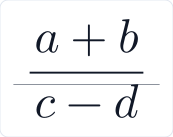

# 

[](https://github.com/tkinnis/tex_math/actions/workflows/ci.yml) [](REFERENCE.md) [](REFERENCE.md) [](LICENSE)

**`tex_math`** is a pure-Dart TeX math-mode parser, OpenType `MATH` layout engine, and Flutter rendering suite targeting layout, glyph, and error parity with pinned **MathJax `4.1.3`** and JupyterLab math rendering defaults, with zero WebView or JavaScript dependencies at runtime.

## Highlights

* **Pure-Dart Core Engine (`packages/tex_math`)**: Deterministic, synchronous five-stage pipeline (tokenizer, macro expander, sealed AST parser, Appendix G layout engine, display list & SVG/MathML/spoken-text exporters) depending solely on `package:meta`, with zero `flutter`, `dart:ui`, `dart:io`, or `dart:html` imports.
* **OpenType `MATH`-Driven Layout**: Reads `cmap`, `hmtx`/`hhea`, `head`, `OS/2`, `MATH`, `glyf`, and `CFF`/`CFF2` directly from in-memory font bytes (`MathFont.fromBytes`), using glyph-ID addressing for size variants and extensible assemblies without hardcoded font metric tables.
* **Flutter Integration (`packages/tex_math_flutter`)**: Renders cached glyph `Path` outlines directly on `Canvas`, supports theme color roles (`TexMathTheme`), inline baseline alignment (`TexMathSpan`), `SelectionArea` / `Semantics` accessibility hooks, background isolate layout (`TexMathIsolateLayouter`), and bundles `NewCMMath-Regular.otf` (`8.1.1`).
* **Safety Budgets & Strict Error Parity**: Enforces `TexMathBudgets` caps on input length, macro depth, macro expansions, nesting depth, output items, and SVG size, throwing structured `TexMathError` types mapped to MathJax's `TexMathErrorClass` taxonomy.
* **Differential MathJax Verification**: Verified against a pinned MathJax `4.1.3` oracle (`tool/oracle/`) across a 352-case multi-tier corpus (`corpus/`) covering Core TeX/AMS, JupyterLab extensions, remaining MathJax 4 extensions, stretchy delimiters, notebook equations, and malformed inputs.

## Display List SVG Preview

Generated directly by `DisplayList.toSvg()` via [`tool/generate_doc_images.dart`](tool/generate_doc_images.dart):

| DisplayList Sample | DisplayMetrics Box Model |
| :---: | :---: |
|  |  |

## Workspace Packages & Structure

| Component | Path | Purpose |
| :--- | :--- | :--- |
| **`tex_math`** | [`packages/tex_math/`](packages/tex_math/README.md) | Pure-Dart TeX parser, OpenType `MATH` layout engine, SVG / MathML / spoken-text exporters. |
| **`tex_math_flutter`** | [`packages/tex_math_flutter/`](packages/tex_math_flutter/README.md) | Flutter `TexMath` / `TexMathSpan` widgets, `Path` caching, theming, accessibility, and bundled `NewCMMath-Regular.otf`. |
| **Flutter Example** | [`packages/tex_math_flutter/example/`](packages/tex_math_flutter/example/lib/main.dart) | Minimal Flutter application demonstrating display and inline math rendering. |
| **Comparison Studio** | [`studio/`](studio/README.md) | Desktop workbench comparing `tex_math`, MathJax, and KaTeX side by side. |
| **Reference & Coverage** | [`REFERENCE.md`](REFERENCE.md) · [`doc/COVERAGE.md`](doc/COVERAGE.md) | Pinned upstream targets, package tiers, and measured corpus parity reports. |

## Quick Start

### Pure Dart (`packages/tex_math`)

```dart
import 'package:tex_math/tex_math.dart';

void main() {
  const DisplayList displayList = DisplayList(
    source: r'\frac{a + b}{c}',
    metrics: DisplayMetrics(
      widthEm: 2.8,
      heightEm: 1.15,
      depthEm: 0.75,
      baselineEm: 1.15,
      unitsPerEm: 1000,
    ),
    items: <DisplayItem>[
      RuleItem(xEm: 0.1, yEm: 0.24, widthEm: 2.4, heightEm: 0.05),
    ],
  );

  print(displayList.toSvg());
}
```

### Flutter (`packages/tex_math_flutter`)

```dart
import 'package:flutter/material.dart';
import 'package:tex_math_flutter/tex_math_flutter.dart';

Widget buildFormula() {
  return const TexMath(
    r'\frac{a + b}{c - d}',
    displayMode: TexMathDisplayMode.display,
  );
}
```

## Corpus Coverage & Benchmarks

Measured corpus parity from [`doc/COVERAGE.md`](doc/COVERAGE.md) (`corpus/expectations.json` verified against `MathJax 4.1.3` with `mathjax-newcm`) reports **352** total corpus cases (**315** Oracle Accepted, **37** Oracle Refused). Live `TexMathEngine` execution with `NewCMMath-Regular.otf` achieves `37/37` error-class parity (`0` Pass, `0` Differs, `315` Unsupported, `37` Refused Match, `10.5%` Pass %) while accepted expressions await Appendix G layout:

| Tier | Pass | Differs | Unsupported | Refused Match | Total | Pass % |
| :--- | ---: | ---: | ---: | ---: | ---: | ---: |
| Tier 1 (Core TeX, AMS, Macros, Textmacros, Tag/ConfigMacros) | 0 | 0 | 125 | 0 | 125 | 0.0% |
| Tier 2 (JupyterLab Standard Extensions) | 0 | 0 | 105 | 0 | 105 | 0.0% |
| Tier 3 (Remaining MathJax 4 Extensions) | 0 | 0 | 35 | 0 | 35 | 0.0% |
| Stretchy (Delimiters, Radicals, Braces, Wide Accents) | 0 | 0 | 25 | 0 | 25 | 0.0% |
| Notebooks (Physics, Calculus, Linear Algebra, ML, Chemistry) | 0 | 0 | 25 | 0 | 25 | 0.0% |
| Errors (Malformed Inputs & Macro/Delimiter Violations) | 0 | 0 | 0 | 37 | 37 | 100.0% |
| **Total** | **0** | **0** | **315** | **37** | **352** | **10.5%** |

Native Dart AOT measurements for `MathFont.fromBytes` (`1.021 ms` mean on `NewCMMath-Regular.otf`), `DisplayList.toSvg()`, `TexMathBudgets` guards, and full-corpus parse dispatch (`7.456 ms` mean across `352` cases) are recorded in [`doc/BENCHMARKS.md`](doc/BENCHMARKS.md).

## Documentation

| Guide | Description |
| :--- | :--- |
| **[Architecture & Design](doc/ARCHITECTURE.md)** | Five-stage TeX pipeline, OpenType `MATH` usage, accessibility, safety budgets, and architectural design decisions. |
| **[API Manual](doc/API_MANUAL.md)** | Public types across `tex_math` and `tex_math_flutter`. |
| **[Reference Pins](REFERENCE.md)** | Pinned MathJax `4.1.3`, JupyterLab `@jupyterlab/mathjax-extension`, font versions, and package tiers. |
| **[Coverage Matrix](doc/COVERAGE.md)** | Generated corpus coverage across Tier 1, Tier 2, Tier 3, stretchy constructs, notebooks, and error cases. |
| **[Benchmarks](doc/BENCHMARKS.md)** | Native Dart AOT measurements and regression baseline. |
| **[Studio Guide](doc/STUDIO_GUIDE.md)** | Desktop comparison workbench usage. |
| **[Reference Sync](doc/REFERENCE_SYNC.md)** | Procedure for verifying and updating upstream reference pins. |
| **[Releasing](doc/RELEASING.md)** | Lockstep `vX.Y.Z` verification, tagging, and pub.dev release order. |

## License

* **`tex_math` & `tex_math_flutter`**: Copyright (c) 2026 Tony Kinnis — [MIT License](LICENSE).
* **Bundled Math Font (`NewCMMath-Regular.otf` `8.1.1`)**: New Computer Modern Math — GUST Font License 1.0 (`packages/tex_math_flutter/assets/fonts/GUST-FONT-LICENSE.txt`).
