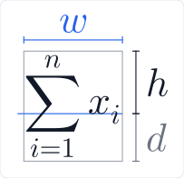

# 

[](https://github.com/tkinnis/tex_math/actions/workflows/ci.yml) [](REFERENCE.md) [](REFERENCE.md) [](LICENSE)

**`tex_math`** is a pure-Dart TeX math-mode parser, OpenType `MATH` layout engine, and Flutter rendering suite targeting layout, glyph, and error parity with pinned **MathJax `4.1.3`** and JupyterLab math rendering defaults, with zero WebView or JavaScript dependencies at runtime.

## Highlights

* **Pure-Dart Core Engine (`packages/tex_math`)**: Deterministic, synchronous five-stage pipeline (tokenizer, macro expander, 16-variant sealed AST parser across all 42 MathJax `4.1.3` TeX packages, Appendix G layout engine with `DisplayBreakHint`s, and display list & SVG/MathML/spoken-text exporters) depending solely on `package:meta`, with zero `flutter`, `dart:ui`, `dart:io`, `dart:html`, or `dart:js*` imports.
* **OpenType `MATH`, Variable Font & Hinting Support**: Decodes `head`, `maxp`, `hhea`, `hmtx`, `OS/2`, `name`, `cmap` (Format 4/12), `GSUB` (`ssty`), `MATH`, `fvar`/`avar`/`HVAR`/`GDEF` variations, `glyf`/`loca`, and `CFF`/`CFF2` (including Type 2 stem hinting) directly from in-memory bytes (`MathFont.fromBytes`) without hardcoded font metric tables.
* **Flutter Integration (`packages/tex_math_flutter`)**: Paints cached `Path` outlines (`TexMathPathCache`) without re-layout on `TexMathTheme` updates, auto-loads bundled `NewCMMath-Regular.otf` (`8.1.1`) once per lifecycle (`TexMathFontBundle.loadMathFont`), supports `TexMathOverflow` policies and `TexMathSpan` baseline alignment, provides `SelectionArea` sub-expression `"copy as LaTeX"` (`TexMathSelectionUtils`) and spoken-text `Semantics`, and runs persistent background isolate layout (`TexMathIsolateLayouter`).
* **Safety Budgets & Strict Error Parity**: Enforces `TexMathBudgets` caps on input length, macro depth, macro expansions, nesting depth, output items, and SVG size, throwing structured `TexMathError` types mapped to MathJax's `TexMathErrorClass` taxonomy.
* **Differential MathJax Verification & 3-Way Studio**: Verified against a pinned MathJax `4.1.3` oracle (`tool/oracle/`) across a 352-case multi-tier corpus (`corpus/`) and inspectable interactively in the macOS 3-Way Comparison Studio (`studio/`) with Side-by-Side, Pixel Diff, and Curtain Diff modes.

## Display List SVG Preview

Generated directly by `DisplayList.toSvg()` via [`tool/generate_doc_images.dart`](tool/generate_doc_images.dart):

| DisplayList Sample | DisplayMetrics Box Model |
| :---: | :---: |
|  |  |

## Workspace Packages & Structure

| Component | Path | Purpose |
| :--- | :--- | :--- |
| **`tex_math`** | [`packages/tex_math/`](packages/tex_math/README.md) | Pure-Dart TeX parser, OpenType `MATH` layout engine, SVG / MathML / spoken-text exporters. |
| **`tex_math_flutter`** | [`packages/tex_math_flutter/`](packages/tex_math_flutter/README.md) | Flutter `TexMath` / `TexMathSpan` widgets, `TexMathPathCache`, theming, selection, persistent isolate layouter, and bundled `NewCMMath-Regular.otf`. |
| **Flutter Example** | [`packages/tex_math_flutter/example/`](packages/tex_math_flutter/example/lib/main.dart) | Flutter showcase and 50-equation notebook app demonstrating theme toggling, `SelectionArea`, and `TexMathIsolateLayouter`. |
| **Comparison Studio** | [`studio/`](studio/README.md) | macOS 3-way workbench comparing `tex_math`, MathJax `4.1.3`, and KaTeX `0.19.1` with Pixel Diff and Curtain Diff views. |
| **Reference & Coverage** | [`REFERENCE.md`](REFERENCE.md) · [`doc/COVERAGE.md`](doc/COVERAGE.md) | Pinned upstream targets, package tiers, and measured corpus parity reports. |

## Quick Start

### Pure Dart (`packages/tex_math`)

```dart
import 'dart:io';
import 'package:tex_math/tex_math.dart';

void main() {
  final MathFont font = MathFont.fromBytes(
    File('packages/tex_math_flutter/assets/fonts/NewCMMath-Regular.otf')
        .readAsBytesSync(),
  );
  final TexMathEngine engine = TexMathEngine(font: font);
  final RenderResult result = engine.render(
    r'\int_0^\infty e^{-x^2}\,dx = \frac{\sqrt{\pi}}{2}',
  );

  print(result.toSvg(fontSize: 20.0));
  print(result.toMathMl());
  print(result.toSpokenText());
}
```

### Flutter (`packages/tex_math_flutter`)

```dart
import 'package:flutter/material.dart';
import 'package:tex_math_flutter/tex_math_flutter.dart';

Widget buildFormula() {
  return const TexMath(
    r'\frac{a + b}{c - d}',
    displayMode: TexMathDisplayMode.display,
    overflow: TexMathOverflow.scroll,
  );
}
```

## Corpus Coverage & Native AOT Benchmarks

Measured corpus parity from [`doc/COVERAGE.md`](doc/COVERAGE.md) (`corpus/expectations.json` verified against `MathJax 4.1.3` with `mathjax-newcm`) covers **352** total corpus cases (**315** Oracle Accepted, **37** Oracle Refused). Live `TexMathEngine` execution with `NewCMMath-Regular.otf` renders `315/315` accepted expressions into `DisplayList` and standalone SVG `<path>`/`<rect>` primitives (`0` Unsupported), matches `37/37` error-class refusals (`Refused Match`), and matches strict `0.02em` MathJax geometry on `74` accepted expressions (`74` Pass, `241` Differs, `0` Unsupported, `37` Refused Match, `31.5%` Pass % — see [Architecture: OpenType MATH Conformance](doc/ARCHITECTURE.md#opentype-math-conformance-vs-mathjax-4-js-fontdata-divergences) for the OpenType `MATH` vs legacy `.tfm`/tile/subfont causes of the `241` differences):

| Tier | Pass | Differs | Unsupported | Refused Match | Total | Pass % |
| :--- | ---: | ---: | ---: | ---: | ---: | ---: |
| Tier 1 (Core TeX, AMS, Macros, Textmacros, Tag/ConfigMacros) | 38 | 87 | 0 | 0 | 125 | 30.4% |
| Tier 2 (JupyterLab Standard Extensions) | 26 | 79 | 0 | 0 | 105 | 24.8% |
| Tier 3 (Remaining MathJax 4 Extensions) | 7 | 28 | 0 | 0 | 35 | 20.0% |
| Stretchy (Delimiters, Radicals, Braces, Wide Accents) | 3 | 22 | 0 | 0 | 25 | 12.0% |
| Notebooks (Physics, Calculus, Linear Algebra, ML, Chemistry) | 0 | 25 | 0 | 0 | 25 | 0.0% |
| Errors (Malformed Inputs & Macro/Delimiter Violations) | 0 | 0 | 0 | 37 | 37 | 100.0% |
| **Total** | **74** | **241** | **0** | **37** | **352** | **31.5%** |

Native Dart AOT measurements on `Apple M4` (`arm64`, `macos` `Version 15.6 (Build 24G84)`, `32 GiB`, Dart `3.13.5`) recorded in [`doc/BENCHMARKS.md`](doc/BENCHMARKS.md) pass every target budget:

| Benchmark | Mean | Median (p50) | p95 | Target |
| :--- | ---: | ---: | ---: | :--- |
| `math_font_from_bytes` | 699.00 us | 634.90 us | 1.049 ms | Once per font |
| `inline_expression_layout` | 7.76 us | 7.68 us | 9.42 us | `< 50 us` |
| `notebook_50_equations` | 1.830 ms | 1.809 ms | 2.149 ms | `< 5 ms` |
| `cached_display_list_lookup` | 0.46 us | 0.45 us | 0.63 us | Paint-only cost |
| `corpus_parse_phase` (`352` cases) | 4.090 ms | 4.071 ms | 4.491 ms | — |
| `corpus_layout_phase` (`315` valid trees) | 2.925 ms | 2.905 ms | 3.691 ms | — |
| `corpus_full_dispatch` (`352` cases) | 7.740 ms | 7.573 ms | 9.246 ms | — |
| `display_list_to_svg_small` | 12.66 us | 12.25 us | 18.78 us | — |
| `display_list_to_svg_large` | 258.54 us | 267.19 us | 298.42 us | — |
| `budget_input_check_valid` | 13.05 us | 12.81 us | 17.71 us | — |
| `budget_input_check_exceeded` | 3.35 us | 3.45 us | 4.40 us | — |

## Documentation

| Guide | Description |
| :--- | :--- |
| **[Architecture & Design](doc/ARCHITECTURE.md)** | Five-stage TeX pipeline, OpenType `MATH` usage, OpenType vs MathJax FontData divergences, accessibility, safety budgets, and design contracts. |
| **[API Manual](doc/API_MANUAL.md)** | Public types across `tex_math` and `tex_math_flutter`. |
| **[Reference Pins](REFERENCE.md)** | Pinned MathJax `4.1.3`, JupyterLab `@jupyterlab/mathjax-extension`, font versions, and package tiers. |
| **[Coverage Matrix](doc/COVERAGE.md)** | Generated corpus coverage across Tier 1, Tier 2, Tier 3, stretchy constructs, notebooks, and error cases. |
| **[Benchmarks](doc/BENCHMARKS.md)** | Native Dart AOT measurements and regression baseline. |
| **[Studio Guide](doc/STUDIO_GUIDE.md)** | macOS 3-Way Comparison Studio workbench usage and headless tests. |
| **[Reference Sync](doc/REFERENCE_SYNC.md)** | Procedure for verifying and updating upstream reference pins. |
| **[Releasing](doc/RELEASING.md)** | Lockstep `vX.Y.Z` verification, tagging, and pub.dev release order. |

## License

* **`tex_math` & `tex_math_flutter`**: Copyright (c) 2026 Tony Kinnis — [MIT License](LICENSE).
* **Bundled Math Font (`NewCMMath-Regular.otf` `8.1.1`)**: New Computer Modern Math — GUST Font License 1.0 (`packages/tex_math_flutter/assets/fonts/GUST-FONT-LICENSE.txt`).
