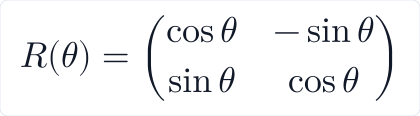

# 

[](https://github.com/tkinnis/tex_math/actions/workflows/ci.yml) [](REFERENCE.md) [](REFERENCE.md) [](LICENSE)

**`tex_math`** is a pure-Dart TeX math parser, OpenType math layout engine, and Flutter rendering suite aligned with MathJax `4.1.3` and JupyterLab math defaults. Every stage of parsing, font decoding, and geometric layout runs synchronously in Dart without a WebView or JavaScript runtime.

## Quick Start

### Pure Dart (`packages/tex_math`)

Load an OpenType math font from bytes and render a formula to standalone SVG, Presentation MathML, or spoken text:

```dart
import 'dart:io';
import 'package:tex_math/tex_math.dart';

void main() {
  final MathFont font = MathFont.fromBytes(
    File('packages/tex_math_flutter/assets/fonts/NewCMMath-Regular.otf')
        .readAsBytesSync(),
  );
  final TexMathEngine engine = TexMathEngine(font: font);
  final RenderResult result = engine.render(
    r'\int_0^\infty e^{-x^2}\,dx = \frac{\sqrt{\pi}}{2}',
  );

  print(result.toSvg(fontSize: 20.0));
  print(result.toMathMl());
  print(result.toSpokenText());
}
```

### Flutter (`packages/tex_math_flutter`)

Drop `TexMath` or inline `TexMathSpan` directly into your widget tree—the bundled `NewCMMath-Regular.otf` font loads automatically off the UI thread:

```dart
import 'package:flutter/material.dart';
import 'package:tex_math_flutter/tex_math_flutter.dart';

Widget buildFormula() {
  return const TexMath(
    r'\frac{a + b}{c - d}',
    displayMode: TexMathDisplayMode.display,
    overflow: TexMathOverflow.scroll,
  );
}
```

## Rendered Examples

Every SVG below was generated directly in pure Dart by [`tool/generate_doc_images.dart`](https://github.com/tkinnis/tex_math/blob/main/tool/generate_doc_images.dart) using the bundled New Computer Modern Math font.

**Gaussian Integral** — Display limits, optical superscripts, stacked fractions, and stretchy square roots:


```tex
\int_{-\infty}^{\infty} e^{-\alpha x^2}\,dx = \sqrt{\frac{\pi}{\alpha}} \quad (\alpha > 0)
```

**Piecewise Cases** — Extensible left curly brace, multi-row alignment, and embedded text runs:


```tex
|x| = \begin{cases} x & \text{if } x \ge 0 \\ -x & \text{if } x < 0 \end{cases}
```

**Rotation Matrix** — Parenthesized matrix grid with named trigonometric operators and Greek symbols:



```tex
R(\theta) = \begin{pmatrix} \cos\theta & -\sin\theta \\ \sin\theta & \cos\theta \end{pmatrix}
```

**Nested Radical** — Multi-level fraction scaling beneath an automatically sized radical bar:


```tex
\sqrt{\frac{\frac{a}{b} + \frac{c}{d}}{\frac{e}{f} - \frac{g}{h}}}
```

**Chemical Equilibrium (`mhchem`)** — Stoichiometric coefficients, upright element formulas, and bidirectional reaction arrows:


```tex
\ce{N2 + 3H2 <=> 2NH3}
```

## Highlights

* **Pure-Dart Core Engine**: A deterministic five-stage pipeline tokenizes TeX, expands macros across all 42 MathJax packages, builds an immutable syntax tree, applies TeX Appendix G layout rules, and emits a flat display list with SVG, Presentation MathML, and spoken-text exporters. The core library depends strictly on `package:meta` with zero Flutter, DOM, or I/O imports.
* **OpenType Font & Variable Font Reader**: Reads OpenType math constants, glyph metrics, TrueType outlines, PostScript outlines with optional stem hinting, and variable font axes directly from in-memory bytes via `MathFont.fromBytes`.
* **Flutter Rendering Suite**: Provides `TexMath` and `TexMathSpan` widgets with baseline alignment inside rich text, zero-relayout theme updates via cached glyph paths, spoken-text accessibility labels, copy-as-LaTeX sub-expression selection, and a persistent background isolate layouter.
* **Safety Budgets & Hardening**: Bounds untrusted TeX inputs and font payloads using configurable `TexMathBudgets` limits, SFNT table validation, safe link URI allowlists, XML character filtering, and structured `TexMathError` exceptions.
* **Differential Verification & Studio**: Checked against a live MathJax `4.1.3` oracle across 352 corpus entries and inspectable interactively in the macOS Comparison Studio.

## Display Lists & Box Metrics

The layout engine produces a flat display list containing positioned glyph items, horizontal and vertical rules, and semantic anchor points measured in em units relative to the baseline. You can serialize any display list directly to standalone SVG XML or paint its cached glyph paths on a Flutter canvas.

| Display List Sample (`\frac{a + b}{c - d}`) | Display Metrics Box Model (`\sum_{i=1}^{n} x_i`) |
| :---: | :---: |
|  |  |

## Workspace Packages

| Component | Path | Role |
| :--- | :--- | :--- |
| **`tex_math`** | [`packages/tex_math/`](packages/tex_math/README.md) | Pure-Dart TeX parser, OpenType math layout engine, and SVG / MathML / spoken-text exporters. |
| **`tex_math_flutter`** | [`packages/tex_math_flutter/`](packages/tex_math_flutter/README.md) | Flutter rendering widgets, glyph path cache, Material theming, selection, isolate layouter, and bundled font. |
| **Flutter Example** | [`packages/tex_math_flutter/example/`](https://github.com/tkinnis/tex_math/blob/main/packages/tex_math_flutter/example/lib/main.dart) | Standalone Flutter demo and 50-equation notebook showcasing theme switching, selection, and background layout. |
| **Comparison Studio** | [`studio/`](studio/README.md) | macOS desktop workbench comparing `tex_math`, MathJax `4.1.3`, and KaTeX `0.19.1` interactively. |
| **Reference & Coverage** | [`REFERENCE.md`](REFERENCE.md) · [`doc/COVERAGE.md`](doc/COVERAGE.md) | Pinned upstream targets, package tiers, and live corpus parity reports. |

## Comparison Studio

The macOS Comparison Studio (`studio/`) renders live expressions side by side across **`tex_math`**, the **MathJax `4.1.3`** reference oracle, and **KaTeX `0.19.1`** alongside a 352-case corpus browser, pixel-level RGBA diffing, an interactive curtain wipe, and lazy SVG, MathML, and spoken-text inspectors. See the [Comparison Studio Guide](doc/STUDIO_GUIDE.md) for setup, diff modes, and keyboard shortcuts.


## Corpus Coverage & Native AOT Benchmarks

`tex_math` achieves **100.0% feature support** across all 42 MathJax packages tracked in [`doc/COVERAGE.md`](doc/COVERAGE.md): **315/315** valid corpus expressions render cleanly into vector layout and SVG output (`0` unsupported), and **37/37** invalid expressions are refused with the exact matching error class.

When comparing exact bounding boxes against MathJax 4.1.3, `Strict ±0.02em` acts as a diagnostic tolerance tracking verbatim agreement with MathJax's JavaScript `.tfm` font tables rather than a measure of broken features. Because `tex_math` reads authentic OpenType math tables from `NewCMMath-Regular.otf`, the 241 expressions with minor metric deltas (74/315 strict matches, 111/352 combined strict oracle matches) reflect expected typographic differences such as fraction rule thickness and optical script spacing—see [OpenType MATH Conformance](doc/ARCHITECTURE.md#opentype-math-conformance-vs-mathjax-4-js-fontdata-divergences) for details.

| Tier | Rendered | Refused Match | Unsupported | Total | Supported | Strict ±0.02em* |
| :--- | ---: | ---: | ---: | ---: | ---: | ---: |
| Tier 1 (Core TeX, AMS, Macros, Textmacros, Tag/ConfigMacros) | 125 | 0 | 0 | 125 | 100.0% | 38 / 125 (30.4%) |
| Tier 2 (JupyterLab Standard Extensions) | 105 | 0 | 0 | 105 | 100.0% | 27 / 105 (25.7%) |
| Tier 3 (Remaining MathJax 4 Extensions) | 35 | 0 | 0 | 35 | 100.0% | 6 / 35 (17.1%) |
| Stretchy (Delimiters, Radicals, Braces, Wide Accents) | 25 | 0 | 0 | 25 | 100.0% | 3 / 25 (12.0%) |
| Notebooks (Physics, Calculus, Linear Algebra, ML, Chemistry) | 25 | 0 | 0 | 25 | 100.0% | 0 / 25 (0.0%) |
| Errors (Malformed Inputs & Macro/Delimiter Violations) | 0 | 37 | 0 | 37 | 100.0% | — |
| **Total** | **315** | **37** | **0** | **352** | **100.0%** | **74 / 315 (23.5%)** |

\* *Diagnostic `±0.02em` box parity vs. MathJax `.tfm` font tables (`Pass / Oracle Accepted`, or `—` for refusal-only rows); small metric deltas reflect OpenType math constants rather than missing support.*

Native Dart AOT benchmarks on Apple M4 (`arm64`, macOS 15.6, Dart `3.13.5`) pass every target budget with comfortable headroom—see [`doc/BENCHMARKS.md`](doc/BENCHMARKS.md) for all 13 workloads, memory telemetry, and charts:

| Benchmark | Mean | Median (p50) | p95 | Target |
| :--- | ---: | ---: | ---: | :--- |
| `math_font_from_bytes` | 302.78 us | 299.83 us | 361.10 us | Once per font |
| `cold_font_glyph_decode` | 438.38 us | 439.63 us | 507.40 us | Cold font + decode |
| `inline_expression_layout` | 4.09 us | 4.12 us | 4.45 us | `< 50 us` |
| `notebook_50_equations` | 474.49 us | 439.41 us | 1.126 ms | `< 5 ms` |
| `cached_display_list_lookup` | 0.13 us | 0.13 us | 0.16 us | Paint-only cost |
| `lru_cache_mixed_eviction` | 62.82 us | 62.49 us | 71.11 us | Bounded 32-entry LRU |
| `corpus_full_dispatch` (352 cases) | 4.269 ms | 4.241 ms | 4.620 ms | Full corpus pass |
| `display_list_to_svg_small` / `large` | 75.02 us / 428.90 us | 72.82 us / 422.19 us | 81.23 us / 458.93 us | Real CFF SVG |

## Documentation

| Guide | Description |
| :--- | :--- |
| **[Architecture & Design](doc/ARCHITECTURE.md)** | Five-stage TeX pipeline, OpenType math table usage, oracle divergences, accessibility, and safety budgets. |
| **[API Manual](doc/API_MANUAL.md)** | Complete public API reference across `tex_math` and `tex_math_flutter`. |
| **[Studio Guide](doc/STUDIO_GUIDE.md)** | Comparison Studio workflows, pixel and curtain diffing, keyboard navigation, and headless tests. |
| **[Reference Pins](REFERENCE.md)** | Pinned MathJax `4.1.3`, JupyterLab, font versions, and package tiers. |
| **[Coverage Matrix](doc/COVERAGE.md)** | Full corpus parity breakdown across packages, features, and error classes. |
| **[Benchmarks](doc/BENCHMARKS.md)** | Native Dart AOT measurements, RSS memory telemetry, and regression gates. |
| **[Reference Sync](doc/REFERENCE_SYNC.md)** | Procedure for verifying and updating upstream reference pins. |
| **[Releasing](doc/RELEASING.md)** | Lockstep versioning checks, release tagging, and pub.dev publishing order. |
| **[Security Policy](SECURITY.md)** | Input budgets, font hardening, safe serialization, Studio isolation, and vulnerability reporting. |

## License

* **`tex_math` & `tex_math_flutter`**: Copyright (c) 2026 Tony Kinnis — [MIT License](LICENSE).
* **Bundled Math Font (`NewCMMath-Regular.otf` `8.1.1`)**: New Computer Modern Math — [GUST Font License 1.0](packages/tex_math_flutter/assets/fonts/GUST-FONT-LICENSE.txt).
