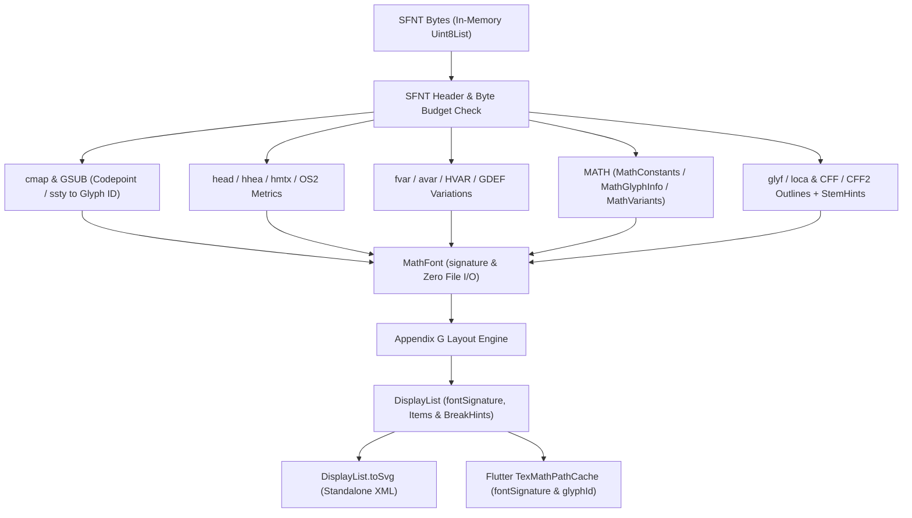
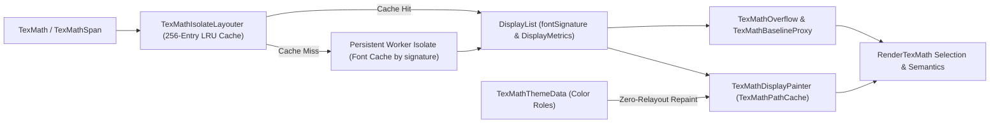

# Architecture & Design

**`tex_math`** is a pure-Dart TeX math-mode parser, OpenType `MATH` layout engine, and Flutter rendering suite targeting layout, glyph, and error parity with pinned **MathJax `4.1.3`** and JupyterLab math rendering defaults ([`REFERENCE.md`](../REFERENCE.md)).

---

## 1. Scope & Design Goals

* **Zero Runtime WebView or JavaScript**: All TeX tokenization, macro expansion, syntax analysis, OpenType font decoding, layout calculation, and SVG/MathML/spoken-text generation run synchronously in pure Dart inside `packages/tex_math/lib/`.
* **Strict Pure-Dart Core Boundary**: `packages/tex_math` depends strictly on `package:meta` and never imports `package:flutter`, `dart:ui`, `dart:io`, `dart:html`, or `dart:js*`. Both `MathFont.fromBytes` and `TexMathEngine` run deterministically over caller-provided strings and byte buffers with zero filesystem I/O, network calls, or mutable global state.
* **OpenType `MATH`-Driven Layout**: Appendix G constants, glyph advance widths, italics corrections, accent attachments, math kerns, size variants, and extensible assemblies come from the parsed OpenType `MATH` table (`NewCMMath-Regular.otf` `8.1.1` by default) rather than hardcoded per-font metric tables.
* **Strict Error Parity & Safety**: Malformed TeX and exceeded safety limits raise structured `TexMathError` exceptions mapped to `TexMathErrorClass`, bounded by `TexMathBudgets` and hardened font decoders.
* **Continuous Differential Verification**: Corpus parity and native AOT timings are verified against `tool/oracle/render.mjs` and reported in [`doc/COVERAGE.md`](COVERAGE.md) and [`doc/BENCHMARKS.md`](BENCHMARKS.md).

---

## 2. Five-Stage Pipeline & Module Boundaries

`TexMathEngine` (`packages/tex_math/lib/src/engine.dart`) organizes TeX processing into five unidirectional stages backed by leaf shared tables (`packages/tex_math/lib/src/shared/`), leaf `break_point.dart`, and non-circular font decoders (`packages/tex_math/lib/src/font/`):

### Stage 1: Tokenizer

`tokenizeTex` (`packages/tex_math/lib/src/parser/tokenizer.dart`) scans UTF-16 TeX source via direct `codeUnitAt` indexing without regex backtracking into catcode-annotated `TexToken` values (`escape`, `beginGroup`, `endGroup`, `mathShift`, `alignmentTab`, `parameter`, `superscript`, `subscript`, `active`, `space`, `letter`, `other`, `comment`). Every token retains an exact half-open UTF-16 `SourceSpan`.

### Stages 2 & 3: Interleaved Macro Expansion, Package Registry & Parser

Macro expansion (Stage 2) and AST construction (Stage 3) execute interleaved on demand inside `_TexParser` (`packages/tex_math/lib/src/parser/parser.dart`):

* **On-Demand Macro Expansion (`TexTokenCursor` & `TexMacroTable`)**: Expands `\newcommand`, `\renewcommand`, `\providecommand`, `\def`/`\gdef`/`\edef`/`\xdef`, `\let`, `\newenvironment`/`\renewenvironment`, and `TexMathOptions.macros` (with `#1`–`#9`, optional defaults, and delimited `\def` patterns) within shared `TexTokenBudgetState` cumulative limits (`maxMacroDepth`, `maxMacroExpansions`, and `maxTokens`) and zero-allocation delimiter lookahead (`matchesDelimiterAhead`).
* **Synchronous `\require` & 42-Package Registry**: `TexActivePackages` tracks active packages across all 42 MathJax `4.1.3` packages compiled into `TexPackageRegistry` (`package_registry.dart`) and resolves synchronous `\require{pkg}` and `\setOptions` calls against `TexMathOptions.requireAllowlist`.
* **Immutable 16-Variant Sealed AST**: Builds `@immutable` `sealed class MathNode` trees (`ast.dart`) retaining `SourceSpan` on every node and guarding all recursive parser paths against `maxNestingDepth`. Sub-parsers handle `mhchem` (`\ce`, `\pu`), `physics` (constructing `MatrixNode` directly for `\mqty`, `\imat`, `\xmat`, `\zmat`, `\dmat`), `units` (direct `FractionNode` for `\unitfrac`/`\nicefrac`), `amscd`, `bussproofs`, and table specifications (`environments.dart`, pre-parsing `MatrixNode.columnSeparators` `@{...}`/`!{...}` into `Map<int, MathNode>` during Stage 3 so Stage 4 never calls back into Stage 3). Non-fatal error modes (`strictErrors: false` or `noerrors`) emit `ErrorNode`.

### Stage 4: TeX Appendix G Layout Engine to Box Tree

`layoutMathTree` (`packages/tex_math/lib/src/layout/layout_engine.dart`) transforms `MathNode` trees into positioned `HBox`, `VBox`, `GlyphBox`, `RuleBox`, `KernBox`, and `AnchorBox` nodes using leaf `src/shared/` tables (`colors.dart`, `layout_constants.dart`, `math_symbols.dart`) with zero `src/parser/` imports:

* **Styles, Atom Spacing & Break Hints**: Applies `TexMathStyle` transitions (`display`, `text`, `script`, `scriptScript`, and cramped forms), Appendix G Rules 5–6 atom promotions, `thinmuskip`/`medmuskip`/`thickmuskip` spacing, and top-level `BreakPoint` / `DisplayBreakHint` metadata (`afterBinary`, `afterRelation`, `penalty`, `explicit`).
* **OpenType `MATH` Construct Layout**: Threads validated non-null `MathTableData` into `matrix_layout.dart`, `stretchy.dart`, and `style_spacing.dart` alongside centralized `LayoutDefaults` ratios, resolving `ex` from `MathFont.xHeight / unitsPerEm` (`LayoutDefaults.fallbackXHeightEm = 0.431` fallback) and solving extensible `GlyphAssembly` repeats in `O(1)` arithmetic.

### Stage 5: Flat Display List, Exporters & `RenderResult`

`DisplayList` (`packages/tex_math/lib/src/display_list.dart`) flattens the positioned box tree into `DisplayMetrics`, `DisplayBreakHint` entries, optional `fontSignature` (`MathFont.signature`), and `DisplayItem` primitives (`GlyphItem` by `glyphId` + `codePoint`, `RuleItem`, `AnchorItem`). `RenderResult` (`packages/tex_math/lib/src/engine.dart`) binds `displayList`, `syntaxTree`, and `source` together, exposing `toSvg()`, `toMathMl()`, and `toSpokenText()`. `DisplayList.toSvg()` streams vector `<path>` contours and `<rect>` primitives while checking `maxOutputItems` and `maxSvgLength` incrementally.

---

## 3. OpenType Font Reader

`MathFont` (`packages/tex_math/lib/src/font.dart`) decodes SFNT containers exclusively from an in-memory `Uint8List` via `MathFont.fromBytes`, enforcing `maxBytes` (`16 MiB` default) and validating `OTTO`/`0x00010000`/`true`/`typ1` headers. Font sub-decoders (`glyf.dart`, `cff_decoder.dart`, `type2_charstring.dart`, `outline_utils.dart`) depend strictly on leaf `metrics.dart`, `outline.dart`, `binary_reader.dart`, `cff_common.dart`, and `variation.dart` with zero circular imports back to `font.dart`:

* **`head`, `maxp`, `hhea`, `hmtx`, `OS/2`, `name`**: Extracts `unitsPerEm`, glyph count, horizontal advance widths, side bearings, font bounding box, `xHeight` (`OS/2.sxHeight`), `capHeight`, and typographic ascender/descender metrics.
* **`cmap` & `GSUB`**: Maps BMP and non-BMP Unicode scalars via Format 4/12 subtables and decodes `GSUB` `ssty` lookups (`LookupType 1` / `LookupType 3`) for `TexMathOptions.useOpticalScriptVariants`.
* **`MATH` & Variable Font Tables (`fvar`, `avar`, `HVAR`, `GDEF`)**: Decodes `MathConstants`, `MathGlyphInfo`, `MathVariants`, `fvar`/`avar` normalized variation axes, `HVAR` advance/LSB deltas, and `GDEF` v1.3+ `ItemVariationStore` deltas on `MathValueRecord`s.
* **`glyf`/`loca` & `CFF`/`CFF2`**: Lazily decodes vector contours into `@immutable` `GlyphOutline` records (`GlyphOutline.cached` with memoized `hashCode`), evaluates `CFF2` `blend` deltas, computes analytical Bezier-extrema `GlyphMetrics`, and caches Type 2 `StemHint`-snapped outlines per `(glyphId, ppem)` on the `MathFont` data holder.
* **Payload Identity (`MathFont.signature`)**: Computes a fast deterministic SFNT payload-and-variation digest (`signature`) and memoizes `hashCode`, preventing `MathFont.==` collisions across distinct fonts with matching header scalars and enabling cross-isolate path cache keying via `DisplayList.fontSignature`.

---

## 4. OpenType `MATH` Table Usage

`MathTableData` parses and exposes all three OpenType `MATH` subtables:

* **`MathConstants`**: Layout consumes normalized constants (`unitsPerEm`) including `scriptPercentScaleDown`, `scriptScriptPercentScaleDown`, `axisHeight`, `accentBaseHeight` and `flattenedAccentBaseHeight` (TeX Appendix G Rule 12 accent positioning in `_layoutAccentNode`, aligning x-height-designed accents directly over bases up to `accentBaseHeight` with `flattenedAccentBaseHeight` fallback and shifting only by excess base height), fraction shifts/gaps/rule thickness, radical gaps/rule/extra ascender/degree kerns, script shifts, and operator limit gaps (`mathLeading` is also parsed and exposed on `MathConstants`).
* **`MathGlyphInfo`**: Layout consumes `MathItalicsCorrectionInfo`, `MathTopAccentAttachment`, and four-corner `MathKernInfo` staircase cut-in kerns (`topRight`, `bottomRight`, `topLeft`, and `bottomLeft` corners via `_evaluatePairKern`); `ExtendedShapeCoverage` (`isExtendedShape`) is parsed and exposed on `MathGlyphInfo`.
* **`MathVariants`**: Supplies `minConnectorOverlap` plus vertical/horizontal `MathGlyphConstruction` records (`MathGlyphVariant` discrete steps and `GlyphAssembly` part recipes) for delimiters, large operators, radicals, horizontal braces, extensible arrows, and wide accents.

### OpenType `MATH` Conformance vs. MathJax 4 JS-FontData Divergences

As recorded in [`doc/COVERAGE.md`](COVERAGE.md), `tex_math` renders all `315` accepted corpus cases cleanly (`0` unsupported, `37/37` error-class parity) while strict `0.02em` numeric comparison against MathJax `4.1.3` (`@mathjax/mathjax-newcm-font`) reports `241` differences caused by structural differences between OpenType `MATH` (`NewCMMath-Regular.otf` `8.1.1`) and MathJax's `.tfm`-derived JS `FontData` tables:

* **`MathConstants` vs. Legacy `.tfm` `fontdimen`s**: OpenType `MATH` defines unified `superscriptShiftUp` (`0.363em`), `superscriptShiftUpCramped` (`0.289em`), `subscriptShiftDown` (`0.247em`), and `fractionRuleThickness` (`0.040em`). `@mathjax/mathjax-newcm-font` retains `.tfm` slots distinguishing display `sup1` (`0.413em`) from `sup2` (`0.363em`), standalone `sub1` (`0.150em`) from `sub2` (`0.247em`), `rule_thickness = 0.060em`, and `delimitershortfall = 0.3em` (vs Appendix G `0.5em`).
* **Unencoded `GlyphAssembly` Parts vs. Clipped SVG Tiles**: OpenType `MathVariants` builds tall delimiters and horizontal braces from unencoded `glyphId` segments (`codePoint = 0`) with overlap/extender recipes, whereas MathJax emits encoded/scaled `<use>` SVG glyph tiles.
* **Unified `hmtx`/`cmap` vs. 33 Virtual Subfonts**: `tex_math` resolves glyphs from the active font's single `cmap`, `hmtx`, `MATH`, and `GSUB` tables, whereas MathJax splits `mathjax-newcm` across 33 virtual variant tables carrying per-subfont `.tfm` overrides such as `extra_ic`.

Hardcoding MathJax `.tfm` patches into core layout would break font independence across other OpenType math fonts (such as Latin Modern Math, STIX Two Math, or `CFF2` variable fonts). `tex_math` therefore keeps OpenType `MATH` authoritative for geometry while verifying structural, glyph-selection, and error-class parity against the MathJax oracle.

---

## 5. Accessibility & Source Mapping

Accessibility exporters read the `MathNode` tree directly and filter disallowed XML 1.0 control characters and lone surrogates (`format_utils.dart`):

* **Presentation MathML (`mathNodeToMathMl` / `toMathMl()`)**: Exhaustively traverses all 16 `MathNode` variants, sanitizes `mathcolor`/`mathbackground` via `sanitizeMathMlColor`, and restricts `\href` links via `isSafeHrefUri` (`http`, `https`, `mailto`, `#`, relative paths).
* **Spoken Text (`mathNodeToSpokenText` / `toSpokenText()`)**: Streams plain natural-language math descriptions for screen readers (`Semantics` labels in Flutter).
* **Source Span Mapping ("Copy as LaTeX")**: Every `MathNode` and `DisplayItem` carries an optional UTF-16 `SourceSpan`; `TexMathSelectionUtils.sliceMinimalLatex` expands partial selections to the minimal syntactically valid enclosing `MathNode` slice.

---

## 6. Flutter Integration (`packages/tex_math_flutter`)

* **Vector `Path` & `TextPainter` Caching (`TexMathPathCache`)**: Converts `GlyphOutline.commands` into `Path` geometry keyed by `(font?.signature ?? displayList.fontSignature, glyphId, ppemBucket?)` (preserving `(signature, glyphId)` cache hits even for isolate-laid-out `DisplayList`s where no `MathFont` object sits on the UI thread, and falling back to `GlyphOutline` only when no signature is attached). Also caches bounded fallback `TextPainter`s (`maxTextPainterEntries`) and disposes evicted painters.
* **Zero-Relayout Theme Updates**: `TexMathDisplayPainter` resolves `TexMathColorRole` colors from `TexMathThemeData` during `paint()`, so light/dark theme transitions repaint without re-running layout or rebuilding `Path`s.
* **Off-Thread Font Decoding (`TexMathFontBundle`)**: `TexMathFontBundle.loadMathFont()` reads `NewCMMath-Regular.otf` (`8.1.1`) once per lifecycle and decodes `MathFont.fromBytes` off the UI thread via `Isolate.run` (`runInRealAsyncZone` prevents `FakeAsync` timer stalls in tests).
* **Sizing Precedence, Baseline & Overflow (`TexMath`, `TexMathSpan`)**: Resolves font size via `widget.textStyle?.fontSize ?? TexMathTheme.maybeOf(context)?.fontSize ?? DefaultTextStyle.of(context).style.fontSize ?? theme.fontSize` (validated by `resolveSafeTexMathFontSize` and scaled by `MediaQuery.textScalerOf(context)`), applies `widget.textStyle?.color`, and avoids double-parsing on cold bundled font loads by passing the pre-parsed `MathNode` directly to `engine.layout()`. `TexMathBaselineProxy` handles both `TextBaseline.alphabetic` and `TextBaseline.ideographic` and proportionally scales both dry and actual baselines under `TexMathOverflow.scaleToFit` (`FittedBox`).
* **Persistent Background Isolate Layouter (`TexMathIsolateLayouter`)**: Spawns a long-lived worker `Isolate` (`withBundledFont` / `warmUp`), transfers bundled bytes once via `TransferableTypedData`, caches explicit per-request `MathFont` instances in the worker by `signature`, deduplicates concurrent in-flight renders (including custom fonts), caches up to `maxCacheEntries` (`256`) results under `TexMathLayoutCacheKey(source, options, fontId, fontSignature)`, recovers from unexpected worker crashes via `onExit`/`onError` listeners, and enforces `shutdownTimeout` `Isolate.kill` cleanup on `dispose()`.
* **Lazy Selection & Error Semantics (`RenderTexMath`, `TexMathErrorWidget`)**: `RenderTexMath` (`Selectable` + `SelectionRegistrant`) builds `_atoms` lazily only when registered for selection (avoiding eager `Path.getBounds()` on non-selectable equations) and aligns hit-testing/`boundingBoxes` to visual bounds when `TexMathOverflow.visible` is active. `TexMathErrorWidget` marks outer `Semantics(excludeSemantics: true)` and wraps content in `SelectionContainer.disabled` when `!selectable` inside an ancestor `SelectionArea`.

---

## 7. Safety Budgets & Error Parity

`TexMathBudgets` (`packages/tex_math/lib/src/options.dart`) and hardened font/export guards bound untrusted inputs, throwing one of five `sealed class TexMathError` subclasses (`TexMathSyntaxError`, `TexMathMacroError`, `TexMathBudgetError`, `TexMathFontError`, `TexMathUnsupportedError`) tagged with `TexMathErrorClass`:

| Budget Field | Default Limit | Protected Resource |
| :--- | :--- | :--- |
| `maxInputLength` | `50000` UTF-16 code units | Raw and synthetic TeX string length before tokenization. |
| `maxMacroDepth` | `64` levels | Inherited nested macro call stack depth across cursors. |
| `maxMacroExpansions` | `10000` expansions | Shared cumulative macro expansions per parse. |
| `maxTokens` | `100000` tokens | Shared cumulative tokens tokenized and materialized during expansion. |
| `maxNestingDepth` | `64` levels | Group, parser recursion, `mhchem`, and AST depth across all entry points. |
| `maxOutputItems` | `50000` items | Maximum `DisplayItem` count emitted in a `DisplayList`. |
| `maxSvgLength` | `4000000` characters | Maximum serialized XML length (checked incrementally) in `toSvg()`. |
| `MathFont.defaultMaxFontBytes` | `16 MiB` | Maximum font payload accepted by `MathFont.fromBytes`. |

---

## 8. Architectural Decisions & Rationales

* **Dart 3 `sealed class` Hierarchies (`MathNode`, `DisplayItem`, `PathCommand`, `TexMathError`)**: Enforce compile-time exhaustiveness across layout, MathML/spoken-text exporters, SVG serialization, and Flutter `Canvas` painters without runtime type casts or mutable visitors.
* **Pure-Dart OpenType + `CFF`/`CFF2` Parser vs. Native FFI**: Avoids C/Rust toolchains, runs identically across Flutter mobile/desktop/web and Dart CLI/server targets, and keeps core byte decoding isolate-safe.
* **Glyph-ID `DisplayList` + Vector `Path` Painting vs. `TextPainter`**: OS text shapers cannot address unencoded `MATH` glyph IDs or `GlyphAssembly` parts and vary across platforms; cached vector `Path`s ensure deterministic cross-platform geometry and zero-relayout recoloring.
* **Lockstep Packages in a Dart `pub` Workspace**: Splitting `tex_math` (`meta` only) and `tex_math_flutter` enforces SDK boundaries at compile time while keeping versions synchronized via `tool/check_versions.dart`.
