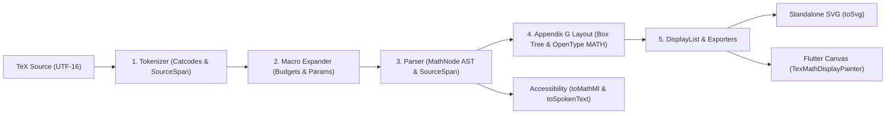
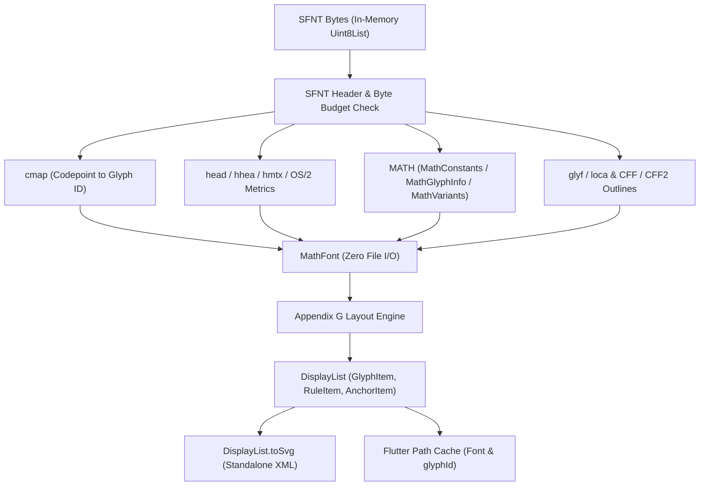
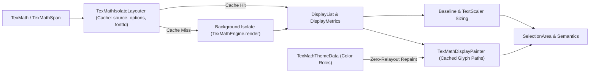

# Architecture & Design

**`tex_math`** is a pure-Dart TeX math-mode parser, OpenType `MATH` layout engine, and Flutter rendering suite targeting layout, glyph, and error parity with pinned **MathJax `4.1.3`** and JupyterLab math rendering defaults ([`REFERENCE.md`](../REFERENCE.md)).

---

## 1. Scope & Design Goals

* **Zero Runtime WebView or JavaScript**: All TeX tokenization, macro expansion, syntax analysis, OpenType font decoding, layout calculation, and SVG/MathML/spoken-text generation run synchronously in pure Dart inside `packages/tex_math/lib/`.
* **Strict Pure-Dart Core Boundary**: `packages/tex_math` depends exclusively on `package:meta` and avoids importing `package:flutter`, `dart:ui`, `dart:io`, `dart:html`, or `dart:js*`. Both `MathFont.fromBytes` and `TexMathEngine` run deterministically over caller-provided strings and byte buffers with zero filesystem I/O, network calls, or mutable global state.
* **No Hand-Built Per-Font Metric Tables**: TeX Appendix G layout constants, glyph advance widths, italics corrections, accent attachments, math kerns, size variants, and extensible assemblies come directly from the parsed OpenType `MATH` table (`NewCMMath-Regular.otf` `8.1.1` by default).
* **Strict Error Parity & Safety**: Malformed TeX and exceeded safety limits raise structured `TexMathError` exceptions aligned to MathJax's `TexError` taxonomy (`TexMathErrorClass`) rather than silently painting broken expressions.
* **Continuous Differential Verification**: Corpus parity and native AOT timings are verified against `tool/oracle/render.mjs` and reported in [`doc/COVERAGE.md`](COVERAGE.md) and [`doc/BENCHMARKS.md`](BENCHMARKS.md).

---

## 2. Five-Stage Pipeline

`TexMathEngine` (`packages/tex_math/lib/src/engine.dart`) structures TeX processing into five isolated stages, each with a single clear owner and contract:

### Stage 1: Tokenizer

Converts raw UTF-16 TeX source into catcode-annotated tokens (escape `\`, begin/end group `{`/`}`, math shift `$`, alignment tab `&`, macro parameter `#`, superscript `^`, subscript `_`, active `~`, comment `%`, letter, and other). Control sequences (`\command` and single-symbol escapes) are normalized without regex backtracking, and every token retains an exact half-open UTF-16 `SourceSpan` pointing back into the original input.

### Stage 2: Macro Expander

Expands user-defined macros (`\newcommand`, `\renewcommand`, `\def`, `\let`, `\newenvironment`, `\renewenvironment`) along with preconfigured `TexMathOptions.macros`. Parameter templates (`#1`–`#9` and optional bracketed defaults) expand eagerly in a bounded token stream that enforces `TexMathBudgets.maxMacroDepth` and `TexMathBudgets.maxMacroExpansions`, throwing `TexMathMacroError` or `TexMathBudgetError` on invalid definitions or unbounded recursion.

### Stage 3: Parser to Typed Sealed Syntax Tree

Consumes expanded tokens to construct an immutable Dart 3 `sealed class MathNode` syntax tree (`packages/tex_math/lib/src/ast.dart`), preserving `SourceSpan` on every node and enforcing `TexMathBudgets.maxNestingDepth`. The AST differentiates structural roles explicitly (`MathRootNode`, `MathGroupNode`, `SymbolNode`, `OperatorNode`, `FractionNode`, `ScriptNode`, `RadicalNode`, `AccentNode`, `DelimiterNode`, `MatrixNode`, `TextNode`, `SpaceNode`, `StyleNode`, `ColorNode`, `TagNode`, and non-fatal `ErrorNode` when `TexMathOptions.strictErrors` is `false`).

### Stage 4: TeX Appendix G Layout Engine to Box Tree

Transforms the `MathNode` tree into positioned horizontal and vertical boxes using TeX's math typesetting rules and `TexMathStyle` state transitions (`display`, `text`, `script`, `scriptScript`, and their cramped counterparts `crampedDisplay`, `crampedText`, `crampedScript`, `crampedScriptScript`):

* **Atom Classification & Spacing**: Assigns TeX atom classes (`Ord`, `Op`, `Bin`, `Rel`, `Open`, `Close`, `Punct`, `Inner`) and applies TeX's eight-by-eight inter-atom spacing matrix (`thinmuskip`, `medmuskip`, `thickmuskip`) conditioned on display vs script styles.
* **Construct Layout**: Positions fractions (numerator shift, denominator shift, rule thickness, and `\binom` delimiters), radicals (vinculum thickness, vertical gap, and optional degree index placement), superscripts/subscripts and `\limits`/`\nolimits` attachments, over/under accents, matrices/alignments, and stretchy delimiters strictly from OpenType `MATH` constants and variant tables.

### Stage 5: Flat Display List & Standalone SVG Path Exporter

Flattens the positioned box tree into a coordinate-normalized `DisplayList` (`packages/tex_math/lib/src/display_list.dart`) containing `DisplayMetrics` (`widthEm`, `heightEm`, `depthEm`, `baselineEm`, `unitsPerEm`) and flat `DisplayItem` primitives:

* **`GlyphItem`**: References glyphs by OpenType `glyphId` (plus `codePoint`), em coordinates `(xEm, yEm)`, `(scaleX, scaleY)`, `advanceEm`, optional resolved `GlyphOutline`, `SourceSpan`, and `TexMathColorRole`.
* **`RuleItem`**: Positioned rectangular stroke for fraction bars, radical vincula, `\overline`/`\underline`, and border rules.
* **`AnchorItem`**: Non-inked structural anchor carrying `id`, `(xEm, yEm)`, and optional `label` for equation tags, cross-references, and metric inspection.

`DisplayList.toSvg()` emits a self-contained XML SVG document directly from `RuleItem`, `AnchorItem`, and `GlyphItem` records (emitting `<path>` vectors when `GlyphOutline` contours are attached or `<text>` fallbacks otherwise), enforcing `TexMathBudgets.maxOutputItems` and `TexMathBudgets.maxSvgLength`.

---

## 3. OpenType Font Reader

`MathFont` (`packages/tex_math/lib/src/font.dart`) decodes SFNT font containers exclusively from an in-memory `Uint8List` via `MathFont.fromBytes(Uint8List bytes, {int maxBytes = MathFont.defaultMaxFontBytes})`, validating non-empty input, byte-size budget (`16 MiB` default), and SFNT magic headers (`OTTO`, `0x00010000`, `true`, `typ1`).

The pure-Dart table reader parses the SFNT table directory and decodes:

* **`head`, `hhea`, `hmtx`, `OS/2`**: Extracts `unitsPerEm`, horizontal advance widths, side bearings, and typographic ascender/descender metrics.
* **`cmap`**: Resolves Unicode scalar code points (including non-BMP mathematical alphanumeric planes via Format 4 and Format 12 subtables) to internal glyph IDs.
* **`MATH`**: Decodes mathematical constants, per-glyph positioning metadata, size variants, and extensible glyph assembly recipes.
* **`glyf` / `loca` (TrueType)** and **`CFF` / `CFF2` (Type 2 Charstrings)**: Extracts vector contours into immutable `GlyphOutline` records composed of `PathCommand` primitives (`MoveTo`, `LineTo`, `QuadTo`, `CubicTo`, `ClosePath`).

All layout and display primitives address glyphs by `glyphId` rather than Unicode code point alone so unencoded stylistic alternates, display-size operators, and `GlyphAssembly` connector segments (`codePoint = 0`) resolve unambiguously without filesystem access.

---

## 4. OpenType `MATH` Table Usage

The layout engine consumes all three OpenType `MATH` subtables directly:

* **`MathConstants`**: Supplies design constants normalized against `unitsPerEm`, including `scriptPercentScaleDown`, `scriptScriptPercentScaleDown`, `axisHeight`, `accentBaseHeight`, `flattenedAccentBaseHeight`, numerator/denominator shifts and minimum gaps (`fractionNumeratorShiftUp`, `fractionDenominatorShiftDown`, `fractionRuleThickness`), radical parameters (`radicalVerticalGap`, `radicalDisplayStyleVerticalGap`, `radicalRuleThickness`, `radicalExtraAscender`, `radicalKernBeforeDegree`, `radicalKernAfterDegree`), subscript/superscript shifts (`subscriptShiftDown`, `superscriptShiftUp`, `superscriptShiftUpCramped`), and operator limit gaps.
* **`MathGlyphInfo`**:
  * `MathItalicsCorrectionInfo` adjusts horizontal spacing after sloped glyphs and positions superscripts relative to base right bearings.
  * `MathTopAccentAttachment` supplies exact horizontal attachment coordinates for placing accents (`\hat`, `\tilde`, `\vec`, `\bar`) over italic or asymmetric glyphs.
  * `ExtendedShapeCoverage` identifies tall glyphs requiring cut-in kerning or full-height baseline treatment.
  * `MathKernInfo` provides four-corner staircase kern heights and cut-in values for tight subscript/superscript kerning against sloped glyphs (such as `f_i` or `V^2`).
* **`MathVariants`**: Supplies both vertical and horizontal `MathGlyphConstruction` records (`minConnectorOverlap` plus per-glyph `MathGlyphVariantRecord` discrete size steps and `GlyphAssembly` part lists of `glyphId`, `startConnectorLength`, `endConnectorLength`, `fullAdvance`, and `isExtender` flags) for stretchy delimiters, large operators, radicals, `\overbrace`/`\underbrace`, and wide accents.

---

## 5. Accessibility & Source Mapping

Accessibility and diagnostic exporters operate directly on the structured `MathNode` tree and `SourceSpan` metadata rather than reconstructing meaning from flat glyph coordinates:

* **Presentation MathML (`toMathMl()`)**: Traverses `MathNode` (`FractionNode` to `<mfrac>`, `ScriptNode` to `<msub>`/`<msup>`/`<msubsup>`, `RadicalNode` to `<msqrt>`/`<mroot>`, `MatrixNode` to `<mtable>`, `DelimiterNode` to `<mrow>` + `<mo stretchy="true">`) to emit clean Presentation MathML for screen readers and external interchange.
* **Spoken Text (`toSpokenText()`)**: Generates plain natural-language math descriptions from `MathNode` structure for platform accessibility trees (`Semantics` labels in Flutter).
* **Source Span Mapping ("Copy as LaTeX")**: Every `MathNode` and `DisplayItem` carries an optional UTF-16 `SourceSpan`. Callers can slice exact original TeX sub-expressions via `span.slice(source)` for diagnostics, hit-testing, and sub-expression LaTeX copy actions.

---

## 6. Flutter Integration (`packages/tex_math_flutter`)

`packages/tex_math_flutter` adapts pure-Dart `DisplayList` output into Flutter's rendering, accessibility, and theming pipeline:

* **Vector `Path` Construction & Caching**: `TexMathDisplayPainter` converts `GlyphOutline.commands` into `dart:ui` `Path` instances via `TexMathDisplayPainter.buildPathFromCommands`, designed to cache built `Path` geometry per `(font, glyphId)` across repaints.
* **Theme Color Roles Without Re-Layout**: `DisplayItem` stores a semantic `TexMathColorRole` (`foreground`, `accent`, `error`, `muted`, `custom`). `TexMathTheme` / `TexMathThemeData` (derived from `ColorScheme` via `TexMathThemeData.fromColorScheme` or customized directly) resolves paint colors inside `TexMathDisplayPainter.paint`, so light/dark theme changes trigger a `CustomPaint` repaint without re-running TeX parsing or Appendix G layout.
* **Baseline Alignment & Scaling**: `TexMath` wraps `CustomPaint` inside a `Baseline` widget set to `DisplayMetrics.baselineEm * fontSize` (`TextBaseline.alphabetic`), while `TexMathSpan` extends `WidgetSpan` with `PlaceholderAlignment.baseline` and `TextBaseline.alphabetic` for inline `Text.rich` / `RichText` embedding. Effective font size merges `DefaultTextStyle.of(context).style`, widget `textStyle`, `TexMathThemeData.fontSize`, and `MediaQuery.textScalerOf(context)`.
* **Background Isolate Layout & Caching**: `TexMathIsolateLayouter` executes `TexMathEngine.render` off the UI thread via `Isolate.run` and memoizes results in a bounded cache keyed by `TexMathLayoutCacheKey(source, options, fontId)`.
* **Selection & Semantics**: `TexMath` wraps output in a `SelectionArea` automatically when `selectable` is `true` and no ancestor `SelectionContainer` exists, and exposes `Semantics(label: ..., readOnly: true)` using `semanticsLabel` or the expression source/spoken text.
* **Bundled Font Asset & License**: `TexMathFontBundle.load()` loads and caches `packages/tex_math_flutter/assets/fonts/NewCMMath-Regular.otf` (`8.1.1`) once per lifecycle, verifies the `OTTO` signature, and loads `GUST-FONT-LICENSE.txt` alongside `MANIFEST-NewCMMath.txt`.
* **Default Error Widget**: When `TexMathEngine` throws a `TexMathError`, `TexMath` invokes `errorBuilder` if supplied or renders `TexMathErrorWidget`, displaying the original TeX `source` in monospace alongside the structured error message tinted with `TexMathThemeData.error` and `errorBackground`.

---

## 7. Safety Budgets & Error Parity

Untrusted or malformed TeX input is bounded before and during execution by `TexMathBudgets` (`packages/tex_math/lib/src/options.dart`) and reported via `sealed class TexMathError` (`packages/tex_math/lib/src/error.dart`):

| Budget Field | Default Limit | Protected Resource |
| :--- | :--- | :--- |
| `maxInputLength` | `50000` UTF-16 code units | Raw TeX input length before tokenization/parsing. |
| `maxMacroDepth` | `64` levels | Nested macro call stack depth during expansion. |
| `maxMacroExpansions` | `10000` expansions | Total macro expansions per expression to halt exponential blowup. |
| `maxNestingDepth` | `64` levels | Brace group and `MathNode` recursion depth. |
| `maxOutputItems` | `50000` items | Maximum `DisplayItem` count emitted in a `DisplayList`. |
| `maxSvgLength` | `4000000` characters | Maximum serialized XML length returned by `DisplayList.toSvg()`. |
| `MathFont.defaultMaxFontBytes` | `16 MiB` | Maximum font payload accepted by `MathFont.fromBytes`. |

When `TexMathOptions.strictErrors` is `true` (default), malformed syntax, invalid macro definitions, unknown environments, font corruption, unimplemented features, and exceeded budgets throw one of five sealed `TexMathError` subclasses (`TexMathSyntaxError`, `TexMathMacroError`, `TexMathBudgetError`, `TexMathFontError`, `TexMathUnsupportedError`), each tagged with a `TexMathErrorClass` enum matching MathJax's TeX error taxonomy (`undefinedControlSequence`, `missingBrace`, `extraBrace`, `misplacedAlignmentTab`, `misplacedNewline`, `missingDelimiter`, `extraDelimiter`, `mismatchedEnvironment`, `doubleScript`, `missingArgument`, `invalidMacroDefinition`, `unknownEnvironment`, `budgetExceeded`, `invalidFont`, `unsupportedFeature`, `syntaxError`).

---

## 8. Architectural Decisions & Rationales

* **Dart 3 `sealed class` Hierarchies (`MathNode`, `DisplayItem`, `PathCommand`, `TexMathError`)**: Sealed classes enforce compile-time exhaustiveness across layout passes, MathML/spoken-text emitters, SVG export, and Flutter `Canvas` painters without fragile runtime type checks or mutable visitor state.
* **Pure-Dart OpenType + `CFF`/`CFF2` Parser vs Native FFI**: Parsing SFNT tables and charstrings in pure Dart avoids C/Rust native build toolchains, works identically across Flutter mobile/desktop/web and Dart CLI/server targets, and passes cleanly across `Isolate` boundaries via raw `Uint8List` bytes.
* **Glyph-ID `DisplayList` + Vector `Path` Painting vs Flutter `TextPainter`**: `TextPainter` depends on host OS text shaping, cannot address unencoded OpenType `MATH` glyph IDs or `GlyphAssembly` extensions, applies platform-dependent font fallback, and cannot guarantee sub-pixel parity against MathJax. Painting cached vector `Path`s from OpenType outlines yields deterministic cross-platform geometry and zero-relayout theme recoloring.
* **Lockstep Packages in a Dart `pub` Workspace**: Splitting `tex_math` (pure Dart, `meta` only) and `tex_math_flutter` (Flutter widgets, assets, painters) inside a single `pub` workspace enforces strict SDK boundaries at the package level while keeping API evolution and releases synchronized via `tool/check_versions.dart`.

---

## 9. Open Questions for Phase 1 Review

Resolve the following design questions during Phase 1 architectural review before implementing Phases 2–4:

1. **CFF2 Variable-Font Instancing & Hinting vs Static Outlines**: `NewCMMath-Regular.otf` uses static `CFF` outlines, whereas third-party OpenType math fonts may encode outlines in `CFF2` with variation deltas (`fvar`/`avar` and `ItemVariationStore`) or depend on PostScript/TrueType hints at small sizes. Should Phase 2 decode default static `CFF`/`CFF2` outlines only, or implement full `CFF2` variation-store evaluation and optional stem/grid snapping for small inline sizes?
2. **`TexMathSpan` Baseline Alignment Precision in `WidgetSpan`**: `DisplayMetrics.baselineEm * fontSize` supplies an alphabetic baseline inside `Baseline`, while surrounding `TextSpan` runs derive line height, ascent, and strut metrics from platform font shaping and `TextScaler`. How should `TexMathSpan` calibrate or pad vertical metrics across desktop, mobile, and web engines so inline fractions and exponents align seamlessly with surrounding prose under arbitrary `TextScaler` factors?
3. **MathJax-to-`NewCMMath` Code-Point & Variant Divergences**: `@mathjax/mathjax-newcm-font` applies MathJax-specific symbol mappings, private-use glyph slots, and synthetic stretching heuristics where raw `NewCMMath-Regular.otf` uses Unicode math scalars, OpenType `ssty` script alternates, and raw `MATH` variant records. Where should `tex_math` apply explicit compatibility mappings versus delegating purely to `cmap`/`MATH` so differential checks remain within the `0.02` em tolerance of `tool/oracle/render.mjs`?
4. **Line-Breaking & Narrow-Container Overflow Strategy**: Inline math expressions in prose and display equations on mobile viewports can exceed container width, while a flat `DisplayList` models one continuous box. Should Phase 3+ emit TeX break-point metadata (splitting inline math across multiple `InlineSpan` segments at top-level relation/binary operators) or provide configurable horizontal scrolling, wrapping, or scale-to-fit policies on `TexMath`?
5. **`\require` Dynamic Package Activation vs Compile-Time Registry**: MathJax and JupyterLab support mid-expression `\require{pkg}` commands, whereas `TexMathOptions.packages` configures enabled extensions upfront. Should all implemented TeX packages live in a static compile-time registry gated by `TexMathOptions.packages` plus a configurable `\require` allowlist (preserving determinism and budget isolation), or should disallowed `\require` calls always raise `TexMathUnsupportedError`?
6. **Selection Granularity & Multi-Format Clipboard Inside `SelectionArea`**: Flutter's `SelectionArea` interacts with `Selectable` render objects rather than raw `CustomPaint` canvases. Should `TexMath` implement a custom `Selectable` adapter treating the expression as an atomic LaTeX copy target (`"copy as LaTeX"`), support sub-expression range selection via `DisplayItem.span` (`SourceSpan`), or expose a secondary selection/context action exporting LaTeX, Presentation MathML, and spoken text?
7. **Live Oracle & KaTeX Execution Model in `studio/`**: Determine how `studio/` executes live differential renders against `tool/oracle/render.mjs` (MathJax `4.1.3`) and KaTeX `0.19.1` during Phase 2+ — via a desktop `dart:io` Node subprocess worker or an isolated local service — without introducing `dart:io` or Node assumptions into `packages/tex_math` or `packages/tex_math_flutter`.
