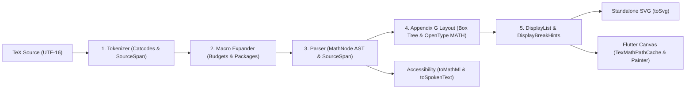
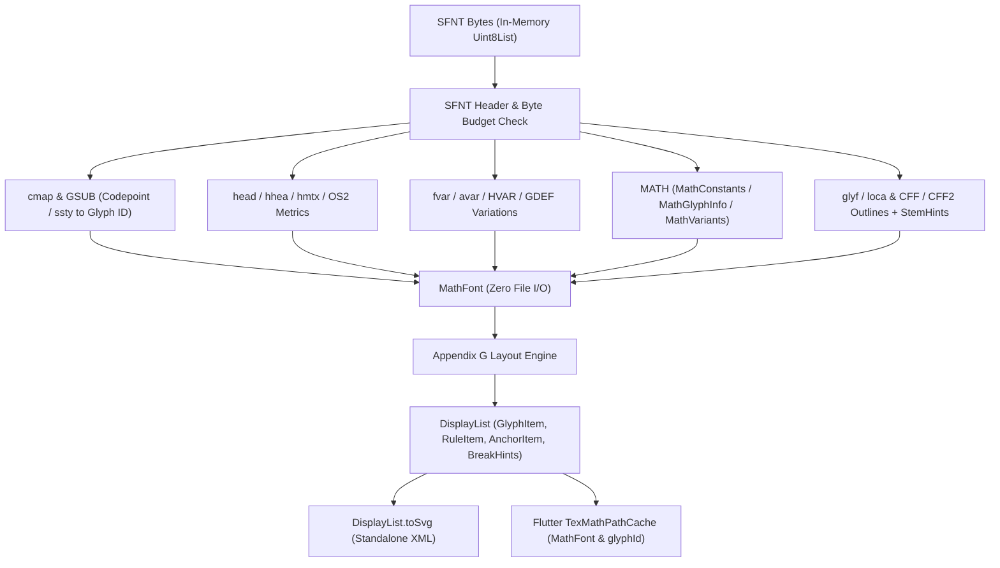
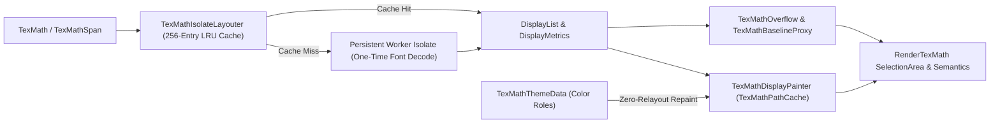

# Architecture & Design

**`tex_math`** is a pure-Dart TeX math-mode parser, OpenType `MATH` layout engine, and Flutter rendering suite targeting layout, glyph, and error parity with pinned **MathJax `4.1.3`** and JupyterLab math rendering defaults ([`REFERENCE.md`](../REFERENCE.md)).

---

## 1. Scope & Design Goals

* **Zero Runtime WebView or JavaScript**: All TeX tokenization, macro expansion, syntax analysis, OpenType font decoding, layout calculation, and SVG/MathML/spoken-text generation run synchronously in pure Dart inside `packages/tex_math/lib/`.
* **Strict Pure-Dart Core Boundary**: `packages/tex_math` depends exclusively on `package:meta` and avoids importing `package:flutter`, `dart:ui`, `dart:io`, `dart:html`, or `dart:js*`. Both `MathFont.fromBytes` and `TexMathEngine` run deterministically over caller-provided strings and byte buffers with zero filesystem I/O, network calls, or mutable global state.
* **No Hand-Built Per-Font Metric Tables**: TeX Appendix G layout constants, glyph advance widths, italics corrections, accent attachments, math kerns, size variants, and extensible assemblies come directly from the parsed OpenType `MATH` table (`NewCMMath-Regular.otf` `8.1.1` by default).
* **Strict Error Parity & Safety**: Malformed TeX and exceeded safety limits raise structured `TexMathError` exceptions aligned to MathJax's `TexError` taxonomy (`TexMathErrorClass`) rather than silently painting broken expressions.
* **Continuous Differential Verification**: Corpus parity and native AOT timings are verified against `tool/oracle/render.mjs` and reported in [`doc/COVERAGE.md`](COVERAGE.md) and [`doc/BENCHMARKS.md`](BENCHMARKS.md).

---

## 2. Five-Stage Pipeline

`TexMathEngine` (`packages/tex_math/lib/src/engine.dart`) structures TeX processing into five isolated stages, each with a single clear owner and contract:

### Stage 1: Tokenizer

Converts raw UTF-16 TeX source (`tokenizeTex`) into catcode-annotated `TexToken` values (escape `\`, begin/end group `{`/`}`, math shift `$`, alignment tab `&`, macro parameter `#`, superscript `^`, subscript `_`, active `~`, comment `%`, letter, and other). Control sequences (`\command` and single-symbol escapes) are scanned via direct `codeUnitAt` indexing without regex backtracking, and every token retains an exact half-open UTF-16 `SourceSpan` pointing back into the original input.

### Stage 2: Macro Expander & Package Registry

Expands user-defined macros (`\newcommand`, `\renewcommand`, `\providecommand`, `\def`, `\let`, `\newenvironment`, `\renewenvironment`) along with preconfigured `TexMathOptions.macros`. Parameter templates (`#1`–`#9`, optional bracketed defaults, and delimited `\def` patterns) expand eagerly within `TexMathBudgets.maxMacroDepth` and `TexMathBudgets.maxMacroExpansions`, throwing `TexMathMacroError` or `TexMathBudgetError` on invalid definitions or unbounded recursion. `TexActivePackages` tracks enabled packages across all 42 MathJax `4.1.3` extensions in `TexPackageRegistry` and resolves synchronous `\require{pkg}` calls against `TexMathOptions.requireAllowlist` without global state.

### Stage 3: Parser to Typed Sealed Syntax Tree

Consumes expanded tokens to construct an immutable Dart 3 `sealed class MathNode` syntax tree (`packages/tex_math/lib/src/ast.dart`), preserving `SourceSpan` on every node and enforcing `TexMathBudgets.maxNestingDepth`. Specialized sub-parsers handle `mhchem` chemical formulas (`\ce`, `\pu`), `physics` derivatives and Dirac notation, `amscd` commutative diagrams, `bussproofs` sequent deduction trees, and table/array specifications (`\hline`, column separators, `\cellcolor`, `\rowcolor`, `\tag`). When `TexMathOptions.strictErrors` is `false` or `noerrors` is active, non-budget syntax/macro errors emit `ErrorNode` instead of throwing.

### Stage 4: TeX Appendix G Layout Engine to Box Tree

Transforms the `MathNode` tree into positioned `HBox`, `VBox`, `GlyphBox`, `RuleBox`, `KernBox`, and `AnchorBox` trees (`packages/tex_math/lib/src/layout/layout_engine.dart`) using TeX's math typesetting rules and `TexMathStyle` transitions (`display`, `text`, `script`, `scriptScript`, and cramped variants):

* **Atom Classification, Spacing & Break Hints**: Assigns TeX atom classes (`Ord`, `Op`, `Bin`, `Rel`, `Open`, `Close`, `Punct`, `Inner`), applies Appendix G Rules 5–6 binary-to-ordinary promotions, inserts inter-atom spacing (`thinmuskip`, `medmuskip`, `thickmuskip`), and records top-level `BreakPoint` / `DisplayBreakHint` metadata (`afterBinary`, `afterRelation`, `penalty`, `explicit`).
* **Construct Layout**: Positions fractions (numerator/denominator shifts, rule thickness, `\binom`, bevelled `\nicefrac`), radicals (surd assembly, vinculum thickness, vertical clearance, degree index), superscripts/subscripts, `\prescript`, `\limits`/`\nolimits`, over/under accents (`MathTopAccentAttachment`), `\cancel`/`\enclose` annotations, matrices/alignments/proof trees (`layoutMatrixNode`), and vertical/horizontal stretchy delimiters (`stretchy.dart`) strictly from OpenType `MATH` constants and variant tables.

### Stage 5: Flat Display List & Standalone SVG Path Exporter

Flattens the positioned box tree into a coordinate-normalized `DisplayList` (`packages/tex_math/lib/src/display_list.dart`) containing `DisplayMetrics` (`widthEm`, `heightEm`, `depthEm`, `baselineEm`, `unitsPerEm`), ordered `DisplayBreakHint` entries, and flat `DisplayItem` primitives:

* **`GlyphItem`**: References glyphs by OpenType `glyphId` (plus `codePoint`), em coordinates `(xEm, yEm)`, `(scaleX, scaleY)`, `advanceEm`, optional resolved `GlyphOutline`, `SourceSpan`, and `TexMathColorRole`.
* **`RuleItem`**: Positioned rectangular stroke or frame (`strokeWidthEm`) for fraction bars, radical vincula, `\overline`/`\underline`, `\cancel` strokes, `\boxed`/`\fcolorbox` borders, and array lines.
* **`AnchorItem`**: Non-inked structural anchor carrying `id`, `(xEm, yEm)`, and optional `label` for equation tags, `\href`/`\cssId` wrappers, action tooltips, and metric inspection.

`DisplayList.toSvg()` emits a self-contained XML SVG document directly from `RuleItem`, `AnchorItem`, and `GlyphItem` records (emitting vector `<path>` contours for all ink glyphs and `<rect>` strokes/fills for rules while enforcing `TexMathBudgets.maxOutputItems` and `TexMathBudgets.maxSvgLength`).

---

## 3. OpenType Font Reader

`MathFont` (`packages/tex_math/lib/src/font.dart`) decodes SFNT font containers exclusively from an in-memory `Uint8List` via `MathFont.fromBytes(Uint8List bytes, {int maxBytes = MathFont.defaultMaxFontBytes, Map<String, double> variationAxes = const <String, double>{}})`, validating non-empty input, byte-size budget (`16 MiB` default), and SFNT magic headers (`OTTO`, `0x00010000`, `true`, `typ1`).

The pure-Dart table reader parses the SFNT table directory and decodes:

* **`head`, `maxp`, `hhea`, `hmtx`, `OS/2`, `name`**: Extracts `unitsPerEm`, glyph count, horizontal advance widths, side bearings, font bounding box, and typographic ascender/descender metrics.
* **`cmap` & `GSUB`**: Resolves Unicode scalar code points (including non-BMP mathematical alphanumeric planes via Format 4 and Format 12 subtables) to internal glyph IDs, and decodes `GSUB` `ssty` lookups (`LookupType 1` and `LookupType 3`) for optional optical script variants (`TexMathOptions.useOpticalScriptVariants`).
* **`MATH` & Variable Font Tables (`fvar`, `avar`, `HVAR`, `GDEF`)**: Decodes mathematical constants, per-glyph positioning metadata, size variants, extensible glyph assemblies, `fvar`/`avar` normalized variation axes, `HVAR` advance/LSB deltas, and `GDEF` v1.3+ `ItemVariationStore` deltas on `MathValueRecord`s.
* **`glyf` / `loca` (TrueType)** and **`CFF` / `CFF2` (Type 2 Charstrings)**: Lazily decodes and caches vector contours into immutable `GlyphOutline` records (`PathCommand`: `MoveTo`, `LineTo`, `QuadTo`, `CubicTo`, `ClosePath`), evaluates `CFF2` `blend` variation deltas, computes tight analytical Bezier-extrema `GlyphMetrics` (`metricsForGlyph`), and captures Type 2 horizontal/vertical `StemHint`s for optional pixel-grid alignment (`outlineForGlyph(glyphId, ppem: ..., enableHinting: true)`).

All layout and display primitives address glyphs by `glyphId` rather than Unicode code point alone so unencoded stylistic alternates, display-size operators, and `GlyphAssembly` connector segments (`codePoint = 0`) resolve unambiguously without filesystem access.

---

## 4. OpenType `MATH` Table Usage

The layout engine consumes all three OpenType `MATH` subtables directly:

* **`MathConstants`**: Supplies all 56 design constants normalized against `unitsPerEm`, including `scriptPercentScaleDown`, `scriptScriptPercentScaleDown`, `axisHeight`, `accentBaseHeight`, `flattenedAccentBaseHeight`, numerator/denominator shifts and minimum gaps (`fractionNumeratorShiftUp`, `fractionDenominatorShiftDown`, `fractionRuleThickness`), radical parameters (`radicalVerticalGap`, `radicalDisplayStyleVerticalGap`, `radicalRuleThickness`, `radicalExtraAscender`, `radicalKernBeforeDegree`, `radicalKernAfterDegree`), subscript/superscript shifts (`subscriptShiftDown`, `superscriptShiftUp`, `superscriptShiftUpCramped`), and operator limit gaps.
* **`MathGlyphInfo`**:
  * `MathItalicsCorrectionInfo` adjusts horizontal spacing after sloped glyphs and positions superscripts relative to base right bearings.
  * `MathTopAccentAttachment` supplies exact horizontal attachment coordinates for placing accents (`\hat`, `\tilde`, `\vec`, `\bar`) over italic or asymmetric glyphs.
  * `ExtendedShapeCoverage` identifies tall glyphs requiring cut-in kerning or full-height baseline treatment.
  * `MathKernInfo` provides four-corner staircase kern heights (`MathKernCorner`) and cut-in values for tight subscript/superscript kerning against sloped glyphs (such as `f_i` or `V^2`).
* **`MathVariants`**: Supplies both vertical and horizontal `MathGlyphConstruction` records (`minConnectorOverlap` plus per-glyph `MathGlyphVariant` discrete size steps and `GlyphAssembly` part lists of `glyphId`, `startConnectorLength`, `endConnectorLength`, `fullAdvance`, and `isExtender` flags) for stretchy delimiters, large operators, radicals, `\overbrace`/`\underbrace`, extensible arrows, and wide accents.

### OpenType `MATH` Conformance vs. MathJax 4 JS-FontData Divergences

As recorded in [`doc/COVERAGE.md`](COVERAGE.md), `tex_math` renders all `315` accepted corpus cases cleanly (`0` unsupported, `37/37` error-class parity) while strict `0.02em` numeric comparison against MathJax `4.1.3` (`@mathjax/mathjax-newcm-font`) reports `241` differences. Inspecting both engines side by side establishes that these differences stem from structural differences between the OpenType `MATH` specification (`NewCMMath-Regular.otf` `8.1.1`) and MathJax's JavaScript `FontData` tables derived from legacy TeX `.tfm` metrics:

* **`MathConstants.superscriptShiftUp` / `subscriptShiftDown` vs. Legacy `.tfm` `sup1` / `sub1` (and Rule Thickness)**: OpenType `MATH` defines one uncramped `superscriptShiftUp` (`363 / 1000 = 0.363em`), one `superscriptShiftUpCramped` (`289 / 1000 = 0.289em`), one `subscriptShiftDown` (`247 / 1000 = 0.247em`), and `fractionRuleThickness = 40` (`0.040em`). By contrast, `@mathjax/mathjax-newcm-font` retains TeX `.tfm` `fontdimen` slots distinguishing display-only `sup1 = 0.413` from `sup2 = 0.363` and standalone `sub1 = 0.15` from `sub2 = 0.247`, alongside `rule_thickness = 0.06` (`0.060em`) and `delimitershortfall = 0.3` (vs Appendix G `0.5em`). Consequently, a display superscript like `x^2` places `2` at `y = 0.363em` in OpenType `MATH` vs `0.413em` in MathJax, standalone subscripts sit at `-0.247em` vs `-0.150em`, and fraction rules use `0.040em` vs `0.060em`.
* **Unencoded OpenType `GlyphAssembly` Parts vs. MathJax Clipped Multi-Glyph SVG Tiles**: `MathVariants` constructs tall delimiters, radicals, and horizontal braces from unencoded `glyphId` assembly parts (`codePoint = 0`) joined with `startConnectorLength`/`endConnectorLength` overlaps and repeated `isExtender` segments. For `\left\{ \begin{matrix} 1 \\ 2 \\ 3 \\ 4 \\ 5 \end{matrix} \right\}`, both engines produce identical outer bounds (`width = 2.304em`, `height = 3.550em`, `depth = 3.050em`), yet `tex_math` emits 23 `GlyphAssembly` pieces (`codePoint = 0`) while MathJax emits 15 encoded/scaled `<use>` SVG tiles combining `U+23A7`–`U+23AD` pieces (`9127`–`9133`) with scaled `{` (`123`) extenders; similarly, `\overbrace` (`U+23DE`) in `NewCMMath-Regular.otf` uses 5 assembly parts vs MathJax's 4-entry `stretch` tuple (`9182`, `175`, `9182`, `9182`).
* **`NewCMMath-Regular.otf` `hmtx` / `cmap` vs. MathJax's Split Virtual Subfonts**: `tex_math` resolves every character and math alphabet directly from the active font's single `cmap` (Format 4/12), `hmtx`, `MATH`, and `GSUB` (`ssty`) tables. MathJax `4.1.3` decomposes `mathjax-newcm` across 33 virtual variant tables (`normal`, `bold`, `italic`, `-tex-calligraphic`, `-smallop`, `-largeop`, `-size3`–`-size7`, `-lf-tp`, `-rt-bt`, `-ex-md`, `-bbold`, `-upsmall`, `-uplarge`, etc.) carrying per-subfont `.tfm` metrics such as `extra_ic = 0.033em` (placing scripts on `x` at `0.572 + 0.033 = 0.605em` vs `hmtx` `0.572em`) and custom `HDW` bounds.

**Why Strict OpenType `MATH` Conformance Is Maintained**: Hardcoding MathJax `.tfm` patches (`sup1`/`sub1`, `extra_ic`, `0.06em` rule overrides, or clipped `<use>` tile tables) into the core layout engine would break font independence for any other OpenType math font (such as Latin Modern Math, STIX Two Math, or variable `CFF2` math fonts) and violate OpenType `MATH` Appendix G fidelity. `tex_math` therefore treats OpenType `MATH` as authoritative for geometry while verifying strict structural, glyph-selection, and error-class parity against the MathJax oracle.

---

## 5. Accessibility & Source Mapping

Accessibility and diagnostic exporters operate directly on the structured `MathNode` tree and `SourceSpan` metadata rather than reconstructing meaning from flat glyph coordinates:

* **Presentation MathML (`toMathMl()`)**: Exhaustively traverses all 16 `MathNode` variants (`FractionNode` to `<mfrac>`, `ScriptNode` to `<msub>`/`<msup>`/`<msubsup>`/`<mmultiscripts>`, `RadicalNode` to `<msqrt>`/`<mroot>`, `MatrixNode` to `<mtable>`, `DelimiterNode` to `<mrow>` + `<mo stretchy="true">`) to emit clean Presentation MathML for screen readers and external interchange.
* **Spoken Text (`toSpokenText()`)**: Generates plain natural-language math descriptions from `MathNode` structure for platform accessibility trees (`Semantics` labels in Flutter).
* **Source Span Mapping ("Copy as LaTeX")**: Every `MathNode` and `DisplayItem` carries an optional UTF-16 `SourceSpan`. Callers and Flutter selection adapters expand partial selections to the minimal enclosing `MathNode` slice via `TexMathSelectionUtils.sliceMinimalLatex` (`span.slice(source)`) so copied LaTeX remains syntactically valid.

---

## 6. Flutter Integration (`packages/tex_math_flutter`)

`packages/tex_math_flutter` adapts pure-Dart `DisplayList` output into Flutter's rendering, accessibility, and theming pipeline:

* **Vector `Path` Construction & `TexMathPathCache`**: `TexMathDisplayPainter` converts `GlyphOutline.commands` into `dart:ui` `Path` instances via `TexMathDisplayPainter.buildPathFromCommands` and caches them inside `TexMathPathCache` (LRU-bounded, keyed by `(MathFont, glyphId)` with `GlyphOutline` fallback).
* **Zero-Relayout Theme Color Updates**: `DisplayItem` stores a semantic `TexMathColorRole` (`foreground`, `accent`, `error`, `muted`, `custom`). `TexMathTheme` / `TexMathThemeData` resolves paint colors inside `TexMathDisplayPainter.paint`, so light/dark theme transitions trigger only a `CustomPaint` repaint using cached `Path`s without re-running `TexMathEngine.render` or rebuilding outlines.
* **Once-Per-Lifecycle Bundled Font Loading**: `TexMathFontBundle.loadMathFont()` loads and decodes `packages/tex_math_flutter/assets/fonts/NewCMMath-Regular.otf` (`8.1.1`) once per lifecycle (`TexMathFontBundle.cachedMathFont`), alongside `GUST-FONT-LICENSE.txt` and `MANIFEST-NewCMMath.txt`. `TexMath` resolves the cached font synchronously once loaded or fetches it asynchronously on first mount.
* **Baseline Alignment, Scaling & Overflow (`TexMathOverflow`)**: `TexMath` wraps output in `Baseline(baselineType: TextBaseline.alphabetic)` driven by `DisplayMetrics.baselineEm * scaledFontSize` (merging `DefaultTextStyle`, `textStyle`, `TexMathThemeData.fontSize`, and `MediaQuery.textScalerOf(context)`). `TexMathBaselineProxy` forwards exact alphabetic baseline metrics across `TexMathOverflow.scroll`, `TexMathOverflow.scaleToFit`, and `TexMathOverflow.clip` containers so inline `TexMathSpan` (`WidgetSpan`) stays aligned with surrounding prose.
* **Persistent Background Isolate Layouter (`TexMathIsolateLayouter`)**: Spawns a long-lived worker `Isolate` (via `TexMathIsolateLayouter.withBundledFont` / `warmUp`), transfers raw SFNT font bytes once via `TransferableTypedData`, decodes `MathFont.fromBytes` once in the worker, deduplicates in-flight renders, propagates `TexMathError` across isolate boundaries, and caches up to `maxCacheEntries` (`256` default) results by `TexMathLayoutCacheKey(source, options, fontId)`.
* **Sub-Expression Selection & Semantics**: `RenderTexMath` (`Selectable` + `SelectionRegistrant` inside `src/selection_adapter.dart`) supports partial drag selection over `DisplayItem.span` boxes expanded via `TexMathSelectionUtils.expandSpanToMinimalNode`, wraps standalone widgets in `SelectionArea` automatically when `selectable` is `true` and no ancestor `SelectionContainer` exists, and exposes `Semantics(label: ..., readOnly: true)` from `RenderResult.toSpokenText()`.
* **Default Error Widget**: When `TexMathEngine` throws a `TexMathError`, `TexMath` invokes `errorBuilder` if supplied or renders `TexMathErrorWidget`, displaying the original TeX `source` in monospace alongside the structured error message tinted with `TexMathThemeData.error` and `errorBackground`.

---

## 7. Safety Budgets & Error Parity

Untrusted or malformed TeX input is bounded before and during execution by `TexMathBudgets` (`packages/tex_math/lib/src/options.dart`) and reported via `sealed class TexMathError` (`packages/tex_math/lib/src/error.dart`):

| Budget Field | Default Limit | Protected Resource |
| :--- | :--- | :--- |
| `maxInputLength` | `50000` UTF-16 code units | Raw TeX input length before tokenization/parsing. |
| `maxMacroDepth` | `64` levels | Nested macro call stack depth during expansion. |
| `maxMacroExpansions` | `10000` expansions | Total macro expansions per expression to halt exponential blowup. |
| `maxNestingDepth` | `64` levels | Brace group and `MathNode` recursion depth. |
| `maxOutputItems` | `50000` items | Maximum `DisplayItem` count emitted in a `DisplayList`. |
| `maxSvgLength` | `4000000` characters | Maximum serialized XML length returned by `DisplayList.toSvg()`. |
| `MathFont.defaultMaxFontBytes` | `16 MiB` | Maximum font payload accepted by `MathFont.fromBytes`. |

When `TexMathOptions.strictErrors` is `true` (default) and `noerrors` is inactive, malformed syntax, invalid macro definitions, unknown environments, font corruption, unsupported features, and exceeded budgets throw one of five sealed `TexMathError` subclasses (`TexMathSyntaxError`, `TexMathMacroError`, `TexMathBudgetError`, `TexMathFontError`, `TexMathUnsupportedError`), each tagged with a `TexMathErrorClass` enum matching MathJax's TeX error taxonomy (`undefinedControlSequence`, `missingBrace`, `extraBrace`, `misplacedAlignmentTab`, `misplacedNewline`, `missingDelimiter`, `extraDelimiter`, `mismatchedEnvironment`, `doubleScript`, `missingArgument`, `invalidMacroDefinition`, `unknownEnvironment`, `budgetExceeded`, `invalidFont`, `unsupportedFeature`, `syntaxError`).

---

## 8. Architectural Decisions & Rationales

* **Dart 3 `sealed class` Hierarchies (`MathNode`, `DisplayItem`, `PathCommand`, `TexMathError`)**: Sealed classes enforce compile-time exhaustiveness across layout passes, MathML/spoken-text emitters, SVG export, and Flutter `Canvas` painters without fragile runtime type checks or mutable visitor state.
* **Pure-Dart OpenType + `CFF`/`CFF2` Parser vs. Native FFI**: Parsing SFNT tables and charstrings in pure Dart avoids C/Rust native build toolchains, works identically across Flutter mobile/desktop/web and Dart CLI/server targets, and passes cleanly across `Isolate` boundaries via raw `Uint8List` bytes.
* **Glyph-ID `DisplayList` + Vector `Path` Painting vs. Flutter `TextPainter`**: `TextPainter` depends on host OS text shaping, cannot address unencoded OpenType `MATH` glyph IDs or `GlyphAssembly` extensions, applies platform-dependent font fallback, and cannot guarantee deterministic cross-platform geometry. Painting cached vector `Path`s from OpenType outlines yields identical cross-platform geometry and zero-relayout theme recoloring.
* **Lockstep Packages in a Dart `pub` Workspace**: Splitting `tex_math` (pure Dart, `meta` only) and `tex_math_flutter` (Flutter widgets, assets, painters) inside a single `pub` workspace enforces strict SDK boundaries at the package level while keeping API evolution and releases synchronized via `tool/check_versions.dart`.

---

## 9. Core Design Contracts

The following architectural contracts govern the OpenType font reader, TeX layout engine, Flutter integration, and comparison studio:

1. **Full `CFF2` Variable-Font Instancing & Stem Hinting Support**: OpenType `CFF`/`CFF2` decoding includes `fvar`/`avar` axis normalization, `HVAR` advance/LSB deltas, `GDEF`/`CFF2` `ItemVariationStore` delta evaluation (`blend` operators), and optional horizontal/vertical Type 2 `StemHint` grid alignment (`outlineForGlyph(enableHinting: true, ppem: ...)`) in pure Dart without native FFI.
2. **`TexMathSpan` Baseline Alignment Precision**: Inline math aligns using `DisplayMetrics.baselineEm * scaledFontSize` inside `Baseline` + `TexMathBaselineProxy` wrapped in `WidgetSpan(alignment: PlaceholderAlignment.baseline, baseline: TextBaseline.alphabetic)`, combining surrounding `DefaultTextStyle`, widget `textStyle`, `TexMathThemeData.fontSize`, and `MediaQuery.textScalerOf(context)`.
3. **Font-Driven OpenType `MATH` Metrics with Font-Independent TeX-to-Unicode Mapping**: All layout constants, advance widths, italics corrections, accent attachments, math kerns, size variants, and `GlyphAssembly` constructions derive exclusively from the active font's `cmap`, `GSUB` (`ssty`), and `MATH` tables, while TeX-to-Unicode semantic mapping (including `\mathbb`/`\mathcal`/`\mathfrak`/`\mathbf`/`\mathit`/`\mathrm`/`\mathsf`/`\mathtt` math alphabets) stays independent of any single font file.
4. **Line-Breaking Hints & Narrow-Container Overflow**: `DisplayList` retains a single positioned box for primary layout while recording top-level `DisplayBreakHint` entries (`afterBinary`, `afterRelation`, `penalty`, `explicit`), paired with configurable `TexMathOverflow` policies (`scroll`, `scaleToFit`, `clip`, `visible`) on `TexMath`.
5. **Synchronous `\require` Against a Compile-Time Package Registry**: All 42 MathJax `4.1.3` TeX packages live in the immutable compile-time `TexPackageRegistry`, enabling default or custom extensions via `TexMathOptions.packages` and resolving synchronous `\require{pkg}` against `TexMathOptions.requireAllowlist` within a single render call with zero I/O or global mutable state.
6. **Sub-Expression Selection & Multi-Format Accessibility in `SelectionArea`**: `RenderTexMath` (`Selectable`) maps hit-tested `DisplayItem.span` ranges through `TexMathSelectionUtils.expandSpanToMinimalNode` to copy minimal syntactically valid LaTeX slices (`span.slice(source)`), while `RenderResult.toMathMl()` and `RenderResult.toSpokenText()` supply accessible Markup and `Semantics` labels.
7. **macOS `WKWebView` Comparison Architecture in `studio/`**: `studio/` renders MathJax `4.1.3` and KaTeX `0.19.1` inside macOS `WKWebView` (`webview_flutter` and `webview_flutter_wkwebview`) served from `StudioLocalAssetServer` against gitignored `tool/oracle/node_modules/` assets, supporting 3-way Side-by-Side, RGBA `Pixel Diff`, and draggable `Curtain Diff` modes without adding WebView or JS dependencies to `packages/tex_math` or `packages/tex_math_flutter`.
