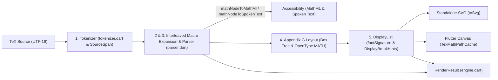
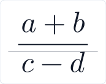
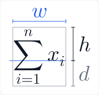
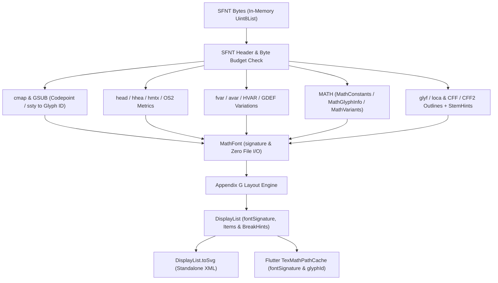
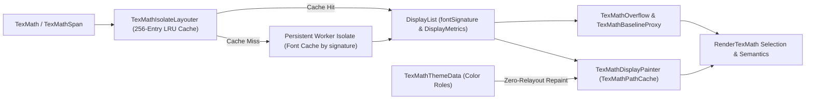

# Architecture & Design

**`tex_math`** is a pure-Dart TeX math parser, OpenType math layout engine, and Flutter rendering suite targeting layout, glyph, and error parity with pinned MathJax `4.1.3` and JupyterLab math defaults ([`REFERENCE.md`](../REFERENCE.md)).

---

## 1. Scope & Design Goals

* **Zero Runtime WebView or JavaScript**: All TeX tokenization, macro expansion, syntax analysis, font decoding, geometric layout, and SVG, MathML, or spoken-text generation run synchronously in pure Dart inside `packages/tex_math/lib/`.
* **Strict Pure-Dart Core Boundary**: The core package depends exclusively on `package:meta` and omits Flutter, `dart:ui`, and platform I/O or JS interop libraries. Both `MathFont.fromBytes` and `TexMathEngine` run deterministically on caller-supplied strings and byte buffers with zero filesystem access, network calls, or global mutable state.
* **OpenType Math-Driven Layout**: Appendix G constants, glyph advance widths, italics corrections, accent attachments, math kerns, size variants, and extensible assemblies come directly from the parsed OpenType `MATH` table (`NewCMMath-Regular.otf` `8.1.1` by default) rather than hardcoded per-font lookup tables.
* **Error Parity & Safety**: Malformed TeX inputs and exceeded complexity limits throw typed `TexMathError` exceptions mapped to `TexMathErrorClass`, bounded by `TexMathBudgets` and hardened SFNT font decoders.
* **Continuous Differential Verification**: Corpus parity and native AOT timings are verified against `tool/oracle/render.mjs` and published in [`doc/COVERAGE.md`](COVERAGE.md) and [`doc/BENCHMARKS.md`](BENCHMARKS.md).

---

## 2. Five-Stage Pipeline & Module Boundaries

`TexMathEngine` (`packages/tex_math/lib/src/engine.dart`) organizes TeX processing into five unidirectional stages backed by leaf shared tables, break-point metadata, and non-circular font decoders in `packages/tex_math/lib/src/font/`:

| Stage | Primary Module | Responsibility |
| :--- | :--- | :--- |
| **1. Tokenizer** | `parser/tokenizer.dart` | Scans UTF-16 TeX source via direct code-unit indexing into catcode-annotated tokens retaining exact half-open `SourceSpan` ranges. |
| **2. Macro Expander** | `parser/macros.dart` | Expands `\newcommand`, `\renewcommand`, `\providecommand`, `\def`/`\gdef`/`\edef`/`\xdef`, `\let`, `\newenvironment`, `\renewenvironment`, and `TexMathOptions.macros` on demand inside cumulative token and depth limits. |
| **3. AST Parser & Registry** | `parser/parser.dart`, `parser/package_registry.dart` | Tracks all 42 MathJax `4.1.3` packages, resolves synchronous `\require` calls against `requireAllowlist`, pre-parses matrix column separators, and builds an immutable 16-variant `MathNode` tree. |
| **4. Appendix G Layout** | `layout/layout_engine.dart` | Applies TeX math styles, atom spacing rules, and OpenType math table geometry to construct positioned box trees without importing any parser module. |
| **5. Display List & Exporters** | `display_list.dart`, `export/` | Flattens boxes into positioned glyph, rule, and anchor items with break hints, then exports SVG XML, Presentation MathML, or spoken text via `RenderResult`. |

### Stage 1: Tokenizer

The tokenizer scans UTF-16 TeX input with direct index arithmetic rather than backtracking regular expressions. It classifies every character by TeX category code (`escape`, group braces, math shift, alignment tab, parameter, scripts, space, letters, comments, and active or other tokens) and attaches exact UTF-16 source spans for diagnostics and sub-expression selection.

### Stages 2 & 3: Interleaved Macro Expansion, Package Registry & Parser

Macro expansion and syntax tree construction run interleaved on demand inside `parser.dart`. Expansion supports `#1`–`#9` parameters, optional defaults, and delimited `\def` patterns with zero-allocation delimiter lookahead, sharing cumulative macro depth, macro expansion, and token budgets across nested expansions.

The active package tracker compiles all 42 MathJax 4.1.3 packages and validates synchronous `\require` and `\setOptions` calls against `TexMathOptions.requireAllowlist`. Specialized sub-parsers handle chemistry reactions, physics matrices, physical units, commutative diagrams, proof trees, and table column specifications. Table parsing resolves `@{...}` and `!{...}` column separators during Stage 3 (`environments.dart`) so layout never calls back into the parser. Non-fatal error modes (`strictErrors: false` or `noerrors`) emit an `ErrorNode` instead of throwing.

### Stage 4: TeX Appendix G Layout Engine

The layout engine turns the immutable syntax tree into positioned horizontal boxes, vertical boxes, glyph boxes, rules, kerns, and anchors using leaf shared tables (`colors.dart`, `layout_constants.dart`, `math_symbols.dart`) with zero parser imports. It tracks display, text, script, and script-script styles (including cramped forms), promotes atom classes per Appendix G Rules 5–6, applies standard math spacing, and attaches top-level line-breaking hints.

Construct layout modules (`matrix_layout.dart`, `stretchy.dart`, `style_spacing.dart`) consume validated OpenType math table data alongside centralized fallback defaults. The engine resolves `ex` height from `MathFont.xHeight` relative to `unitsPerEm` (falling back to `0.431em` when absent) and computes extensible glyph assembly repeats in constant time.

### Stage 5: Flat Display List & Exporters

`DisplayList` flattens the positioned box tree into bounding-box metrics, break hints, an optional font payload signature, and display primitives (`GlyphItem`, `RuleItem`, and `AnchorItem`). `RenderResult` pairs the display list, syntax tree, and original source string, exposing `toSvg()`, `toMathMl()`, and `toSpokenText()`. Incremental SVG serialization streams vector `<path>` contours and `<rect>` bars while checking output-item and serialized-length limits on the fly.

---

## 3. OpenType Font Reader

`MathFont` (`packages/tex_math/lib/src/font.dart`) decodes SFNT containers exclusively from an in-memory `Uint8List`, enforcing a 16 MiB default byte limit and validating OpenType or TrueType headers. Font sub-decoders rely solely on leaf metric, outline, binary-reader, and variation helpers with zero circular imports back to `font.dart`.

| SFNT Tables | Decoded Data & Behavior |
| :--- | :--- |
| `head`, `maxp`, `hhea`, `hmtx`, `OS/2`, `name` | Extracts units per em, glyph count, horizontal advance widths, side bearings, font bounds, `sxHeight`, cap height, and typographic ascender/descender metrics. |
| `cmap`, `GSUB` | Maps BMP and supplementary Unicode code points via Format 4 and Format 12 subtables and decodes `ssty` lookups for optical script alternates (`useOpticalScriptVariants`). |
| `MATH` | Parses `MathConstants`, `MathGlyphInfo`, and `MathVariants` subtables driving Appendix G layout. |
| `fvar`, `avar`, `HVAR`, `GDEF` | Resolves normalized variation axes, horizontal advance and side-bearing deltas, and `ItemVariationStore` deltas on math value records. |
| `glyf`/`loca`, `CFF`/`CFF2` | Lazily decodes vector outlines into immutable `GlyphOutline` records, evaluates `CFF2` blend deltas, computes analytical Bezier bounding boxes, and caches stem-hinted outlines per glyph ID and `ppem`. |

Each `MathFont` computes a deterministic payload-and-variation `signature` and memoizes its hash code, preventing equality collisions across distinct fonts with identical header scalars and enabling cross-isolate path cache keys via `DisplayList.fontSignature`.

---

## 4. OpenType `MATH` Table Usage

`MathTableData` parses and exposes all three OpenType math subtables:

* **`MathConstants`**: Supplies normalized constants including script scale-down percentages, axis height, accent base heights (used by TeX Appendix G Rule 12 to align x-height accents directly over bases and shift only by excess height), fraction shifts and rule thickness, radical gaps and degree kerns, script shifts, and operator limit gaps.
* **`MathGlyphInfo`**: Exposes italics corrections, top accent attachment coordinates, extended-shape flags, and four-corner staircase kerning for tight script placement.
* **`MathVariants`**: Supplies minimum connector overlap plus vertical and horizontal construction recipes (`MathGlyphVariant` discrete size steps and `GlyphAssembly` part lists) for tall delimiters, large operators, radicals, horizontal braces, extensible arrows, and wide accents.

### OpenType MATH Conformance vs. MathJax 4 JS-FontData Divergences

As documented in [`doc/COVERAGE.md`](COVERAGE.md), `tex_math` renders all 315 accepted corpus cases cleanly (0 unsupported and 37/37 error-class parity). Strict ±0.02em bounding-box comparison against MathJax 4.1.3 reports 241 numeric deltas caused by structural differences between authentic OpenType math tables (`NewCMMath-Regular.otf` 8.1.1) and MathJax's `.tfm`-derived font data:

* **Math Constants vs. Legacy TFM Parameters**: OpenType `MATH` defines unified constants such as `superscriptShiftUp` (0.363em), `superscriptShiftUpCramped` (0.289em), and `fractionRuleThickness` (0.040em). MathJax retains `.tfm` slots distinguishing display `sup1` (0.413em) from `sup2` (0.363em), separate subscript shifts, and 0.060em rule thickness.
* **Unencoded Glyph Assemblies vs. Clipped SVG Tiles**: OpenType math variants build tall delimiters and horizontal braces from unencoded glyph ID segments with overlap recipes, whereas MathJax emits scaled and clipped SVG `<use>` tiles.
* **Unified Font Tables vs. Virtual Subfonts**: `tex_math` resolves glyphs from one unified set of OpenType `cmap`, `hmtx`, and `MATH` tables. MathJax splits its font data across 33 virtual subfonts with per-subfont overrides.

Hardcoding MathJax `.tfm` overrides into the core layout engine would compromise font independence for other OpenType math fonts such as Latin Modern Math, STIX Two Math, or variable math fonts. `tex_math` therefore keeps OpenType `MATH` authoritative for geometry while verifying structural rendering, glyph selection, and error parity against the MathJax oracle.

---

## 5. Accessibility & Source Mapping

Accessibility exporters read the parsed `MathNode` syntax tree directly while filtering disallowed XML 1.0 control characters and lone surrogates (`format_utils.dart`):

* **Presentation MathML (`mathNodeToMathMl`)**: Exhaustively translates all 16 syntax node variants and sanitizes color attributes. `\href` links pass through safe URI validation allowing only HTTP, HTTPS, `mailto:`, `#` fragments, and scheme-less relative paths.
* **Spoken Text (`mathNodeToSpokenText` / `toSpokenText()`)**: Generates plain natural-language descriptions exposed directly to screen readers through Flutter `Semantics` labels.
* **Source Span Mapping ("Copy as LaTeX")**: Every syntax node and display item retains an optional UTF-16 `SourceSpan`; `TexMathSelectionUtils.sliceMinimalLatex` expands partial drag selections to the smallest syntactically valid enclosing expression.

---

## 6. Flutter Integration (`packages/tex_math_flutter`)

The Flutter package wraps the pure-Dart engine in idiomatic widgets, caches, and background workers so UI threads stay responsive even during rapid theme switches or multi-equation notebook rendering:

| Component | Architecture & Behavior |
| :--- | :--- |
| **`TexMathPathCache`** | Caches Flutter `Path` geometry keyed by `(fontSignature, glyphId, ppemBucket?)`—preserving hits even when a display list came from a background isolate without a `MathFont` on the UI thread—and bounds fallback `TextPainter` entries with automatic disposal on eviction. |
| **`TexMathDisplayPainter` & `TexMathTheme`** | Resolves semantic `TexMathColorRole` colors at paint time, allowing light and dark theme changes to repaint immediately without re-running TeX layout or rebuilding glyph paths. |
| **`TexMathFontBundle`** | Reads `NewCMMath-Regular.otf` (`8.1.1`) once per app lifecycle and decodes it off the UI thread via `Isolate.run`, using a real async zone guard so `FakeAsync` widget tests never stall. |
| **`TexMath` & `TexMathSpan`** | Resolves font size in precedence order (`widget.textStyle`, `TexMathTheme`, `DefaultTextStyle`, theme fallback) scaled by `MediaQuery.textScalerOf(context)`. Passes pre-parsed syntax trees directly to `engine.layout()` on cold bundled font loads, aligns alphabetic and ideographic baselines, and scales baselines proportionally under `TexMathOverflow.scaleToFit`. |
| **`TexMathIsolateLayouter`** | Maintains a persistent worker isolate with single-transfer font initialization (`TransferableTypedData`), worker-side font caching by signature, in-flight request deduplication, a 256-entry LRU result cache, and crash recovery via exit and error listeners. |
| **Selection & Error Semantics** | Builds selection hit boxes lazily only when an ancestor `SelectionArea` registers the render object, expands hit bounds under `TexMathOverflow.visible`, and respects `selectable: false` and semantic exclusion inside `TexMathErrorWidget`. |

---

## 7. Safety Budgets & Error Parity

`TexMathBudgets` (`packages/tex_math/lib/src/options.dart`) and hardened font guards bound untrusted inputs. Violations throw one of five sealed `TexMathError` subclasses (`TexMathErrorClass`) documented in the [API Manual](API_MANUAL.md):

| Budget Field | Default Limit | Protected Resource |
| :--- | :--- | :--- |
| `maxInputLength` | `50000` UTF-16 code units | Raw and synthetic TeX string length before tokenization. |
| `maxMacroDepth` | `64` levels | Inherited nested macro call stack depth across cursors. |
| `maxMacroExpansions` | `10000` expansions | Shared cumulative macro expansions per parse. |
| `maxTokens` | `100000` tokens | Shared cumulative tokens tokenized and materialized during expansion. |
| `maxNestingDepth` | `64` levels | Group, parser recursion, `mhchem`, and AST depth across all entry points. |
| `maxOutputItems` | `50000` items | Maximum display items emitted in a single display list. |
| `maxSvgLength` | `4000000` characters | Maximum serialized SVG XML length (checked incrementally). |
| `MathFont.defaultMaxFontBytes` | `16 MiB` | Maximum font payload accepted by `MathFont.fromBytes`. |

---

## 8. Architectural Decisions & Rationales

* **Dart 3 Sealed Class Hierarchies**: Using sealed hierarchies for `MathNode`, `DisplayItem`, `PathCommand`, and `TexMathError` enforces compile-time exhaustiveness across layout, exporters, and Flutter painting without runtime type casts.
* **Pure-Dart OpenType Parser vs. Native FFI**: Avoiding C or Rust bindings eliminates native build chains, guarantees identical behavior across mobile, desktop, web, and Dart CLI targets, and keeps font decoding isolate-safe.
* **Glyph-ID Display Lists vs. `TextPainter`**: Platform text shapers cannot address unencoded OpenType `MATH` glyph IDs or assembly pieces and differ across operating systems; cached vector paths guarantee identical cross-platform geometry and zero-relayout recoloring.
* **Lockstep Packages in a Dart Workspace**: Splitting pure-Dart `tex_math` (`meta` only) from `tex_math_flutter` enforces SDK boundaries at compile time while keeping versions synchronized via `tool/check_versions.dart`.
