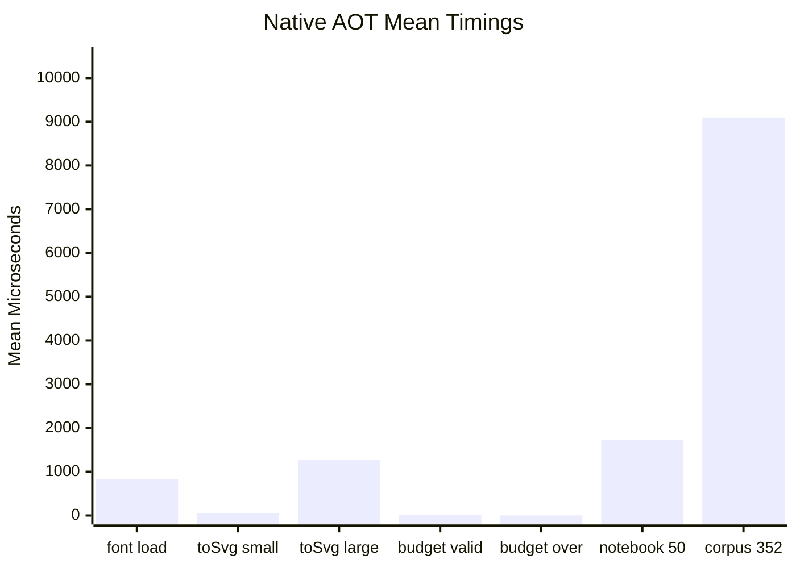

# Benchmarks (Native AOT Baseline)

These timings are measured from a self-compiled native AOT executable built with `dart compile exe tool/benchmark_suite.dart` against the `tex_math` OpenType `MATH` font reader, TeX parser and macro expander, Appendix G layout engine, and `DisplayList.toSvg()` pipeline across 352 corpus cases.

Measurements cover OpenType font decoding (`MathFont.fromBytes` on `NewCMMath-Regular.otf`), display-list SVG serialization, `TexMathBudgets` input-guard enforcement, typical inline expression layout, 50-equation notebook page layout, and full-corpus layout dispatch. Flutter first-paint benchmarks activate alongside widget rendering.

## Host Environment

| Property | Value |
| :--- | :--- |
| CPU | `Apple M4` |
| Architecture | `arm64` |
| OS | `macos` (`Version 15.6 (Build 24G84)`) |
| Logical Cores | `10` |
| Memory | `32 GiB` |
| Dart SDK | `3.13.5` |
| Corpus Cases | `352` |
| Regression Threshold | `5.0x` baseline mean |

## Measured Native AOT Timings

| Benchmark | Description | Samples x Batch | Mean | Median (p50) | p95 | Min | Max |
| :--- | :--- | ---: | ---: | ---: | ---: | ---: | ---: |
| `math_font_from_bytes` | Decode NewCMMath-Regular.otf SFNT, MATH, cmap, GSUB, and CFF tables via MathFont.fromBytes | `10 x 5` | 837.56 us | 799.80 us | 1.023 ms | 698.80 us | 1.023 ms |
| `display_list_to_svg_small` | Serialize a 12-item DisplayList to standalone SVG XML | `20 x 400` | 56.18 us | 55.83 us | 60.31 us | 54.73 us | 60.31 us |
| `display_list_to_svg_large` | Serialize a 250-item DisplayList to standalone SVG XML | `20 x 60` | 1.277 ms | 1.279 ms | 1.332 ms | 1.207 ms | 1.332 ms |
| `budget_input_check_valid` | Validate input budgets, parse, and lay out quadratic formula via TexMathEngine.render | `20 x 1500` | 14.41 us | 14.05 us | 17.56 us | 13.16 us | 17.56 us |
| `budget_input_check_exceeded` | Reject oversized 50,001-char input via TexMathBudgetError guard | `20 x 1500` | 2.17 us | 2.05 us | 3.10 us | 1.86 us | 3.10 us |
| `notebook_50_equations` | Parse and lay out 50 notebook equations in batch via TexMathEngine.render | `20 x 40` | 1.734 ms | 1.751 ms | 2.106 ms | 1.365 ms | 2.106 ms |
| `corpus_full_dispatch` | Dispatch all 352 corpus cases through TexMathEngine.render | `20 x 25` | 9.098 ms | 7.986 ms | 14.177 ms | 4.863 ms | 14.177 ms |

## Target Performance Thresholds

The table below lists target end-to-end performance goals for full TeX parsing, OpenType `MATH` layout, and Flutter rendering. Flutter paint benchmarks remain pending until widget rendering stages land.

| Workload | Target Threshold | Scope | Status |
| :--- | :--- | :--- | :--- |
| Typical inline expression | `< 50 us` | Full parse, layout, and display list build | Measured (`budget_input_check_valid`) |
| 50-equation notebook page | `< 5 ms` | Full page layout batch across 50 expressions | Measured (`notebook_50_equations`) |
| Cached first paint | Paint-only cost | Cached display list and theme color update without re-layout | Pending (Flutter rendering) |
| OpenType `MATH` font parse | Once per font | SFNT and `MATH` table decode per `MathFont` load | Measured (`math_font_from_bytes`) |

## Running Locally

Run `dart run tool/benchmark_suite.dart --check-regressions` to compile a fresh native AOT binary and compare live timings against `tool/benchmark_baseline.json`, or pass `--update-baseline --update-docs` to record a new baseline.
