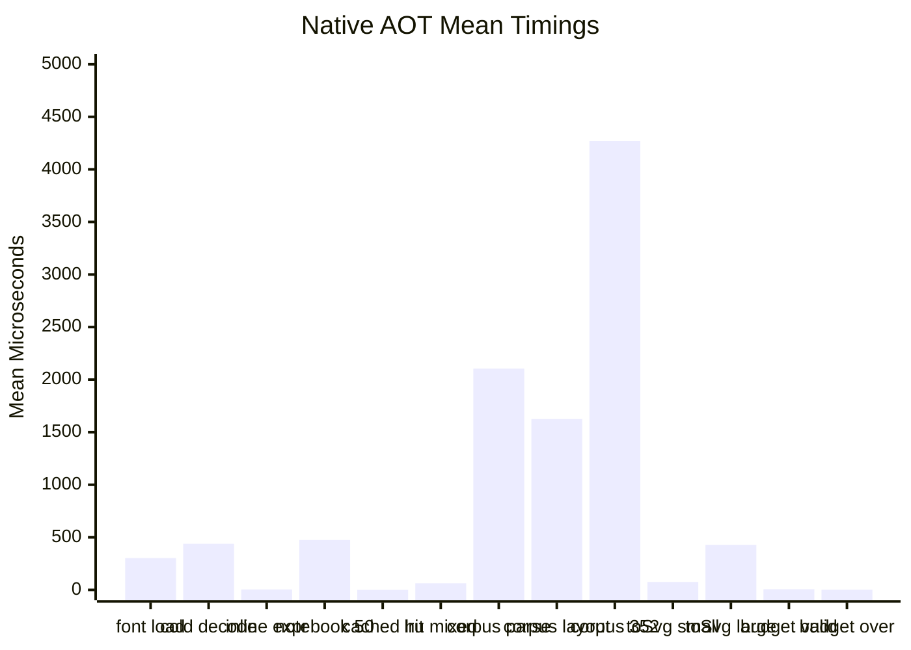

# Benchmarks (Native AOT Baseline)

These timings come from a self-compiled native AOT binary built with `dart compile exe tool/benchmark_suite.dart` and exercised against the pure-Dart engine across all 352 corpus cases.

Measurements cover one-time OpenType font decoding, cold font plus initial glyph decoding, inline expression layout, 50-equation notebook batch layout, warm and mixed-eviction LRU cache lookups, phase-split parse and layout timings, real CFF SVG serialization, `TexMathBudgets` input checks, and process RSS memory telemetry.

## Host Environment

| Property | Value |
| :--- | :--- |
| CPU | `Apple M4` |
| Architecture | `arm64` |
| OS | `macos` (`Version 15.6 (Build 24G84)`) |
| Logical Cores | `10` |
| Memory | `32 GiB` |
| Dart SDK | `3.13.5` |
| Corpus Cases | `352` |
| Regression Threshold | `1.5x` baseline p50 |

## Measured Native AOT Timings

| Benchmark | Description | Samples x Batch | Mean | Median (p50) | p95 | Min | Max | RSS (Delta) |
| :--- | :--- | ---: | ---: | ---: | ---: | ---: | ---: | ---: |
| `math_font_from_bytes` | Decode NewCMMath-Regular.otf SFNT, MATH, cmap, GSUB, and CFF tables via MathFont.fromBytes | `20 x 20` | 302.78 us | 299.83 us | 361.10 us | 265.05 us | 361.10 us | 52.19 MiB (+592.0 KiB) |
| `cold_font_glyph_decode` | Cold MathFont.fromBytes plus initial glyph outline, metrics, and MATH layout decode via TexMathEngine.render | `20 x 15` | 438.38 us | 439.63 us | 507.40 us | 390.53 us | 507.40 us | 52.72 MiB (+1056.0 KiB) |
| `inline_expression_layout` | Parse and lay out representative inline math expressions via TexMathEngine.render | `20 x 1600` | 4.09 us | 4.12 us | 4.45 us | 3.70 us | 4.45 us | 52.22 MiB (+512.0 KiB) |
| `notebook_50_equations` | Parse and lay out 50 tier-stratified corpus equations (Tier 1/2/3, Stretchy, Notebooks) via TexMathEngine.render | `20 x 40` | 474.49 us | 439.41 us | 1.126 ms | 400.00 us | 1.126 ms | 51.78 MiB (+64.0 KiB) |
| `cached_display_list_lookup` | Retrieve 128 cached RenderResult entries by (source, TexMathOptions, fontSignature) LRU key with zero re-layout | `20 x 16000` | 0.13 us | 0.13 us | 0.16 us | 0.12 us | 0.16 us | 52.28 MiB (+512.0 KiB) |
| `lru_cache_mixed_eviction` | Run mixed hit, cold miss (TexMathEngine.render), and bounded 32-entry LRU eviction across varied TexMathOptions | `20 x 200` | 62.82 us | 62.49 us | 71.11 us | 56.24 us | 71.11 us | 52.34 MiB (+32.0 KiB) |
| `corpus_parse_phase` | Tokenize, expand macros, and parse all 352 corpus cases via TexMathEngine.parse | `20 x 25` | 2.105 ms | 2.071 ms | 2.347 ms | 1.899 ms | 2.347 ms | 51.98 MiB (+80.0 KiB) |
| `corpus_layout_phase` | Lay out all 315 valid corpus syntax trees via TexMathEngine.layout | `20 x 25` | 1.625 ms | 1.645 ms | 1.768 ms | 1.484 ms | 1.768 ms | 51.98 MiB (+0.0 KiB) |
| `corpus_full_dispatch` | Dispatch all 352 corpus cases end-to-end through TexMathEngine.render | `20 x 25` | 4.269 ms | 4.241 ms | 4.620 ms | 3.853 ms | 4.620 ms | 51.98 MiB (-16.0 KiB) |
| `display_list_to_svg_small` | Serialize real laid-out DisplayList for tier1_core/base/root_nested (11 items, 8 CFF outlines) to standalone SVG XML | `20 x 400` | 75.02 us | 72.82 us | 81.23 us | 71.68 us | 81.23 us | 52.48 MiB (+512.0 KiB) |
| `display_list_to_svg_large` | Serialize real laid-out DisplayList for stretchy/extensible_xrightarrow_long (70 items, 68 CFF outlines) to standalone SVG XML | `20 x 120` | 428.90 us | 422.19 us | 458.93 us | 395.86 us | 458.93 us | 51.98 MiB (+0.0 KiB) |
| `budget_input_check_valid` | Validate input budgets, parse, and lay out quadratic formula via TexMathEngine.render | `20 x 1500` | 6.48 us | 6.37 us | 7.18 us | 6.10 us | 7.18 us | 52.50 MiB (+512.0 KiB) |
| `budget_input_check_exceeded` | Reject oversized 50,001-char input via TexMathBudgetError guard | `20 x 4000` | 1.55 us | 1.54 us | 1.69 us | 1.43 us | 1.69 us | 52.00 MiB (-512.0 KiB) |

## Target vs Measured Performance

The table below compares target performance budgets against live native AOT measurements across parsing, OpenType math layout, and cached expression retrieval. Zero-relayout theme repaints via `TexMathPathCache` and background isolate caching via `TexMathIsolateLayouter` are also verified by the `packages/tex_math_flutter` widget test suite.

| Workload | Target | Measured (p50 / p95) | Scope | Status |
| :--- | :--- | ---: | :--- | :--- |
| Typical inline expression | `< 50 us` | `4.12 us` / `4.45 us` | Full parse, layout, and display list build (`inline_expression_layout`; quadratic `6.37 us` in `budget_input_check_valid`) | PASS |
| 50-equation notebook page | `< 5 ms` | `439.41 us` / `1.126 ms` | Batch parse and layout across 50 tier-stratified corpus equations spanning `Tier 1`, `Tier 2`, `Tier 3`, `Stretchy`, and `Notebooks` (`notebook_50_equations`) | PASS |
| Cached lookup & mixed LRU eviction | Paint-only / bounded miss | `0.13 us` / `62.49 us` | Repeat `(source, TexMathOptions, fontSignature)` hit (`cached_display_list_lookup`) and 32-entry hit+miss+eviction cycle (`lru_cache_mixed_eviction`); Flutter caches verified by `packages/tex_math_flutter` widget tests | PASS |
| OpenType `MATH` font parse & cold decode | Once per font | `299.83 us` / `439.63 us` | One-time SFNT/MATH/cmap/GSUB/CFF load (`math_font_from_bytes`) and cold font + initial glyph decode (`cold_font_glyph_decode`) | PASS |

## Running Locally

Run `dart run tool/benchmark_suite.dart --check-regressions` to compile a fresh native AOT binary and compare live timings against `tool/benchmark_baseline.json`, or pass `--update-baseline --update-docs` to record a new baseline.
