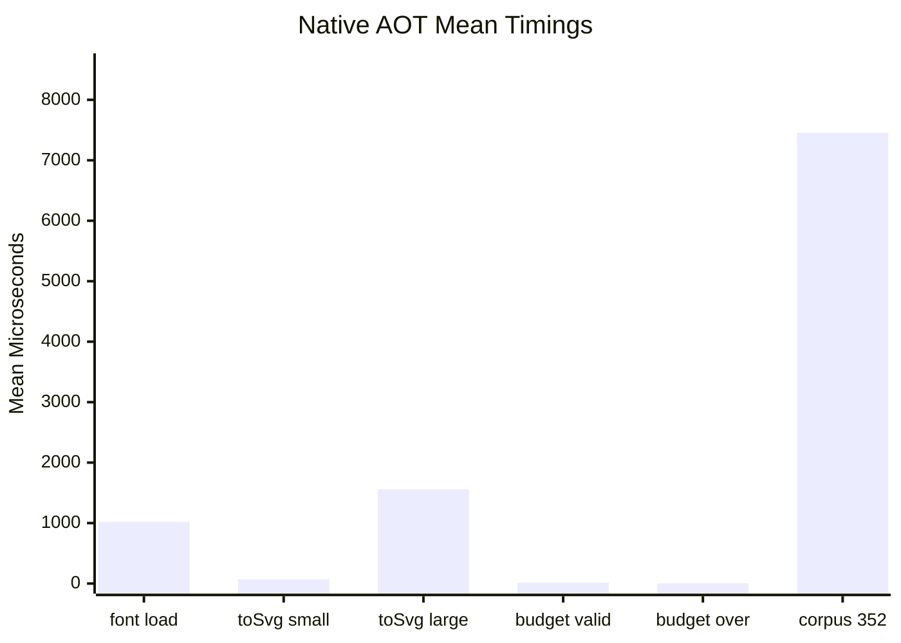

# Benchmarks (Native AOT Baseline)

These timings are measured from a self-compiled native AOT executable built with `dart compile exe tool/benchmark_suite.dart` against the `tex_math` OpenType `MATH` font reader, TeX parser and macro expander, and `DisplayList.toSvg()` pipeline across 352 corpus cases.

Measurements cover OpenType font decoding (`MathFont.fromBytes` on `NewCMMath-Regular.otf`), display-list SVG serialization, `TexMathBudgets` input-guard enforcement, and full-corpus parse and error-parity dispatch. Appendix G OpenType `MATH` layout and Flutter paint benchmarks activate alongside layout and rendering stages.

## Host Environment

| Property | Value |
| :--- | :--- |
| CPU | `Apple M4` |
| Architecture | `arm64` |
| OS | `macos` (`Version 15.6 (Build 24G84)`) |
| Logical Cores | `10` |
| Memory | `32 GiB` |
| Dart SDK | `3.13.5` |
| Corpus Cases | `352` |
| Regression Threshold | `5.0x` baseline mean |

## Measured Native AOT Timings

| Benchmark | Description | Samples x Batch | Mean | Median (p50) | p95 | Min | Max |
| :--- | :--- | ---: | ---: | ---: | ---: | ---: | ---: |
| `math_font_from_bytes` | Decode NewCMMath-Regular.otf SFNT, MATH, cmap, GSUB, and CFF tables via MathFont.fromBytes | `10 x 5` | 1.021 ms | 945.20 us | 1.366 ms | 782.00 us | 1.366 ms |
| `display_list_to_svg_small` | Serialize a 12-item DisplayList to standalone SVG XML | `20 x 400` | 70.75 us | 70.72 us | 83.67 us | 64.41 us | 83.67 us |
| `display_list_to_svg_large` | Serialize a 250-item DisplayList to standalone SVG XML | `20 x 60` | 1.558 ms | 1.529 ms | 1.754 ms | 1.440 ms | 1.754 ms |
| `budget_input_check_valid` | Validate input budgets, parse quadratic formula, and dispatch TexMathEngine.render | `20 x 1500` | 16.02 us | 16.20 us | 19.68 us | 11.81 us | 19.68 us |
| `budget_input_check_exceeded` | Reject oversized 50,001-char input via TexMathBudgetError guard | `20 x 1500` | 3.19 us | 3.29 us | 3.88 us | 2.07 us | 3.88 us |
| `corpus_full_dispatch` | Dispatch all 352 corpus cases through TexMathEngine.render | `20 x 25` | 7.456 ms | 7.446 ms | 8.427 ms | 5.944 ms | 8.427 ms |

## Target Performance Thresholds

The table below lists target end-to-end performance goals for full TeX parsing, OpenType `MATH` layout, and Flutter rendering. Layout and paint workloads remain pending until Appendix G layout and Flutter rendering stages land.

| Workload | Target Threshold | Scope | Status |
| :--- | :--- | :--- | :--- |
| Typical inline expression | `< 50 us` | Full parse, layout, and display list build | Pending (layout) |
| 50-equation notebook page | `< 5 ms` | Full page layout batch across 50 expressions | Pending (layout) |
| Cached first paint | Paint-only cost | Cached display list and theme color update without re-layout | Pending (rendering) |
| OpenType `MATH` font parse | Once per font | SFNT and `MATH` table decode per `MathFont` load | Measured (`math_font_from_bytes`) |

## Running Locally

Run `dart run tool/benchmark_suite.dart --check-regressions` to compile a fresh native AOT binary and compare live timings against `tool/benchmark_baseline.json`, or pass `--update-baseline --update-docs` to record a new baseline.
