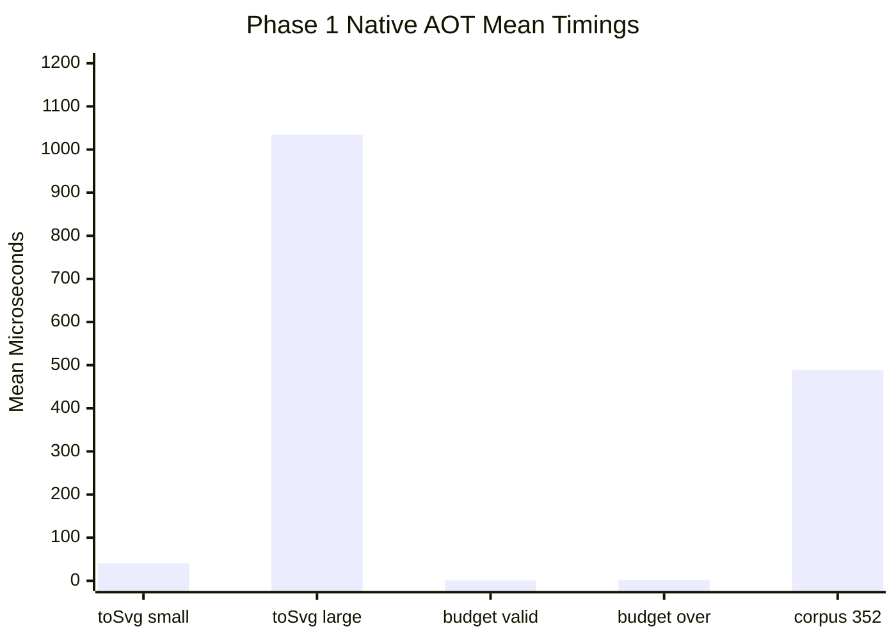

# Benchmarks (Phase 1 Native AOT Baseline)

These timings are measured from a self-compiled native AOT executable built with `dart compile exe tool/benchmark_suite.dart` against the Phase 1 `tex_math` engine and `DisplayList.toSvg()` pipeline across 352 corpus cases.

Phase 1 measurements cover display-list SVG serialization, `TexMathBudgets` input-guard enforcement, and full-corpus dispatch. Full TeX tokenizer, macro expander, and Appendix G OpenType `MATH` layout benchmarks activate in Phases 2–6 against target inline and display latency thresholds.

## Host Environment

| Property | Value |
| :--- | :--- |
| CPU | `Apple M4` |
| Architecture | `arm64` |
| OS | `macos` (`Version 15.6 (Build 24G84)`) |
| Logical Cores | `10` |
| Memory | `32 GiB` |
| Dart SDK | `3.13.5` |
| Corpus Cases | `352` |
| Regression Threshold | `5.0x` baseline mean |

## Measured Phase 1 AOT Timings

| Benchmark | Description | Samples x Batch | Mean | Median (p50) | p95 | Min | Max |
| :--- | :--- | ---: | ---: | ---: | ---: | ---: | ---: |
| `display_list_to_svg_small` | Serialize a 12-item DisplayList to standalone SVG XML | `20 x 400` | 40.28 us | 40.09 us | 42.61 us | 38.90 us | 42.61 us |
| `display_list_to_svg_large` | Serialize a 250-item DisplayList to standalone SVG XML | `20 x 60` | 1.034 ms | 1.015 ms | 1.130 ms | 987.53 us | 1.130 ms |
| `budget_input_check_valid` | Validate input budgets and dispatch Phase 1 TexMathEngine.render stub | `20 x 1500` | 1.45 us | 1.41 us | 1.98 us | 1.36 us | 1.98 us |
| `budget_input_check_exceeded` | Reject oversized 50,001-char input via TexMathBudgetError guard | `20 x 1500` | 1.76 us | 1.63 us | 2.91 us | 1.50 us | 2.91 us |
| `corpus_full_dispatch` | Dispatch all 352 corpus cases through Phase 1 TexMathEngine.render | `20 x 25` | 489.17 us | 481.82 us | 542.80 us | 443.40 us | 542.80 us |

## Target Performance Thresholds (Phases 2–6 — Not Yet Measured)

The table below lists target end-to-end performance goals for full TeX parsing, OpenType `MATH` layout, and Flutter rendering in Phases 2–6. These workloads are not yet implemented in Phase 1 and remain unmeasured until their respective phases land.

| Workload | Target Threshold | Scope | Status |
| :--- | :--- | :--- | :--- |
| Typical inline expression | `< 50 us` | Full parse, layout, and display list build | Pending (Phase 2-6) |
| 50-equation notebook page | `< 5 ms` | Full page layout batch across 50 expressions | Pending (Phase 2-6) |
| Cached first paint | Paint-only cost | Cached display list and theme color update without re-layout | Pending (Phase 2-6) |
| OpenType `MATH` font parse | Once per font | SFNT and `MATH` table decode per `MathFont` load | Pending (Phase 2-6) |

## Running Locally

Run `dart run tool/benchmark_suite.dart --check-regressions` to compile a fresh native AOT binary and compare live timings against `tool/benchmark_baseline.json`, or pass `--update-baseline --update-docs` to record a new baseline.
