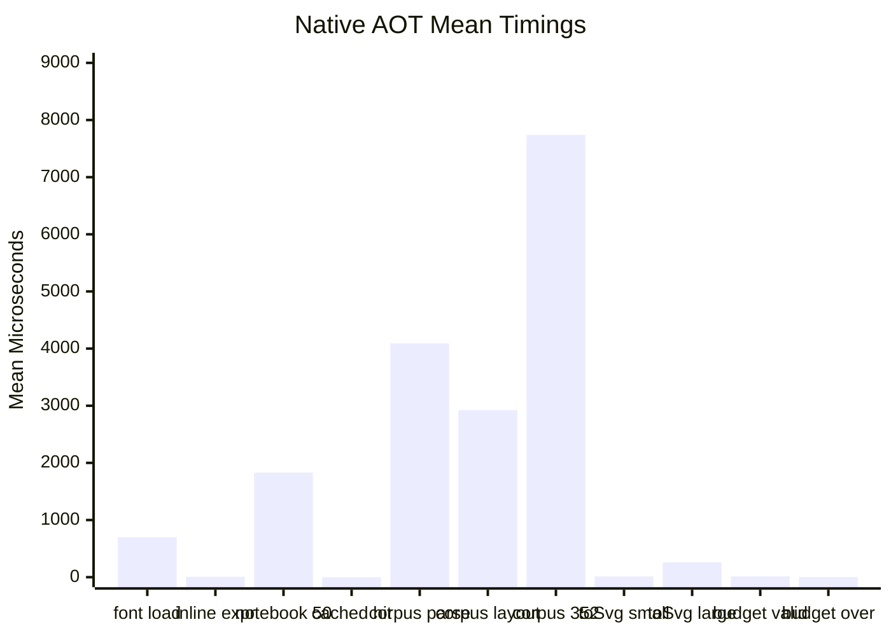

# Benchmarks (Native AOT Baseline)

These timings are measured from a self-compiled native AOT executable built with `dart compile exe tool/benchmark_suite.dart` against the `tex_math` OpenType `MATH` font reader, TeX parser and macro expander, Appendix G layout engine, and `DisplayList.toSvg()` pipeline across 352 corpus cases.

Measurements cover one-time OpenType font decoding (`MathFont.fromBytes` on `NewCMMath-Regular.otf`), representative inline expression layout, 50-equation notebook batch layout, cached display-list retrieval, phase-split corpus parse and layout timings, display-list SVG serialization, and `TexMathBudgets` input-guard enforcement.

## Host Environment

| Property | Value |
| :--- | :--- |
| CPU | `Apple M4` |
| Architecture | `arm64` |
| OS | `macos` (`Version 15.6 (Build 24G84)`) |
| Logical Cores | `10` |
| Memory | `32 GiB` |
| Dart SDK | `3.13.5` |
| Corpus Cases | `352` |
| Regression Threshold | `5.0x` baseline mean |

## Measured Native AOT Timings

| Benchmark | Description | Samples x Batch | Mean | Median (p50) | p95 | Min | Max |
| :--- | :--- | ---: | ---: | ---: | ---: | ---: | ---: |
| `math_font_from_bytes` | Decode NewCMMath-Regular.otf SFNT, MATH, cmap, GSUB, and CFF tables via MathFont.fromBytes | `10 x 5` | 699.00 us | 634.90 us | 1.049 ms | 482.60 us | 1.049 ms |
| `inline_expression_layout` | Parse and lay out representative inline math expressions via TexMathEngine.render | `20 x 1600` | 7.76 us | 7.68 us | 9.42 us | 6.65 us | 9.42 us |
| `notebook_50_equations` | Parse and lay out 50 corpus equations (base, ams, mhchem, stretchy) in batch via TexMathEngine.render | `20 x 40` | 1.830 ms | 1.809 ms | 2.149 ms | 1.589 ms | 2.149 ms |
| `cached_display_list_lookup` | Retrieve cached RenderResult by (source, options, fontId) LRU key with zero re-layout | `20 x 16000` | 0.46 us | 0.45 us | 0.63 us | 0.34 us | 0.63 us |
| `corpus_parse_phase` | Tokenize, expand macros, and parse all 352 corpus cases via TexMathEngine.parse | `20 x 25` | 4.090 ms | 4.071 ms | 4.491 ms | 3.683 ms | 4.491 ms |
| `corpus_layout_phase` | Lay out all 315 valid corpus syntax trees via TexMathEngine.layout | `20 x 25` | 2.925 ms | 2.905 ms | 3.691 ms | 2.455 ms | 3.691 ms |
| `corpus_full_dispatch` | Dispatch all 352 corpus cases end-to-end through TexMathEngine.render | `20 x 25` | 7.740 ms | 7.573 ms | 9.246 ms | 7.045 ms | 9.246 ms |
| `display_list_to_svg_small` | Serialize a 12-item DisplayList to standalone SVG XML | `20 x 400` | 12.66 us | 12.25 us | 18.78 us | 9.81 us | 18.78 us |
| `display_list_to_svg_large` | Serialize a 250-item DisplayList to standalone SVG XML | `20 x 60` | 258.54 us | 267.19 us | 298.42 us | 216.87 us | 298.42 us |
| `budget_input_check_valid` | Validate input budgets, parse, and lay out quadratic formula via TexMathEngine.render | `20 x 1500` | 13.05 us | 12.81 us | 17.71 us | 10.52 us | 17.71 us |
| `budget_input_check_exceeded` | Reject oversized 50,001-char input via TexMathBudgetError guard | `20 x 1500` | 3.35 us | 3.45 us | 4.40 us | 1.88 us | 4.40 us |

## Target vs Measured Performance

The table below compares target performance budgets against live native AOT measurements across parsing, OpenType `MATH` layout, and cached expression retrieval. Flutter `TexMathPathCache` + `TexMathTheme` zero-relayout repaint and `TexMathIsolateLayouter` background caching are also verified by `packages/tex_math_flutter` widget tests.

| Workload | Target | Measured (Mean / p95) | Scope | Status |
| :--- | :--- | ---: | :--- | :--- |
| Typical inline expression | `< 50 us` | `7.76 us` / `9.42 us` | Full parse, layout, and display list build (`inline_expression_layout`; quadratic `13.05 us` in `budget_input_check_valid`) | PASS |
| 50-equation notebook page | `< 5 ms` | `1.830 ms` / `2.149 ms` | Batch parse and layout across 50 corpus equations spanning `base`, `ams`, `mhchem`, and `stretchy` (`notebook_50_equations`) | PASS |
| Cached lookup & zero-relayout repaint | Paint-only cost | `0.46 us` / `0.63 us` | Repeat `(source, options, fontId)` retrieval (`cached_display_list_lookup`); Flutter `TexMathPathCache` + `TexMathTheme` zero-relayout repaint and `TexMathIsolateLayouter` cache verified by `packages/tex_math_flutter` widget tests | PASS |
| OpenType `MATH` font parse | Once per font | `699.00 us` / `1.049 ms` | One-time SFNT, `MATH`, `cmap`, `GSUB`, and `CFF` decode per `MathFont` load (`math_font_from_bytes`) | PASS |

## Running Locally

Run `dart run tool/benchmark_suite.dart --check-regressions` to compile a fresh native AOT binary and compare live timings against `tool/benchmark_baseline.json`, or pass `--update-baseline --update-docs` to record a new baseline.
