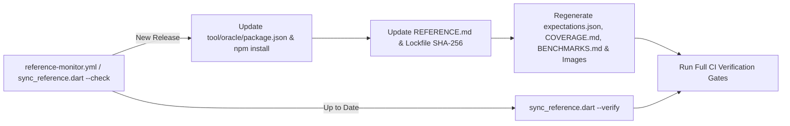

# Reference Synchronization Guide

`tex_math` targets layout, grammar, package, and error parity with pinned upstream **MathJax** and **JupyterLab** MathJax configuration baselines. Every upstream dependency pin, commit digest, package tier mapping, and oracle lockfile hash is recorded in [`REFERENCE.md`](../REFERENCE.md), which serves as the single source of truth across CI, documentation, and verification tooling.

---

## 1. Tracked Upstream Artifacts

The reference table in [`REFERENCE.md`](../REFERENCE.md) records the pinned versions and integrity metadata checked by `tool/sync_reference.dart` and `tool/check_versions.dart`:

* **`mathjax` & `@mathjax/src`**: Pinned MathJax TeX input grammar, package definitions (`ts/input/tex/`), and SVG output engine, paired with exact upstream release tags and commit SHAs.
* **`@mathjax/mathjax-newcm-font`**: MathJax New Computer Modern font tables and SVG glyph data used by the differential oracle.
* **`@jupyterlab/mathjax-extension`**: Pinned JupyterLab baseline tracking the 31 default TeX packages (`TEX_PACKAGES` in `packages/mathjax-extension/src/tex.ts`) plus preloaded `\require` extensions.
* **`katex`**: Pinned side-by-side comparison reference used only inside `studio/` (not a parity target for `tex_math`).
* **`NewCMMath-Regular.otf`**: Bundled default OpenType `MATH` font and its accompanying GUST Font License under `packages/tex_math_flutter/assets/fonts/`.
* **`tool/oracle/package-lock.json` SHA-256**: Cryptographic digest ensuring `npm ci` inside `tool/oracle/` resolves an identical JavaScript dependency graph locally and in CI.

---

## 2. Automated Verification & Release Monitoring

### Integrity Verification (`--verify`)

`tool/sync_reference.dart --verify` parses [`REFERENCE.md`](../REFERENCE.md), checks that `mathjax`, `@mathjax/src`, `@mathjax/mathjax-newcm-font`, and `katex` match the exact versions in `tool/oracle/package.json`, and verifies the computed SHA-256 digest of `tool/oracle/package-lock.json` against the documented hash:

```bash
dart run tool/sync_reference.dart --verify
```

CI executes this check on every push and pull request in `.github/workflows/ci.yml`, exiting non-zero on any version mismatch or lockfile hash drift.

### Upstream Registry Checks (`--check`)

To query the npm registry for newer releases of `mathjax` and `@jupyterlab/mathjax-extension` relative to [`REFERENCE.md`](../REFERENCE.md):

```bash
dart run tool/sync_reference.dart --check
dart run tool/sync_reference.dart --check --json
```

With `--json`, the command emits structured output containing `hasUpdate`, `pinnedMathjax`, `latestMathjax`, `pinnedJupyterlab`, `latestJupyterlab`, `mathjax`, and `jupyterlabMathjax` fields.

### Scheduled Reference Monitor Workflow

`.github/workflows/reference-monitor.yml` runs `dart tool/sync_reference.dart --check --json` on a weekly schedule (`0 13 * * 1` UTC) and via manual `workflow_dispatch`. When `hasUpdate` is `true`, the workflow opens a deduplicated repository issue titled `chore(reference): sync mathjax <latestMathjax> / jupyterlab <latestJupyterlab>` if no open issue with that title exists.

---

## 3. Synchronization Procedure

When adopting a new MathJax or JupyterLab release, execute the steps below in order (also summarized in `.agents/skills/sync-reference-mathjax/SKILL.md`).



### Step 1: Audit Upstream Changes

1. Inspect the upstream release notes and source tree of `mathjax/MathJax` and `mathjax/MathJax-src` (`ts/input/tex/`) for added or modified TeX packages, macro behavior, error classes, and font table updates.
2. Inspect `jupyterlab/jupyterlab` (`packages/mathjax-extension/package.json` and `packages/mathjax-extension/src/tex.ts`) to confirm whether the default `TEX_PACKAGES` list or preloaded `\require` packages changed.

### Step 2: Update `tool/oracle/` Pins & Lockfile

1. Update exact dependency versions in `tool/oracle/package.json` for `mathjax`, `@mathjax/src`, `@mathjax/mathjax-newcm-font` (and `katex` if updating the studio comparison reference).
2. Regenerate the lockfile and compute its SHA-256 digest:

```bash
(cd tool/oracle && npm install)
shasum -a 256 tool/oracle/package-lock.json
```

3. Verify `tool/oracle/render.mjs` runs cleanly against the updated `@mathjax/src` and `@mathjax/mathjax-newcm-font` ESM exports and still extracts box metrics, `<use data-c="...">` glyphs, `<rect>` rules, and `TexError` metadata accurately.

### Step 3: Update `REFERENCE.md`

Update [`REFERENCE.md`](../REFERENCE.md) with:

* Exact new version pins (`mathjax`, `@mathjax/src`, `@mathjax/mathjax-newcm-font`, `@jupyterlab/mathjax-extension`, `katex` if changed).
* Upstream release tag names and commit SHAs.
* Any updated package inventory lists or Tier 1/2/3 mappings.
* The exact lowercase hex SHA-256 digest of `tool/oracle/package-lock.json`.

### Step 4: Regenerate Expectations, Coverage, Benchmarks & Doc Images

Add or adjust `.tex` test fixtures under `corpus/` if upstream additions introduce new TeX packages or edge cases, then regenerate all derived artifacts from the workspace root:

```bash
dart run tool/verify_against_mathjax.dart --update-expectations
dart run tool/coverage_report.dart
dart run tool/benchmark_suite.dart --update-docs --update-baseline
dart run tool/generate_doc_images.dart
```

If [`doc/COVERAGE.md`](COVERAGE.md) totals or [`doc/BENCHMARKS.md`](BENCHMARKS.md) metrics changed, update the summary tables in [`README.md`](../README.md), [`packages/tex_math/README.md`](../packages/tex_math/README.md), and [`packages/tex_math_flutter/README.md`](../packages/tex_math_flutter/README.md) so they match verbatim.

### Step 5: Verify All Workspace Gates

Run every quality gate before committing the reference update:

```bash
dart format --output=none --set-exit-if-changed packages tool studio
dart analyze --fatal-infos
(cd packages/tex_math && dart test && dart run example/main.dart && dart doc --dry-run)
(cd packages/tex_math_flutter && flutter test)
(cd packages/tex_math_flutter/example && flutter test)
(cd studio && flutter test)
dart run tool/check_versions.dart
dart run tool/verify_against_mathjax.dart
dart run tool/sync_reference.dart --verify
dart run tool/generate_doc_images.dart --check
dart run tool/benchmark_suite.dart --check-regressions
```
