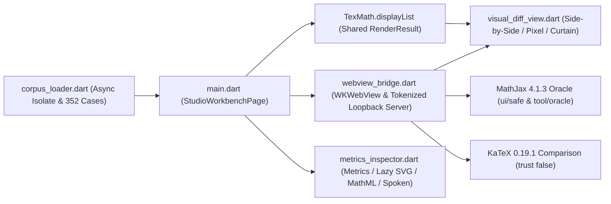

# Comparison Studio Guide

**`tex_math_studio`** (`studio/`) is a macOS Flutter workbench for interactive three-way visual and metric comparison across **`tex_math`**, the **MathJax `4.1.3`** reference oracle, and **KaTeX `0.19.1`**. Contributors can browse all 352 corpus cases, edit TeX live, switch display vs. inline mode, toggle light/dark themes, compute per-pixel RGBA diffs, inspect interactive curtain wipes, and examine `DisplayMetrics`, SVG, Presentation MathML, and spoken text exports.

---

## 1. Architecture & Modules



### Workbench Entry Point (`studio/lib/main.dart`)

`TexMathStudioApp` and `StudioWorkbenchPage` coordinate the workbench UI:

* **AppBar & Toolbar**: Corpus sidebar toggle, light/dark `TexMathTheme` toggle, `SegmentedButton<TexMathDisplayMode>` (`Display` vs. `Inline`), `SegmentedButton<StudioComparisonMode>` (`Side-by-Side`, `Pixel Diff`, `Curtain Diff`), and quick-select `ActionChip` presets.
* **Single-Pass Shared Inspection**: `StudioWorkbenchPage` computes `StudioInspectionResult` once per source, option, or font update outside `build()` and feeds its laid-out `DisplayList` directly to `TexMath.displayList(...)` so the equation is not rendered twice.
* **Capture Lifecycle & Debug Automation**: Editing TeX source or toggling display mode, theme brightness, or `diffTarget` automatically invalidates `_capturedPair` (`null`) so stale captures never bleed across comparisons. Font-load errors surface in both the `tex_math` pane and `StudioMetricsInspector`, and `TEX_MATH_STUDIO_CAPTURE_SPEC` capture automation is gated strictly behind `kDebugMode`.

### Async 352-Case Corpus Browser (`studio/lib/corpus_loader.dart`)

* **Non-Blocking Corpus Load (`StudioCorpusLoader.loadAsync`)**: `StudioWorkbenchPage` boots immediately with `StudioCorpusCatalog.embeddedFallback()` while `StudioCorpusLoader.loadAsync()` discovers the workspace root (`findRepositoryRoot`), parses all `352` `.tex` fixtures, and merges `corpus/expectations.json` off the UI thread via `Isolate.run`.
* **Precomputed Filtering & Grouping**: `StudioCorpusEntry` precomputes lowercase search text and exposes unmodifiable package lists; `StudioWorkbenchPage` caches filtered/grouped sidebar rows across tier (`canonicalCorpusTiers`), `StudioCorpusAcceptanceFilter`, and `StudioCorpusGrouping` selections outside `build()`.

### Tokenized Loopback Server & `WKWebView` Bridge (`studio/lib/webview_bridge.dart`)

* **Runtime Asset Discovery (`StudioOracleAssetLocator`)**: Locates gitignored `tool/oracle/node_modules/` assets (`mathjax/tex-svg.js`, TeX extensions, `@mathjax/mathjax-newcm-font/svg/dynamic/`, `katex/dist/katex.min.js`, `katex.min.css`, `contrib/mhchem.min.js`) without bundling third-party JS into `studio/` or `packages/`.
* **Tokenized Loopback HTTP Server (`StudioLocalAssetServer`)**: Coalesces concurrent `start()` calls cleanly via `_startFuture` (handling mid-bind `close()` safely) on `127.0.0.1:<port>` and scopes every harness and asset URL under `/s/<sessionToken>/...` (`24`-byte `Random.secure()` token). Validates `Host` (`127.0.0.1:<port>` or `localhost:<port>`), omits wildcard CORS headers, attaches `Content-Security-Policy`, `X-Content-Type-Options: nosniff`, `Referrer-Policy: no-referrer`, and `Cache-Control: no-store`, and blocks `%2f`/`%5c`/`\`/NUL traversal and escaping symlinks via `resolveSymbolicLinksSync()`.
* **Hardened `WkWebViewStudioPaneController`**: Loads MathJax `4.1.3` `ui/safe` (`safeOptions` disabling `file:`, `javascript:`, and `data:`), restricts `packages` via `allowedMathJaxPackages` (excluding `texhtml`), configures KaTeX with `trust: false`, locks navigation via `NavigationDelegate.onNavigationRequest` (`evaluateNavigationRequest`) strictly to the active main-frame loopback harness URL, tracks monotonic render sequence IDs (`seq` / `__latestRenderSeq`) with `try/catch` around `runJavaScript`, and checks `_disposed` after every `await`. When `WebViewPlatform.instance` is absent (headless `flutter test`), `HeadlessOraclePaneController` provides deterministic telemetry.
* **RGBA Capture**: `captureRepaintBoundaryRgba` captures `tex_math` at `pixelRatio = 2.0`, while `WkWebViewStudioPaneController.captureRgba` rasterizes MathJax SVG or KaTeX markup and decodes PNG bytes into `StudioCapturedImage` RGBA8888 buffers.

### Visual Comparison & Diff Modes (`studio/lib/visual_diff_view.dart`)

`StudioComparisonView` supports three visualization modes:

* **Side-by-Side (`StudioComparisonMode.sideBySide`)**: Displays **`tex_math (Pure Dart)`**, **`MathJax 4.1.3 Oracle`**, and **`KaTeX 0.19.1 Comparison`** side by side (KaTeX is a comparison reference only, not a parity contract).
* **Pixel Diff (`StudioComparisonMode.pixelDiff`)**: Selects `StudioDiffTarget.mathJax` or `StudioDiffTarget.katex`, guards diff recomputation by `(pair, backgroundColor, channelTolerance)` equality, offloads `alignCapturedPair` + `computePixelDiff` (`channelTolerance` `0`, `8`, or `24`) to `Isolate.run` (`computeAlignedPixelDiffAsync`) when image area exceeds `4096` pixels, disposes superseded `ui.Image` batches cleanly, and highlights mismatched pixels in magenta (`#FFFF00FF`).
* **Curtain Diff (`StudioComparisonMode.curtainDiff`)**: When no capture pair is active, prompts `"Capture for Curtain Diff"` rather than clipping or reparenting live `WKWebView` platform views; once captured, provides a draggable vertical wipe (`_CurtainClipper`) and bottom `Slider` (`0%`–`100%`).

### Metrics & Lazy Export Inspector (`studio/lib/metrics_inspector.dart`)

`inspectTexExpression` evaluates the active expression once into `StudioInspectionPending`, `StudioInspectionSuccess`, or `StudioInspectionFailure`. `StudioMetricsInspector` renders four tabs (`Metrics`, `SVG`, `MathML`, `Spoken`), computing `svgXml`, `mathMl`, and `spokenText` lazily on tab access with one-click clipboard copy.

---

## 2. Running Tests & Launching Studio

### Prerequisites & Headless Tests

```bash
flutter pub get
(cd tool/oracle && npm ci)
(cd studio && flutter test)
```

`studio/test/widget_test.dart` verifies `computePixelDiff`, `alignCapturedPair`, `computeAlignedPixelDiffAsync`, `StudioCorpusLoader` and embedded fallback, `StudioLocalAssetServer` concurrent `start()`, token auth, `Host`/CSP headers, and traversal rejection, `WkWebViewStudioPaneController` navigation locking, render sequence guards, and disposal safety, `_capturedPair` invalidation, `inspectTexExpression`, and headless workbench widget flows (`800x600` and `1280x800`).

### Launching on macOS Desktop

```bash
(cd studio && flutter run -d macos)
```

`studio/macos/` ships the desktop macOS runner (`studio/macos/Runner/*.entitlements` disables `com.apple.security.app-sandbox` solely so this local developer workbench can read repository `corpus/` fixtures and gitignored `tool/oracle/node_modules/` assets directly from disk).

---

## 3. Direct CLI Comparison with the MathJax Oracle

For headless box-metric, glyph-position, and error-class comparisons outside the GUI, pipe JSON cases into `tool/oracle/render.mjs` from the repository root (`texhtml` is disabled unless `--allow-texhtml` is passed, and dynamic module loads are restricted to known `[tex]/...` packages and `@mathjax/` font chunks):

```bash
printf '[{"id":"sample","tex":"\\\\frac{a + b}{c - d}","display":true}]' | node tool/oracle/render.mjs --include-svg
```

* **Input Array**: Each object accepts `id`, `tex`, `display`, and optional `packages` (defaulting to the 29 active JupyterLab packages excluding `noerrors` and `noundefined`).
* **Output Object**: Returns `{ mathjaxVersion: "4.1.3", font: "mathjax-newcm", results: [...] }` with `accepted`, `errorClass`, `errorMessage`, `box`, `glyphs`, `rules`, and optional `svg`.

To run the full 352-case differential verification suite across all tiers:

```bash
dart run tool/verify_against_mathjax.dart
```
