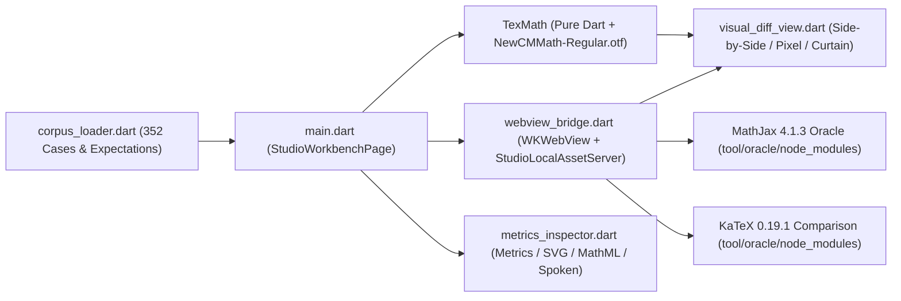

# Comparison Studio Guide

**`tex_math_studio`** (`studio/`) is a macOS Flutter workbench for interactive three-way visual and metric comparison across **`tex_math`**, the **MathJax `4.1.3`** reference oracle, and **KaTeX `0.19.1`**. Contributors can browse all 352 corpus cases, edit TeX live, switch display vs inline math mode, toggle light/dark themes, compute per-pixel RGBA diffs, inspect interactive curtain wipes, and examine `DisplayMetrics`, SVG, Presentation MathML, and spoken text exports.

---

## 1. Architecture & Modules



### Workbench Entry Point (`studio/lib/main.dart`)

`TexMathStudioApp` and `StudioWorkbenchPage` coordinate the studio interface:

* **AppBar Controls**: Toggle button for the corpus browser sidebar, light/dark `TexMathTheme` toggle, and a `SegmentedButton<TexMathDisplayMode>` switching between `TexMathDisplayMode.display` (`$$...$$`) and `TexMathDisplayMode.inline` (`$...$`).
* **Toolbar & Presets**: `SegmentedButton<StudioComparisonMode>` switching between `Side-by-Side`, `Pixel Diff`, and `Curtain Diff`, paired with quick-select `ActionChip` presets (`\frac{a + b}{c - d}`, `\int_{-\infty}^{\infty} e^{-x^2}\,dx = \sqrt{\pi}`, `\begin{pmatrix} 1 & 0 \\ 0 & 1 \end{pmatrix}`, `\ce{CO2 + C -> 2CO}`, and `\undefinedcmd`).
* **Live TeX Source Editor**: Monospace multiline `TextField` dispatching synchronized updates to `TexMath`, the `MathJax 4.1.3` and `KaTeX 0.19.1` `WKWebView` panes, and `StudioMetricsInspector`.

### 352-Case Corpus Browser (`studio/lib/corpus_loader.dart`)

* **`findRepositoryRoot` & `StudioCorpusLoader.load`**: Discovers the workspace root dynamically relative to `Directory.current` or `Platform.resolvedExecutable` without hardcoded filesystem paths, parses all `352` `.tex` test fixtures under `corpus/`, and merges `corpus/expectations.json` status (`pass`, `differs`, `refused_match`) alongside oracle bounding boxes (`oracleBoxWidthEm`, `oracleBoxHeightEm`, `oracleBoxDepthEm`). When launched outside the repository tree, `StudioCorpusCatalog.embeddedFallback()` supplies built-in sample expressions covering all tiers.
* **Filtering & Grouping**: Supports full-text query filtering (`matchesQuery`), tier filtering across `canonicalCorpusTiers` (`Tier 1`, `Tier 2`, `Tier 3`, `Stretchy`, `Notebooks`, `Errors`), acceptance filtering (`StudioCorpusAcceptanceFilter`: `All`, `Accepted`, `Refused`), and grouping via `StudioCorpusGrouping` (`By Tier`, `By Package`, `By Acceptance`). Selecting a corpus entry populates the TeX editor, sets its `TexMathDisplayMode`, and activates any entry-specific package list.

### macOS `WKWebView` Bridge & Local Asset Server (`studio/lib/webview_bridge.dart`)

* **Runtime Asset Discovery (`StudioOracleAssetLocator`)**: Resolves `tool/oracle/node_modules/` relative to the repository root (`mathjax/tex-svg.js`, MathJax TeX extensions, `@mathjax/mathjax-newcm-font/svg/dynamic/`, `katex/dist/katex.min.js`, `katex.min.css`, and `contrib/mhchem.min.js`). Third-party JavaScript and web font packages stay gitignored under `tool/oracle/node_modules/` and are never committed into `studio/` or referenced from `packages/tex_math` or `packages/tex_math_flutter`.
* **Loopback HTTP Server (`StudioLocalAssetServer`)**: Binds `HttpServer.bind(InternetAddress.loopbackIPv4, 0)` on an ephemeral port (`http://127.0.0.1:<port>`), serving offline HTML5 harnesses (`/mathjax-harness.html` and `/katex-harness.html` built by `StudioWebHarnessBuilder`) plus static JS, CSS, and font files with path-traversal protection (`resolveAssetFile`).
* **Injectable Pane Controllers (`StudioWebPaneController`)**: `WkWebViewStudioPaneController` runs MathJax `4.1.3` and KaTeX `0.19.1` inside macOS `WKWebView` (`webview_flutter` + `webview_flutter_wkwebview`) over the `StudioBridge` JavaScript channel. When no platform `WebViewPlatform` is registered (such as headless `flutter test`), `HeadlessOraclePaneController` provides deterministic preview state and telemetry.
* **RGBA Capture**: `captureRepaintBoundaryRgba` captures the `tex_math` `RepaintBoundary` at `pixelRatio = 2.0`, while `WkWebViewStudioPaneController.captureRgba` calls `window.studioRequestCapture` to rasterize MathJax SVG or KaTeX DOM markup via an in-page canvas and decodes the PNG payload into packed `StudioCapturedImage` RGBA8888 bytes.

### Visual Comparison & Diff Modes (`studio/lib/visual_diff_view.dart`)

`StudioComparisonView` supports three interactive visualization modes:

* **Side-by-Side (`StudioComparisonMode.sideBySide`)**: Three equal comparison columns for **`tex_math (Pure Dart)`**, **`MathJax 4.1.3 Oracle`**, and **`KaTeX 0.19.1 Comparison`** (KaTeX is a comparison reference only, not a parity contract for `tex_math`).
* **Pixel Diff (`StudioComparisonMode.pixelDiff`)**: Selects a target (`StudioDiffTarget.mathJax` or `StudioDiffTarget.katex`), pads differing image dimensions with `alignCapturedPair`, computes per-pixel RGBA deltas via `computePixelDiff(Uint8List a, Uint8List b, int width, int height, {int channelTolerance = 0})` across selectable tolerances (`0`, `8`, `24`), highlights mismatched pixels in magenta (`#FFFF00FF`), and displays Match %, Diff Pixels count, Max Delta, dimensions, and three preview frames (`tex_math Capture`, target capture, and `RGBA Diff (Magenta)`).
* **Curtain Diff (`StudioComparisonMode.curtainDiff`)**: Interactive vertical wipe overlay (`_CurtainClipper`) draggable via pointer gestures or controlled by a bottom `Slider` (`0%`–`100%`), comparing `tex_math` on the left against the selected reference engine on the right.

### Metrics & Export Inspector (`studio/lib/metrics_inspector.dart`)

`inspectTexExpression` evaluates the active source synchronously using `TexMathEngine` and the bundled `NewCMMath-Regular.otf` font loaded via `TexMathFontBundle.loadMathFont()`, returning `StudioInspectionPending`, `StudioInspectionSuccess`, or `StudioInspectionFailure`. `StudioMetricsInspector` exposes four tabs:

* **`Metrics`**: Displays `widthEm`, `heightEm`, `depthEm`, `baselineEm`, `GlyphItem` / `RuleItem` / `AnchorItem` / `BreakHints` counts, and `Oracle Δ(w,h,d)` when a corpus entry is active, or `TexMathErrorClass` and diagnostic message on failure.
* **`SVG`**: Standalone XML output from `RenderResult.toSvg(...)` with clipboard copy button.
* **`MathML`**: Presentation MathML markup from `RenderResult.toMathMl()` with clipboard copy button.
* **`Spoken`**: Natural-language spoken text from `RenderResult.toSpokenText()` with clipboard copy button.

---

## 2. Running Tests & Launching Studio

### Prerequisites

Install workspace Dart/Flutter dependencies at the repository root and install the Node.js oracle bundles under `tool/oracle/`:

```bash
flutter pub get
(cd tool/oracle && npm ci)
```

### Running Headless Studio Tests

Verify the pure-Dart pixel-diff unit tests, 352-case corpus loader tests, loopback asset server tests, and headless widget workbench tests inside `studio/`:

```bash
(cd studio && flutter test)
```

`studio/test/widget_test.dart` verifies `computePixelDiff` and `alignCapturedPair` arithmetic, 352-case `StudioCorpusLoader` parsing and embedded fallback, `StudioLocalAssetServer` loopback serving and path-traversal rejection, `inspectTexExpression` success/error snapshots, and headless widget interaction at `800x600` and `1280x800` (3-way panes, live TeX editing, display/inline toggle, light/dark `TexMathTheme` toggle, corpus filtering/selection, `Pixel Diff` and `Curtain Diff` modes, export tabs, and `TexMathErrorWidget` error diagnostics).

### Running Studio as a macOS Desktop Application

`studio/` ships as a workspace Flutter package without committed platform build trees (`macos/`, `linux/`, `windows/`). To launch the interactive `WKWebView` desktop workbench locally on macOS, generate the local runner files and run targeting `macos` inside `studio/`:

```bash
cd studio
flutter create --platforms=macos .
flutter run -d macos
```

---

## 3. Direct CLI Comparison with the MathJax Oracle

For headless box-metric, glyph-position, and error-class comparisons outside the GUI, pipe JSON cases directly into `tool/oracle/render.mjs` from the repository root:

```bash
printf '[{"id":"sample","tex":"\\\\frac{a + b}{c - d}","display":true}]' | node tool/oracle/render.mjs --include-svg
```

### Oracle Input & Output Fields

* **Input Array**: Each object accepts `id` (string), `tex` (TeX source string), `display` (boolean), and optional `packages` (array of MathJax TeX package names; defaults to the 29 active JupyterLab packages excluding `noerrors` and `noundefined`).
* **Output Object**: Returns `{ mathjaxVersion: "4.1.3", font: "mathjax-newcm", results: [...] }` where each item reports `accepted`, `errorClass`, `errorMessage`, `box` (`width`, `height`, `depth` in ems), `glyphs` (`codePoint`, `x`, `y`, `scaleX`, `scaleY`), `rules` (`x`, `y`, `width`, `height`), and optional `svg` when `--include-svg` is passed.

To evaluate the full 352-case verification suite and inspect parity metrics across all tiers, run:

```bash
dart run tool/verify_against_mathjax.dart
```
