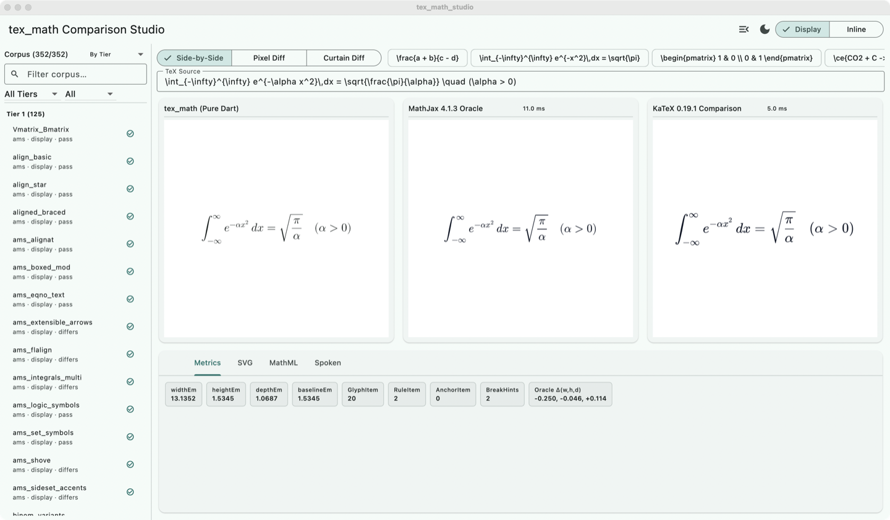
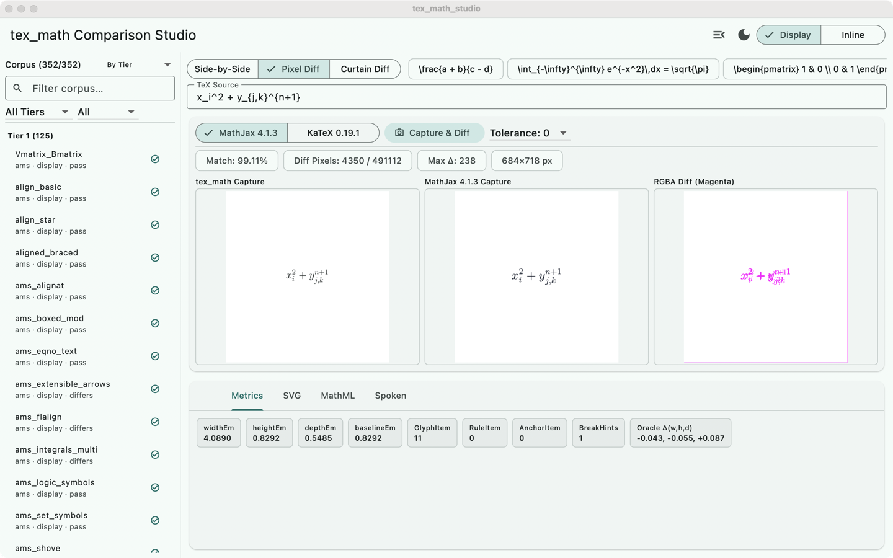
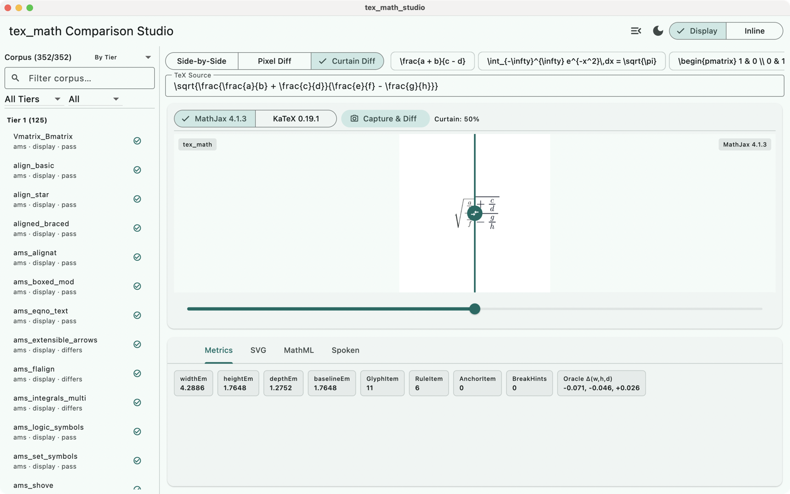
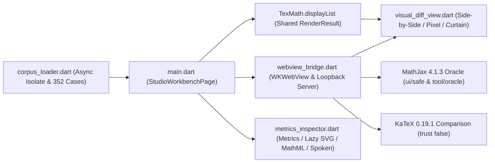

# Comparison Studio Guide

**`tex_math_studio`** (`studio/`) is a macOS Flutter workbench for three-way visual and metric comparison across `tex_math`, MathJax 4.1.3, and KaTeX 0.19.1. Contributors can browse all 352 corpus cases, edit TeX interactively, switch display and inline modes, toggle light and dark themes, inspect per-pixel diffs, drag curtain wipes, and examine bounding-box metrics alongside SVG, MathML, and spoken-text exports.

---

## 1. Visual Comparison Modes

The top toolbar switches between three comparison views (`Side-by-Side`, `Pixel Diff`, and `Curtain Diff`) while quick-select preset chips and the live `TeX Source` field update every pane immediately. Toggling display mode (`Display` vs. `Inline`), changing theme brightness, editing the expression, or switching diff targets invalidates any previous raster capture automatically so stale images never linger across comparisons.

### Side-by-Side Mode

Side-by-Side mode renders the active formula live across **`tex_math (Pure Dart)`**, **`MathJax 4.1.3 Oracle`**, and **`KaTeX 0.19.1 Comparison`**, displaying render latency above the external panes. KaTeX is included purely as a visual comparison reference rather than a parity target.



### Pixel Diff Mode

Pixel Diff mode compares a high-DPI capture of the `tex_math` widget against either **MathJax `4.1.3`** or **KaTeX `0.19.1`**. Click **Capture & Diff** to rasterize both panes, select a channel tolerance (`Tolerance: 0`, `8`, or `24`), and inspect the resulting match percentage, differing pixel count, maximum channel delta, and pixel dimensions alongside an RGBA diff image highlighting mismatches in magenta (`#FFFF00FF`). Captures larger than `4096` pixels align and diff in a background isolate so the UI stays responsive.



### Curtain Diff Mode

Curtain Diff mode overlays two captured panes behind an interactive vertical divider so you can inspect subtle baseline shifts, script offsets, or delimiter heights in place. When no capture exists for the current formula, Studio prompts you with **Capture for Curtain Diff** instead of clipping live platform web views; once captured, drag the vertical divider handle or adjust the bottom slider from `0%` to `100%`.



---

## 2. Corpus Browser & Keyboard Navigation

The collapsible left sidebar loads all 352 `.tex` corpus fixtures and `corpus/expectations.json` metadata off the UI thread while starting immediately with embedded fallback presets. Use the search box, tier dropdown, acceptance filter (All, Accepted, or Refused), and grouping menu (By Tier, By Package, or By Acceptance) to narrow down test cases.

Selecting or focusing any corpus entry enables full **keyboard navigation** through the visible list:

| Key | Action |
| :--- | :--- |
| `ArrowDown` / `ArrowUp` | Move to the next or previous corpus entry, skipping group headers automatically. |
| `PageDown` / `PageUp` | Jump forward or backward by 10 entries in the filtered list. |
| `Home` / `End` | Jump directly to the first or last visible corpus entry. |

Keyboard navigation keeps the selected row scrolled cleanly into view and leaves the search field and `TeX Source` editor unaffected when those text fields have focus.

---

## 3. Inspector Tabs (`Metrics`, `SVG`, `MathML`, `Spoken`)

The bottom diagnostic panel shares the active expression's single parsed and laid-out result with the `tex_math` preview so expressions are never rendered twice. Switching tabs computes exports lazily on demand and provides one-click clipboard copy:

| Tab | Contents |
| :--- | :--- |
| **Metrics** | Displays `widthEm`, `heightEm`, `depthEm`, `baselineEm`, item counts (`GlyphItem`, `RuleItem`, `AnchorItem`), `BreakHints`, and live `Oracle Δ(w,h,d)` deltas when a corpus entry includes oracle box expectations. |
| **SVG** | Serializes standalone XML SVG output on demand for the active expression and theme colors. |
| **MathML** | Generates Presentation MathML markup from the parsed syntax tree. |
| **Spoken** | Generates natural-language spoken math text matching the accessibility label exposed to Flutter screen readers. |

---

## 4. Architecture & Security Controls



| Module | Responsibilities & Hardening |
| :--- | :--- |
| `studio/lib/main.dart` | Coordinates workbench state, single-pass shared inspection, corpus keyboard navigation, capture invalidation, font-load error display, and debug-only capture automation. |
| `studio/lib/corpus_loader.dart` | Discovers the repository root (`findRepositoryRoot`), parses all 352 `.tex` fixtures via `Isolate.run`, precomputes lowercase search text, and merges oracle expectations. |
| `studio/lib/webview_bridge.dart` | Serves local `tool/oracle/node_modules/` JS assets over a coalesced `127.0.0.1` loopback HTTP server (`StudioLocalAssetServer`) scoped by a per-session 24-byte `Random.secure()` token. Validates `Host` headers, enforces strict CSP and `nosniff` headers, rejects path traversal and escaping symlinks, configures MathJax `ui/safe` and KaTeX `trust: false`, locks `WKWebView` navigation to the active harness URL, and guards out-of-order async renders with monotonic sequence IDs. |
| `studio/lib/visual_diff_view.dart` | Manages Side-by-Side, Pixel Diff, and Curtain Diff views; caches diff results by capture pair, background color, and tolerance; offloads alignment and pixel diffing (`computeAlignedPixelDiffAsync`) to `Isolate.run`; and disposes superseded `ui.Image` handles cleanly. |
| `studio/lib/metrics_inspector.dart` | Wraps inspection outcomes (`StudioInspectionPending`, `StudioInspectionSuccess`, `StudioInspectionFailure`) and evaluates SVG, MathML, and spoken exports lazily per tab. |

---

## 5. Running Tests & Launching Studio

### Prerequisites & Headless Tests

Install workspace packages and oracle JavaScript assets from the repository root (`studio/` requires Flutter `>=3.47.0` and Dart `^3.13.0`), then run the Studio test suite (headless runs use `HeadlessOraclePaneController` when no native WebView platform is attached):

```bash
flutter pub get
(cd tool/oracle && npm ci)
(cd studio && flutter test)
```

### Launching on macOS Desktop

```bash
(cd studio && flutter run -d macos)
```

The macOS runner (`studio/macos/Runner/*.entitlements`) disables Apple App Sandbox solely so this local developer workbench can read repository `corpus/` fixtures and gitignored `tool/oracle/node_modules/` assets directly from disk.

---

## 6. Direct CLI Comparison with the MathJax Oracle

For headless box-metric, glyph-position, and error-class checks outside the GUI, pipe JSON cases into `tool/oracle/render.mjs` from the repository root. Each input object accepts `id`, `tex`, `display`, and an optional package list. Packages default to the 29 active JupyterLab extensions excluding noerrors and noundefined, while `texhtml` stays disabled unless `--allow-texhtml` is passed:

```bash
printf '[{"id":"sample","tex":"\\\\frac{a + b}{c - d}","display":true}]' | node tool/oracle/render.mjs --include-svg
```

To verify all 352 corpus cases across every tier against both live MathJax and `corpus/expectations.json`, run:

```bash
dart run tool/verify_against_mathjax.dart
```
