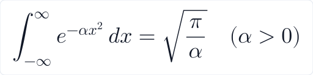
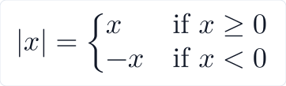
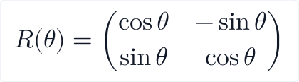
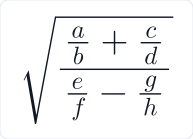
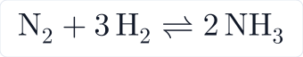

# tex_math

[](https://pub.dev/packages/tex_math) [](https://github.com/tkinnis/tex_math/actions/workflows/ci.yml) [](https://tkinnis.github.io/tex_math/) [](https://github.com/tkinnis/tex_math/blob/main/REFERENCE.md) [](LICENSE)

Pure-Dart TeX math parser, OpenType math layout engine, and standalone SVG, Presentation MathML, and spoken-text renderer aligned with MathJax `4.1.3` and JupyterLab defaults.

Every stage of tokenization, macro expansion, syntax-tree parsing, Appendix G layout, and export runs synchronously on in-memory strings and font bytes with `package:meta` as the sole runtime dependency and zero Flutter, DOM, or filesystem imports.

## Installation

Install `tex_math` with the Dart CLI (requires Dart `^3.8.0`):

```bash
dart pub add tex_math
```

`tex_math` is font-agnostic and reads metrics and vector outlines directly from any OpenType math font (.otf or .ttf containing a `MATH` table) supplied as a `Uint8List`. Syntax-tree exports (`parseTex`, `mathNodeToMathMl`, and `mathNodeToSpokenText`) work without a font, while vector layout and SVG rendering require a loaded `MathFont`. If you are building a Flutter app and want `NewCMMath-Regular.otf` (8.1.1) bundled automatically alongside widgets and Material theming, use [tex_math_flutter](https://pub.dev/packages/tex_math_flutter) instead.

## Quick Start

Load your OpenType math font bytes into `MathFont.fromBytes`, configure a `TexMathEngine`, and call `render` to export standalone SVG, Presentation MathML, and spoken text:

```dart
import 'dart:io';
import 'dart:typed_data';

import 'package:tex_math/tex_math.dart';

void main() {
  final Uint8List fontBytes = File('path/to/NewCMMath-Regular.otf').readAsBytesSync();
  final MathFont font = MathFont.fromBytes(fontBytes);

  final TexMathEngine engine = TexMathEngine(
    font: font,
    defaultOptions: const TexMathOptions(
      displayMode: TexMathDisplayMode.display,
      useOpticalScriptVariants: true,
    ),
  );

  final RenderResult result = engine.render(
    r'\int_0^\infty e^{-x^2}\,dx = \frac{\sqrt{\pi}}{2}',
  );

  final String svg = result.toSvg(fontSize: 20.0, title: 'Gaussian integral');
  final String mathMl = result.toMathMl();
  final String spoken = result.toSpokenText();

  stdout.writeln('Display items: ${result.displayList.items.length}');
  stdout.writeln('Width: ${result.displayList.metrics.widthEm.toStringAsFixed(2)}em');
  stdout.writeln('SVG bytes: ${svg.length}');
  stdout.writeln('MathML: $mathMl');
  stdout.writeln('Spoken: $spoken');
}
```

If you only need MathML or spoken text without glyph layout, call `parseTex`, `mathNodeToMathMl`, or `mathNodeToSpokenText` directly (or invoke `const TexMathEngine().toMathMl(...)` and `toSpokenText(...)`) without supplying a font.

## Rendered Examples

All examples below are rendered synchronously in pure Dart via `DisplayList.toSvg()` using the OpenType math tables in `NewCMMath-Regular.otf`.

**Gaussian Integral** — Display limits, optical scripts, fractions, and stretchy square roots:



```tex
\int_{-\infty}^{\infty} e^{-\alpha x^2}\,dx = \sqrt{\frac{\pi}{\alpha}} \quad (\alpha > 0)
```

**Piecewise Cases** — Extensible left brace, multi-row alignment, and embedded text mode:



```tex
|x| = \begin{cases} x & \text{if } x \ge 0 \\ -x & \text{if } x < 0 \end{cases}
```

**Rotation Matrix** — Parenthesized matrix grid with named trigonometric operators and Greek glyphs:



```tex
R(\theta) = \begin{pmatrix} \cos\theta & -\sin\theta \\ \sin\theta & \cos\theta \end{pmatrix}
```

**Nested Radical** — Multi-level fraction scaling under an extensible radical bar:



```tex
\sqrt{\frac{\frac{a}{b} + \frac{c}{d}}{\frac{e}{f} - \frac{g}{h}}}
```

**Chemical Equilibrium (`mhchem`)** — Stoichiometric coefficients, upright formulas, and equilibrium arrows:



```tex
\ce{N2 + 3H2 <=> 2NH3}
```

## Core API Reference

Import `package:tex_math/tex_math.dart` to access the engine, font decoder, options, budgets, layout display lists, exporters, and typed errors.

### Engine & Font Loading

`TexMathEngine` is an immutable, stateless entry point with zero global state across renders. Reuse a single decoded `MathFont` across equations so OpenType tables and glyph outlines remain cached in memory.

| Symbol | Signature / Role | Behavior |
| :--- | :--- | :--- |
| `TexMathEngine` | `const TexMathEngine({defaultOptions, font})` | Configures default `TexMathOptions` and an optional default `MathFont`. |
| `parse` | `MathNode parse(String source, {options})` | Tokenizes and expands macros within budgets, returning an immutable `MathNode` tree. |
| `layout` | `DisplayList layout(MathNode syntaxTree, {options, font})` | Applies Appendix G OpenType math layout; throws `TexMathFontError` if no font is supplied. |
| `render` | `RenderResult render(String source, {options, font})` | Composes `parse` and `layout` into a `RenderResult` carrying display list, AST, and source. |
| `renderToSvg` | `String renderToSvg(String source, {options, font, fontSize = 16.0})` | Renders directly to standalone SVG XML while enforcing SVG output budgets. |
| `toMathMl` | `String toMathMl(String source, {options})` | Parses TeX and emits Presentation MathML without requiring a `MathFont`. |
| `toSpokenText` | `String toSpokenText(String source, {options})` | Parses TeX and emits natural-language spoken math text for assistive tools. |
| Top-level helpers | `parseTex`, `renderTex`, `renderTexToSvg`, `mathNodeToMathMl`, `mathNodeToSpokenText` | Convenience functions delegating to `const TexMathEngine()` or serializing a `MathNode` directly. |
| `MathFont.fromBytes` | `MathFont.fromBytes(Uint8List bytes, {maxBytes, variationAxes})` | Decodes SFNT `MATH`, `cmap`, `GSUB` `ssty`, TrueType `glyf`, PostScript `CFF`/`CFF2`, and variable font tables (`fvar`/`avar`/`HVAR`) with a 16 MiB default cap. |

Pass `const MathFont.stub()` in unit tests that exercise parsing or layout structure without loading real font tables.

### Configuration (`TexMathOptions` & `TexMathBudgets`)

`TexMathOptions` configures typesetting mode, active TeX packages, preconfigured macros, error strictness, optical script variants, and safety budgets, exposing `copyWith(...)` for overrides.

| Option Field | Type & Default | Description |
| :--- | :--- | :--- |
| `displayMode` | `TexMathDisplayMode` (`display`) | Selects block display (`$$...$$`) vs. inline (`$...$`) limits and fraction rules. |
| `packages` | `List<String>` (`defaultPackages`) | Enables the 29 functional JupyterLab default extensions excluding `noerrors` and `noundefined`. |
| `requireAllowlist` | `List<String>` (`defaultRequireAllowlist`) | Permits 36 extensions for synchronous `\require{pkg}` activation. |
| `macros` | `Map<String, String>` (`const {}`) | Maps control sequence names (without leading backslash) to TeX replacement bodies. |
| `budgets` | `TexMathBudgets` (`const TexMathBudgets()`) | Enforces complexity, recursion, output item, and SVG size caps. |
| `strictErrors` | `bool` (`true`) | Throws `TexMathError` on syntax or macro errors; `false` produces fallback `ErrorNode` entries. |
| `useOpticalScriptVariants` | `bool` (`false`) | Substitutes `GSUB` `ssty` optical script glyphs alongside `MATH` scaling factors. |
| `multlineWidthEm` | `double?` (`null`) | Optional positive finite target line width in ems for `multline` / `multline*` environments; defaults to a compact 12em minimum width when `null`. |
| `tagMode` | `TexMathTagMode` (`none`) | Automatic equation numbering policy (`none`, `ams` for numbered AMS environments, or `all` for all untagged display expressions). |

`TexMathBudgets` protects applications processing untrusted or user-supplied TeX inputs against excessive memory or CPU consumption.

| Budget Field | Default Constant | Default Limit | Protected Resource |
| :--- | :--- | ---: | :--- |
| `maxInputLength` | `defaultMaxInputLength` | `50000` | TeX input length in UTF-16 code units. |
| `maxMacroDepth` | `defaultMaxMacroDepth` | `64` | Maximum nested macro invocation depth. |
| `maxMacroExpansions` | `defaultMaxMacroExpansions` | `10000` | Total macro expansions allowed per expression. |
| `maxTokens` | `defaultMaxTokens` | `100000` | Cumulative tokens buffered or synthesized during expansion. |
| `maxNestingDepth` | `defaultMaxNestingDepth` | `64` | Maximum group or `MathNode` tree depth. |
| `maxOutputItems` | `defaultMaxOutputItems` | `50000` | Maximum primitives emitted in a `DisplayList`. |
| `maxSvgLength` | `defaultMaxSvgLength` | `4000000` | Maximum serialized SVG string length in characters. |

`MathFont.fromBytes` also enforces `MathFont.defaultMaxFontBytes` (16 MiB), throwing a `TexMathBudgetError` when a payload exceeds `maxBytes`.

### Layout Output (`RenderResult`, `DisplayList` & `DisplayMetrics`)

`RenderResult` pairs the positioned `DisplayList` with the immutable `MathNode` syntax tree and original `source` string, providing one-call exporters.

| Type | Key Members | Role |
| :--- | :--- | :--- |
| `RenderResult` | `displayList`, `syntaxTree`, `source`, `toSvg(...)`, `toMathMl()`, `toSpokenText()` | Bundles parsed AST and laid-out display primitives with XML and spoken-text exporters. |
| `DisplayList` | `metrics`, `items`, `breakHints`, `source`, `fontSignature`, `toSvg(...)` | Flat list of positioned primitives (`GlyphItem`, `RuleItem`, `AnchorItem`) and top-level line-break hints. |
| `DisplayMetrics` | `widthEm`, `heightEm`, `depthEm`, `baselineEm`, `totalHeightEm`, `unitsPerEm` | Em-space bounding box and baseline measurements plus integer font-unit helpers (`widthUnits`, `heightUnits`, `depthUnits`). |
| `AnchorItem` | `id`, `xEm`, `yEm`, `widthEm`, `heightEm`, `depthEm`, `label`, `href` | Non-inked semantic anchor with optional hitbox bounds and validated `\href` URI getter; `toSvg()` emits SVG `<a>` overlays when `href != null` and `widthEm > 0`. |
| `TexMathColorRole` | `foreground`, `accent`, `error`, `muted`, `custom` | Semantic color roles mapped to CSS hex strings via the `colors` argument of `toSvg()`. |

Pass `fontSize` (default 16.0), `colors`, and an accessible `title` to `toSvg()` when customizing SVG output.

### Error Diagnostics (`TexMathError`)

Malformed TeX, invalid font bytes, and budget violations throw a subclass of the sealed `TexMathError` exception rather than failing silently. Each error carries `message`, an `errorClass` from the 16-value `TexMathErrorClass` enum, and an optional UTF-16 source `span`, along with three formatting helpers:

| Member | Type | Purpose |
| :--- | :--- | :--- |
| `position` | `int?` | 1-based UTF-16 character index (`span.start + 1`), or `null` when no source span is available. |
| `formattedMessage` | `String` | Appends ` (at position N)` to `message` when `span` is present, or returns `message` otherwise. |
| `formatWithSource` | `String formatWithSource(String source)` | Formats `formattedMessage` above the original `source` line and a caret (`^`) underline highlighting `span`. |

Exhaustive `switch` matching covers all five sealed `TexMathError` subtypes:

| Subclass | Default `errorClass` | Trigger Condition & Extra Fields |
| :--- | :--- | :--- |
| `TexMathSyntaxError` | `syntaxError` | Tokenization, delimiter, environment, `\require`, unsafe `\href` URI, or parser grammar errors. |
| `TexMathMacroError` | `invalidMacroDefinition` | Malformed `\newcommand`, `\def`, or `\newenvironment` definitions or expansion failures. |
| `TexMathBudgetError` | `budgetExceeded` | Exceeded safety cap; adds `budgetName`, `limit`, and `actual` diagnostic fields. |
| `TexMathFontError` | `invalidFont` | Empty, corrupt, or non-SFNT font bytes, or layout called without a `MathFont`. |
| `TexMathUnsupportedError` | `unsupportedFeature` | Explicitly unsupported TeX construct or pipeline option. |

```dart
import 'package:tex_math/tex_math.dart';

String diagnoseTex(TexMathEngine engine, String source) {
  try {
    final RenderResult result = engine.render(source);
    return result.toSpokenText();
  } on TexMathError catch (error) {
    final String summary = switch (error) {
      TexMathBudgetError(:final String? budgetName, :final int? limit) =>
        'Exceeded $budgetName (limit: $limit)',
      TexMathSyntaxError() ||
      TexMathMacroError() ||
      TexMathFontError() ||
      TexMathUnsupportedError() =>
        '${error.errorClass.name} at position ${error.position ?? 0}',
    };
    return '${error.formatWithSource(source)}\n$summary';
  }
}
```

## Supported TeX Packages

`TexPackageRegistry` catalogs all 42 MathJax 4.1.3 TeX packages across three coverage tiers, with 29 functional Core, AMS, and JupyterLab extensions enabled in `TexMathOptions.defaultPackages`.

| Tier | Count | Included Packages |
| :--- | ---: | :--- |
| **Core & AMS (Tier 1)** | 6 | `base`, `ams`, `newcommand`, `textmacros`, `tagformat`, `configmacros` |
| **JupyterLab Extensions (Tier 2)** | 25 | `action`, `amscd`, `bbox`, `boldsymbol`, `braket`, `bussproofs`, `cancel`, `cases`, `centernot`, `color`, `colortbl`, `empheq`, `enclose`, `extpfeil`, `gensymb`, `html`, `mathtools`, `mhchem`, `noerrors`, `noundefined`, `require`, `textcomp`, `unicode`, `upgreek`, `verb` |
| **Extended Packages (Tier 3)** | 11 | `autoload`, `bbm`, `bboldx`, `begingroup`, `colorv2`, `dsfont`, `fontsizev3`, `physics`, `setoptions`, `texhtml`, `units` |

Synchronous `\require{pkg}` loading checks `TexMathOptions.requireAllowlist` at parse time before activating an extension:

| Allowlist Policy | Packages | Behavior |
| :--- | :--- | :--- |
| **Permitted by default (36)** | `ams`, `mhchem`, `mathtools`, `bussproofs`, `color`, `enclose`, `physics`, `units`, and 28 other standard extensions | Loaded synchronously via `\require{...}` when `require` is active in `packages`. |
| **Blocked by default (6)** | `base`, `autoload`, `configmacros`, `tagformat`, `setoptions`, `texhtml` | Refused with `TexMathSyntaxError` unless explicitly added to `requireAllowlist`. |

Including `autoload` in `packages` activates supported Tier 2 commands and environments on first use. Both `noerrors` and `noundefined` remain off by default so invalid TeX raises structured `TexMathError` failures.

## Verification & Performance

Tested against a live MathJax `4.1.3` oracle across 352 corpus entries, `tex_math` achieves **100.0% feature support**: **315/315** valid expressions render into clean vector output (0 unsupported), and **37/37** malformed inputs are refused with matching error classes. Strict ±0.02em bounding-box matching against MathJax (76/315 accepted expressions, 113/352 overall) is tracked as a diagnostic comparison against JavaScript `.tfm` font tables rather than missing coverage, since `tex_math` computes layout directly from OpenType `MATH` metrics.

Native Dart AOT benchmarks on Apple M4 (`arm64`, macOS 15.6, Dart `3.13.5`) demonstrate microsecond layout and sub-millisecond cold font loading:

| Workload | Mean | Median (p50) | Scope |
| :--- | ---: | ---: | :--- |
| `math_font_from_bytes` | 302.78 us | 299.83 us | One-time font decode (`NewCMMath-Regular.otf`) |
| `cold_font_glyph_decode` | 438.38 us | 439.63 us | Cold font load plus initial glyph outline decode |
| `inline_expression_layout` | 4.09 us | 4.12 us | Parse and lay out typical inline math (`< 50 us` target) |
| `notebook_50_equations` | 474.49 us | 439.41 us | 50-equation notebook batch (`< 5 ms` target) |
| `cached_display_list_lookup` | 0.13 us | 0.13 us | Cached display-list hit |
| `corpus_full_dispatch` | 4.269 ms | 4.241 ms | All 352 corpus cases end to end |
| `display_list_to_svg_small` / `large` | 75.02 us / 428.90 us | 72.82 us / 422.19 us | Standalone SVG serialization across CFF outlines |

## License & Additional Resources

* **`tex_math`**: Copyright (c) 2026 Tony Kinnis — [MIT License](LICENSE).
* **OpenType Math Font**: Bring your own OpenType math font (`.otf` or `.ttf` with a `MATH` table), such as New Computer Modern Math under the GUST Font License 1.0, or pair with [tex_math_flutter](https://pub.dev/packages/tex_math_flutter) for bundled `NewCMMath-Regular.otf` (8.1.1).

The sections above cover everything needed to install and use `tex_math` directly; pub.dev API docs and repository deep dives are linked below:

* [pub.dev Package](https://pub.dev/packages/tex_math) & [API Reference](https://pub.dev/documentation/tex_math/latest/)
* [API Manual](https://github.com/tkinnis/tex_math/blob/main/doc/API_MANUAL.md)
* [Architecture & Design](https://github.com/tkinnis/tex_math/blob/main/doc/ARCHITECTURE.md)
* [Corpus Coverage Matrix](https://github.com/tkinnis/tex_math/blob/main/doc/COVERAGE.md)
* [Benchmarks](https://github.com/tkinnis/tex_math/blob/main/doc/BENCHMARKS.md)
