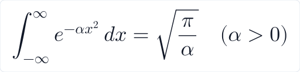
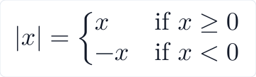
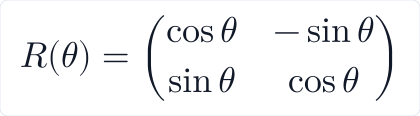
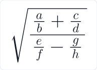
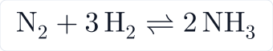

# tex_math_flutter

Flutter math rendering widgets, Material `ColorScheme` theming, bundled `NewCMMath-Regular.otf` (8.1.1) font assets, cached vector glyph painting, baseline-aligned inline spans, copy-as-LaTeX selection, and persistent background isolate layout for `tex_math`.

All parsing and OpenType `MATH` layout runs synchronously in pure Dart via `tex_math` with zero WebViews or JavaScript bridges, while glyph paths and worker-isolate layouts keep Flutter frames smooth across theme changes and equation-heavy views.

## Installation

Install `tex_math_flutter` with the Flutter CLI (requires Dart `^3.13.0` and Flutter `>=3.47.0`):

```bash
flutter pub add tex_math_flutter
```

`NewCMMath-Regular.otf` (8.1.1) and its GUST font license and manifest are bundled automatically inside the package assets, so no extra `pubspec.yaml` font declaration is needed. Importing `package:tex_math_flutter/tex_math_flutter.dart` also re-exports core configuration, engine, font, and error types from [tex_math](https://pub.dev/packages/tex_math) in a single import.

## Quick Start

Wrap a subtree with `TexMathTheme` and `SelectionArea`, then render block and inline formulas using `TexMath` and `TexMathSpan`:

```dart
import 'package:flutter/material.dart';
import 'package:tex_math_flutter/tex_math_flutter.dart';

Widget buildMathShowcase(BuildContext context) {
  return TexMathTheme(
    data: TexMathThemeData.fromColorScheme(
      Theme.of(context).colorScheme,
      fontSize: 20.0,
    ),
    child: SelectionArea(
      child: Column(
        crossAxisAlignment: CrossAxisAlignment.start,
        children: <Widget>[
          const TexMath(
            r'x = \frac{-b \pm \sqrt{b^2 - 4ac}}{2a}',
            overflow: TexMathOverflow.scroll,
          ),
          const SizedBox(height: 12.0),
          Text.rich(
            TextSpan(
              children: <InlineSpan>[
                const TextSpan(text: 'Inline identity: '),
                TexMathSpan(
                  r'a^2 + b^2 = c^2',
                  overflow: TexMathOverflow.scaleToFit,
                ),
              ],
            ),
          ),
        ],
      ),
    ),
  );
}
```

Font sizes resolve from the widget text style, `TexMathTheme`, `DefaultTextStyle`, or the fallback theme, and scale automatically with `MediaQuery.textScalerOf(context)`.

## Rendered Examples

`TexMath` and `TexMathSpan` paint the exact pure-Dart vector layouts below onto Flutter's canvas using cached glyph paths and OpenType math typography.

**Gaussian Integral** — Display limits, optical scripts, fractions, and stretchy square roots:



**Piecewise Cases** — Extensible left curly brace, multi-row alignment, and embedded text mode:



**Rotation Matrix** — Parenthesized matrix grid with named trigonometric operators and Greek symbols:



**Nested Radical** — Multi-level fraction scaling beneath an extensible radical bar:



**Chemical Equilibrium (`mhchem`)** — Stoichiometric coefficients, upright formulas, and equilibrium arrows:



## Widgets, Theming & Performance API

Import `package:tex_math_flutter/tex_math_flutter.dart` to access widgets, overflow policies, theming, selection helpers, asset font loaders, path caching, isolate layout, and core `tex_math` types.

### Rendering Widgets & Overflow (`TexMath`, `TexMathSpan`, `TexMathOverflow`)

| Component | Role & Key Parameters |
| :--- | :--- |
| `TexMath` / `TexMath.display` | Renders block display formulas (default `overflow: TexMathOverflow.scroll`), exposing spoken-text `Semantics`, optional `semanticsLabel`, and `selectable` drag selection. |
| `TexMath.inline` | Preset for inline math mode (`TexMathDisplayMode.inline`) defaulting to `TexMathOverflow.visible`. |
| `TexMath.displayList` | Paints a pre-computed `DisplayList` directly onto the canvas without re-running TeX parsing or OpenType layout. |
| `TexMathSpan` | Baseline-aligned `WidgetSpan` (`PlaceholderAlignment.baseline`, `TextBaseline.alphabetic`) for embedding TeX inside `Text.rich` and `RichText`, scaling baselines proportionally when `overflow` is `TexMathOverflow.scaleToFit`. |
| `TexMathOverflow` | Horizontal constraint policy: `scroll` (horizontal scroll view), `scaleToFit` (uniform `BoxFit.scaleDown` scaling with baseline preservation), `clip` (`ClipRect`), or `visible` (unclipped overflow with matching hit-test bounds). |

Both `TexMath` and `TexMathSpan` accept the shared widget parameters below:

| Parameter | Type | Purpose |
| :--- | :--- | :--- |
| `options` / `engine` | `TexMathOptions?` / `TexMathEngine` | Override default TeX options or supply a custom engine instance. |
| `font` | `MathFont?` | Provide an explicit font instead of auto-loading the bundled font asset. |
| `overflow` | `TexMathOverflow?` | Override the horizontal constraint policy (`scroll`, `scaleToFit`, `clip`, or `visible`). |
| `pathCache` | `TexMathPathCache?` | Supply a custom glyph path cache instead of `TexMathPathCache.shared`. |
| `layouter` | `TexMathIsolateLayouter?` | Offload parsing and OpenType layout to a persistent background worker isolate. |
| `textStyle` / `style` | `TextStyle?` | Override font size and foreground color (`textStyle` on `TexMath`, `style` on `TexMathSpan`). |
| `errorBuilder` | `TexMathErrorBuilder?` | Build a custom fallback widget when TeX parsing or layout throws `TexMathError`. |
| `semanticsLabel` / `selectable` | `String?` / `bool` | Override generated spoken-text semantics or toggle `"copy as LaTeX"` selection handling. |

### Theming, Selection & Font Caching

| Component | Role & Behavior |
| :--- | :--- |
| `TexMathTheme` & `TexMathThemeData` | Inherited theme mapping `foreground`, `accent`, `error`, `muted`, `errorBackground`, and `fontSize` via `TexMathThemeData.fromColorScheme` or `fallback`, supporting zero-relayout light and dark theme updates and `lerp` transitions. |
| `SelectionArea` & `TexMathSelectionUtils` | Integrates `TexMath` and `TexMathSpan` into Flutter text selection; `expandSpanToMinimalNode` and `sliceMinimalLatex` expand partial drags to minimal valid AST subtrees with balanced braces so copying writes valid LaTeX. |
| `TexMathPathCache` & `TexMathDisplayPainter` | Bounded LRU cache (`defaultMaxEntries = 4096`, singleton `TexMathPathCache.shared`) storing Flutter `Path` glyph geometry keyed by font signature and glyph ID alongside fallback `TextPainter` entries. |
| `TexMathFontBundle` | Loads and decodes the bundled `NewCMMath-Regular.otf` asset once per application lifecycle off the UI thread via `load()` and `loadMathFont()`, exposing synchronous `cachedAsset` and `cachedMathFont` getters. |

### Background Isolate Layout (`TexMathIsolateLayouter`)

`TexMathIsolateLayouter` and `TexMathFontBundle` decode `NewCMMath-Regular.otf` and run parsing and layout in a persistent background worker isolate on native platforms (`Android`, `iOS`, `Linux`, `macOS`, `Windows`) while falling back seamlessly on Web and Wasm via conditional imports, backed by a bounded LRU cache (`TexMathLayoutCacheKey`):

| Member | Behavior |
| :--- | :--- |
| `TexMathIsolateLayouter.withBundledFont` | Loads `NewCMMath-Regular.otf` bytes once and configures a worker layouter (`maxCacheEntries = 256` by default). |
| `warmUp` / `dispose` | Starts the worker isolate ahead of first paint (`warmUp`) and shuts it down cleanly (`dispose`, killing unresponsive workers after `shutdownTimeout`). |
| `renderInBackground` / `layoutInBackground` | Transfers font bytes once, deduplicates concurrent in-flight renders, caches results in memory, recovers automatically from worker crashes, and preserves `TexMathError` diagnostics across the isolate boundary. |
| `getCached` / `putCached` / `clearCache` | Synchronous LRU inspection and cache management alongside `cacheLength`, `hitCount`, `missCount`, `isWorkerRunning`, and `isDisposed`. |

Initialize a shared `TexMathIsolateLayouter` once in widget state, pass it to `TexMath` or `TexMathSpan`, and dispose it when the state unmounts:

```dart
import 'dart:async';

import 'package:flutter/material.dart';
import 'package:tex_math_flutter/tex_math_flutter.dart';

class NotebookEquationList extends StatefulWidget {
  const NotebookEquationList({super.key, required this.equations});

  final List<String> equations;

  @override
  State<NotebookEquationList> createState() => NotebookEquationListState();
}

class NotebookEquationListState extends State<NotebookEquationList> {
  TexMathIsolateLayouter? layouter;

  @override
  void initState() {
    super.initState();
    unawaited(initLayouter());
  }

  Future<void> initLayouter() async {
    final TexMathIsolateLayouter instance =
        await TexMathIsolateLayouter.withBundledFont(maxCacheEntries: 256);
    if (!mounted) {
      await instance.dispose();
      return;
    }
    setState(() => layouter = instance);
  }

  @override
  void dispose() {
    final TexMathIsolateLayouter? active = layouter;
    if (active != null) {
      unawaited(active.dispose());
    }
    super.dispose();
  }

  @override
  Widget build(BuildContext context) {
    return ListView.builder(
      itemCount: widget.equations.length,
      itemBuilder: (BuildContext context, int index) {
        return TexMath(widget.equations[index], layouter: layouter);
      },
    );
  }
}
```

### Error Handling (`TexMathErrorWidget` & `errorBuilder`)

When strict error checking is enabled (`strictErrors: true`), failures caught by `TexMath` and `TexMathSpan` fall back to `TexMathErrorWidget` unless a custom builder is provided. `TexMathErrorWidget` displays the original TeX source in a monospace block, structured `TexMathError` diagnostics, and highlighted offending error spans or positions alongside accessible `Semantics` labels.

Supply `errorBuilder` to customize the presentation or pass `error.formattedMessage` explicitly:

```dart
Widget buildFormulaWithErrorFallback() {
  return TexMath(
    r'\frac{1}{',
    errorBuilder: (BuildContext context, String source, TexMathError error) {
      return TexMathErrorWidget(
        source: source,
        error: error,
        errorMessage: error.formattedMessage,
        displayMode: TexMathDisplayMode.display,
      );
    },
  );
}
```

Set `selectable: false` on `TexMathErrorWidget` when embedding error boxes inside non-selectable UI chrome. Inside a custom `errorBuilder`, inspect `error.errorClass`, `error.span`, and `error.position` directly for domain-specific diagnostics.

## Supported TeX Coverage & Benchmarks

`tex_math_flutter` paints layouts produced by `tex_math`, which achieves **100.0% feature support** across all 42 MathJax `4.1.3` packages (**315/315** valid corpus expressions rendered with 0 unsupported, and **37/37** malformed inputs refused with matching error classes). Enabled defaults cover Core TeX, AMS, and JupyterLab extensions such as mhchem, mathtools, bussproofs, color, and enclose. Extended packages including `physics` and `units` are available through `TexMathOptions.packages` or allowlisted `\require`.

On Apple M4 native Dart AOT (`arm64`, macOS 15.6, Dart `3.13.5`), the underlying engine measures 4.09 us mean (4.45 us p95) for inline expressions, 474.49 us mean (1.126 ms p95) for 50-equation notebooks, and 0.13 us mean for cached display-list lookups after a 302.78 us one-time font decode. Combined with `TexMathPathCache` and `TexMathIsolateLayouter`, Flutter interfaces stay well within 60/120 Hz frame budgets even across complex documents.

## License & Additional Resources

* **`tex_math_flutter`**: Copyright (c) 2026 Tony Kinnis — [MIT License](LICENSE).
* **Bundled Font (`assets/fonts/NewCMMath-Regular.otf` `8.1.1`)**: New Computer Modern Math — [GUST Font License 1.0](assets/fonts/GUST-FONT-LICENSE.txt).

This README covers everything needed to install and build with `tex_math_flutter`; optional repository deep dives are available on GitHub:

* [API Manual](https://github.com/tkinnis/tex_math/blob/main/doc/API_MANUAL.md)
* [Architecture & Design](https://github.com/tkinnis/tex_math/blob/main/doc/ARCHITECTURE.md)
* [Corpus Coverage Matrix](https://github.com/tkinnis/tex_math/blob/main/doc/COVERAGE.md)
* [Benchmarks](https://github.com/tkinnis/tex_math/blob/main/doc/BENCHMARKS.md)
