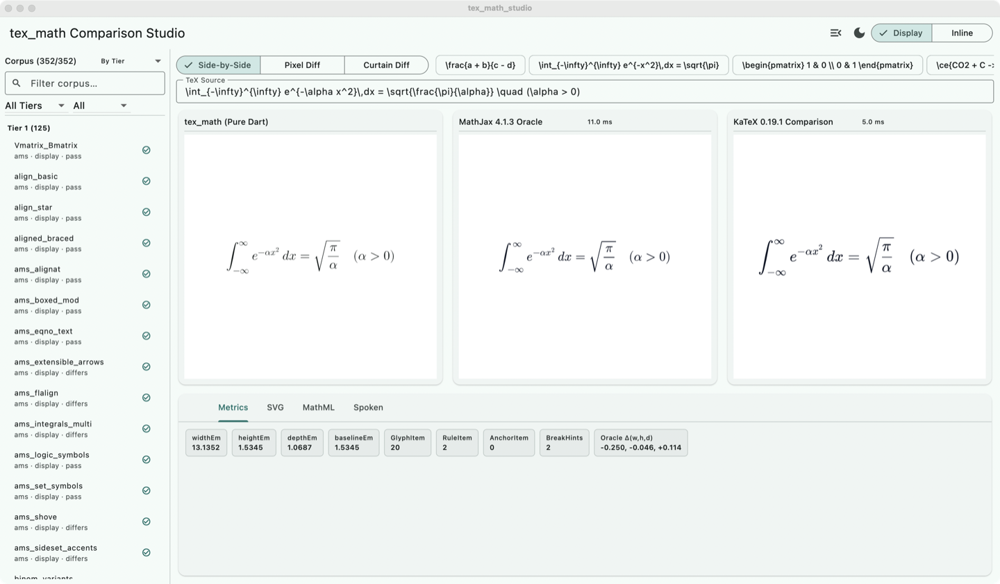

# tex_math_studio

macOS Flutter three-way comparison workbench inspecting **`tex_math`**, **MathJax `4.1.3`**, and **KaTeX `0.19.1`** side by side alongside live display metrics, SVG, Presentation MathML, and spoken-text exports.



## Highlights

* **Three Comparison Modes**: Switch between live **Side-by-Side** panes, per-pixel RGBA **Pixel Diff** (`Tolerance: 0`, `8`, or `24` computed in a background isolate), and an interactive vertical **Curtain Diff** wipe.
* **352-Case Corpus Browser & Keyboard Navigation**: Filter all 352 corpus entries by search text, tier, or acceptance status while skipping group headers automatically. Step through entries with `ArrowDown` or `ArrowUp`, or jump 10 items with `PageDown` or `PageUp`. Press `Home` or `End` to jump directly to the first or last entry.
* **Lazy Inspector Tabs**: Examine bounding-box metrics and live MathJax oracle deltas, standalone SVG XML, Presentation MathML, and screen-reader output computed on demand from one shared layout pass.
* **Hardened Local Web Harnesses**: Serves local MathJax 4.1.3 and KaTeX 0.19.1 assets from `tool/oracle/node_modules/` over a tokenized loopback server with `Host` validation, strict CSP headers, symlink-safe path checks, and locked `WKWebView` navigation.

## Setup, Tests & Launch

Resolve workspace dependencies and oracle JS assets at the repository root, then run headless tests or launch the macOS app:

```bash
flutter pub get
(cd tool/oracle && npm ci)
(cd studio && flutter test)
(cd studio && flutter run -d macos)
```

For screenshots of all three modes, architecture details, security controls, and headless CLI oracle instructions, see the [Comparison Studio Guide](../doc/STUDIO_GUIDE.md).
